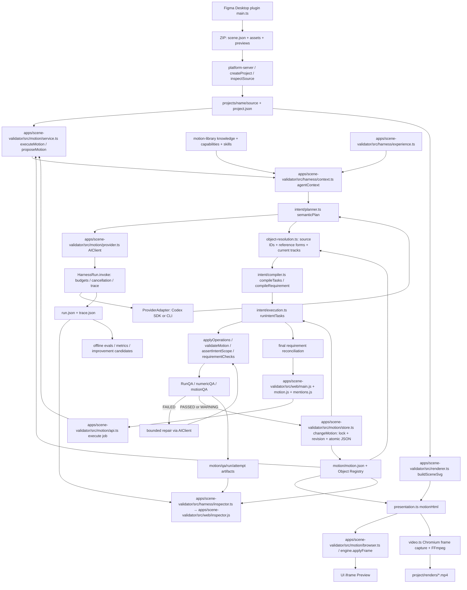

# Motion Platform — Architecture Handoff

## DOCUMENT STATUS

| Поле | Значение |
|---|---|
| Last Updated | 2026-10-14 (Europe/Moscow) — partial Fade wire-contract / composition / reporting update |
| Last Full Audit | 2026-10-13 — структурный аудит исходников перечисленных подсистем; не полный production E2E и не формальная верификация каждой ветви |
| Git Commit | Pre-change checkpoint `8889ea9`; Reviewed Fade source/tests/docs changes committed after checks under `Repair fade wire contract and additive composition`. |
| Git Branch | `main`; локальный репозиторий создан после первоначального аудита |
| Working Tree Status | Reviewed P0 source/tests/docs changes; ignored user projects/assets remain outside history. Final status checked after local commit. |
| Documentation Version | 1.0.9 |
| Scope of Last Update | Optional-null provider adaptation, compositional Fade timing/opacity conflicts, committed conversation grouping, failed-run UI state and diagnostic attempts. No new full audit. |
| Code snapshot SHA-256 | `7cc1f0976ff1a01b80fb65b60c0ac8107581c973dcfa4f1d3d91e375efb3e349` (post Fade repair build) |

Git 2.54.0 (Apple Git-157): локальная история на main, без remote/network/push. В P0 update изменены context, semantic compiler/checks и coverage; математический Engine/Renderer не изменены. До этого обновления отсутствие Git было фактом на момент полного аудита. Source/config/tests/docs отслеживаются; пользовательские проекты, оригинальные экспорты, artifacts, зависимости и сборки исключены.

Snapshot вычислен над отсортированными файлами `apps/scene-validator/src/`, `figma-motion-exporter/src/`, `scripts/`, а также package.json, package-lock.json и manifest плагина: relative path, NUL, bytes, NUL. Это локальный идентификатор просмотренного состояния, не Git commit и не криптографическая аттестация запуска приложения. Документ и AGENTS.md не входят в этот hash.

Корень: `/Users/redcollar/Desktop/Работа/platform`. Все ссылки `path:line` далее относительны этому корню и относятся к исходникам, не к dist. Внешний читатель может передать эти ссылки разработчику, даже без доступа к репозиторию. Номера строк требуют актуализации при изменениях.

Источник технической истины — код. Исторические docs используются только как дополнительные материалы. Статусы: **IMPLEMENTED**, **PARTIAL**, **UNUSED IN PRIMARY FLOW**, **NOT IMPLEMENTED**. Описание реализованного механизма не доказывает качество всех возможных результатов.

## 1. Executive Summary

Motion Platform — локальное файловое приложение для импорта Figma storyboard, реконструкции статических сцен и создания/редактирования анимаций по текстовому запросу. Исходный экспорт хранится отдельно от Motion State. Пользователь выбирает проект, видит сцены/объекты, пишет prompt, получает автоматически применённые изменения, Preview и возможность Undo/Redo и MP4 export.

Реальный основной путь: **vanilla web UI → локальный Node HTTP job → semantic LLM call → validated IntentPlan → deterministic compiler → task-level scope/requirement checks → local Chromium QA → revision-checked commit → reconciliation → autoplay**. В удачном сценарии модель строит intent; первичные Motion Operations строит TypeScript. Модель получает операции для исправления только при repair. Это не открытый агент с произвольным исполнением tools/JavaScript.

Что существует:

- Figma plugin: structural JSON, исходные image bytes, SVG/geometry, text segments, Figma PNG previews, ZIP.
- Import/update проектов, сохранение notes/motion/renders, import history, несколько независимых проектов.
- Exact-name Logical Object Registry и структурные Object States; это не semantic object matching.
- Общий Motion Engine с easing, base-track subframe sampling, typed expressions, path/text reveal и object transitions.
- Codex SDK/CLI transports за ProviderAdapter, лимиты, cancellation, persisted Run/Trace/experience, selective QA, eval infrastructure и candidates.
- Agent Inspector поверх существующих файлов с copy report/ZIP, без дополнительных AI calls.

Основные выводы аудита:

1. **A01 FIXED:** semanticBindings разделяет animation/expression/easing/transition. Wiggle, spring и customCurve проходят create/edit, scope, requirement validation и реальный локальный QA.
2. **A02 TARGETED FIX:** clause guards отклоняют потерянные явные эффекты/тайминг/зависимости даже при full-text coverage; подозрительный план проходит selective semantic audit. Произвольная естественная речь не имеет формального доказательства полноты.
3. **A03 FIXED FOR RELEVANT SCENES:** полный компактный Object Index сохраняет IDs/names/types всех потомков выбранных сцен; детали выборочные, QR/куар aliases разрешаются только однозначно. Tool-based paging всё ещё отсутствует.
4. **High / LIKELY ISSUE:** moveToCenter вычисляет scene-space displacement, обычный renderer применяет его внутри parent-space wrapper. Для rotated/scaled parents это разные координаты.
5. Точное AE Easy Ease parity не достигнуто: сохранённая/пересчитанная ошибка ~0.652 px против допуска 0.15. Формула с предоставленной velocity проходит (~0.105 px).
6. SUCCESS означает выполненный **сформированный** контракт и допускает QA WARNING; это не доказательство полноты человеческого запроса, художественного качества или наблюдаемости каждого эффекта.

Critical confirmed defect с доказанным разрушением данных в этом аудите не установлен. Не следует путать отсутствие такого доказательства с гарантией безопасности при любом crash. Код приложения при исходном аудите не исправлялся; P0 update исправляет только A01–A03.

## 2. Architecture Diagram



Важен порядок: основной task сначала проверяется на рабочем snapshot и проходит QA, затем сохраняется. Исполнение нескольких задач — не одна глобальная transaction: ранее успешные независимые задачи остаются сохранёнными, даже если следующая задача неудачна.

## 3. Repository Structure, Stack and Launch

```text
platform/
  package.json, package-lock.json, tsconfig*.json, AGENTS.md
  apps/scene-validator/
    src/
      apps/scene-validator/src/platform-server.ts, apps/scene-validator/src/importer.ts, apps/scene-validator/src/project.ts, apps/scene-validator/src/source.ts, apps/scene-validator/src/files.ts
      apps/scene-validator/src/renderer.ts, apps/scene-validator/src/comparison.ts, apps/scene-validator/src/validation.ts
      web/                 main.js, motion.js, mentions.js, inspector.js, CSS/HTML
      motion/              schema, operations, store, service, engine, browser
        intent/            schema, planner, compiler, execution, retime
        qa/                technical, numeric, render, geometry
      motion-library/      techniques, expressions, easings, presets, skills
      harness/             providers, context, runtime, qa, evals, experience,
                           metrics, improvements, versions, inspector, retention
    tests/                 TypeScript node:test suites
    dist/                  tsc output + copied web/skills
  figma-motion-exporter/    separate package, manifest, src, tests, dist
  harness/                 evals/dataset.json, config.example.json
  scripts/                 platform.sh, build-ui.mjs, eval/diagnostic scripts
  docs/                    architecture-handoff.md + topic-specific docs
  artifacts/               saved evaluation/render/debug results; not runtime truth
  projects/<slug>/         independent Motion Projects
  motion-project/          original standalone export, preserved
  motion-project.zip       original export archive, preserved
  node_modules/            local dependencies
```

Frontend: plain HTML/CSS/JavaScript modules, no React. Engine/browser runtime originates in TypeScript and is bundled by esbuild into `src/web/motion-runtime.js`; CSS and UI modules are copied into dist. Backend: Node.js ESM, built-in HTTP and filesystem, Zod schemas, no database/service/cloud storage. Rendering: browser SVG/foreignObject/CSS, Playwright Chromium; video: PNG image2pipe into ffmpeg-static/libx264.

Root package versions: @openai/codex-sdk 0.162.1, ffmpeg-static 5.3.0, jszip 3.10.1, playwright 1.62.1, zod 4.6.5; dev TypeScript 5.9.3, esbuild 0.28.2, tsx 4.23.15. Node requirement >=20.19 (`package.json:1`). Actual audit executable: cached Node v24.19.0. Plugin package separately declares @figma/plugin-typings 1.141.0, JSZip and its own build dependencies; several plugin dev constraints use version ranges, with reproducibility supplied by its lockfile, not those ranges alone.

Run:

```sh
cd "/Users/redcollar/Desktop/Работа/platform"
sh scripts/platform.sh dev
# With npm in PATH: npm ci; npm run dev
# Browser: http://127.0.0.1:4173/
# Built app: node apps/scene-validator/dist/src/cli.js dev
```

`scripts/platform.sh:1` falls back to cached Node if Node/npm are absent from PATH. It builds UI on dev. CLI is `src/cli.ts`: import/create-project/projects/validate/dev; web and CLI call shared importer. Browser/server bind and validate local Host/Origin (`apps/scene-validator/src/platform-server.ts:40,67`; listen at end of file). Codex inference is external/provider-backed despite local motion/rendering; `networkAccessEnabled:false` restricts Codex task tools, not the model transport itself. No new provider call occurred for this audit.

## 4. Component Responsibilities and Contracts

В таблице указаны полные пути относительно корня репозитория.

| Component / exact entry | File | Inputs → outputs | Main dependencies |
|---|---|---|---|
| servePlatform | apps/scene-validator/src/platform-server.ts:40 | projectsRoot/port + HTTP → local web/API/job responses | management, importer, motionApi, validation |
| createProject / extractZip | apps/scene-validator/src/importer.ts:132 / :38 | source ZIP/folder, name/update options → project path/config/inspection | JSZip, files, inspectSource, registry |
| inspectSource | apps/scene-validator/src/source.ts:13 | source root + relative scene/report paths → validated document/file inventory/fingerprint/counts | inventory, JSON/reference checks |
| loadProject / readProject | apps/scene-validator/src/project.ts:54 / :12 | project root → LoadedProject | project.json, source inspection |
| buildRegistry / resolveState | apps/scene-validator/src/motion/registry.ts:41 / :115 | SceneDocument + fingerprint / object+scene → logical identities / resolved geometry+hierarchy | geometry matrices, source model |
| projectMotion | apps/scene-validator/src/motion/service.ts:55 | LoadedProject → document, registry, scene/object UI data, provider configuration | store, registry, contexts |
| executeMotion / proposeMotion | apps/scene-validator/src/motion/service.ts:645 / :97 | validated request + revision + settings → applied result or failed run | HarnessRun, semanticPlan, runIntentTasks, RunQA, changeMotion |
| agentContext | apps/scene-validator/src/harness/context.ts:17 | project/state/request/mentions/recent/config → bounded context, bytes/digest/versions | buildContext, motionKnowledge, experienceSearch |
| semanticPlan / validateIntentPlan | apps/scene-validator/src/motion/intent/planner.ts (semanticPlan / validateIntentPlan) | human request + context + IntentProvider → IntentPlan | Zod, registry, source excerpts, deterministic ID validation |
| compileTasks / compileRequirement | apps/scene-validator/src/motion/intent/compiler.ts:60 / :210 | validated plan + MotionState → task DAG / typed operations | expandInheritance, retime, source geometry |
| runIntentTasks / assertIntentScope / requirementChecks | apps/scene-validator/src/motion/intent/execution.ts (runIntentTasks / assertIntentScope / requirementChecks) | plan/snapshot + repair/verify/commit hooks → tasks, requirements, reconciliation, next state | compiler, operations, typed task scope |
| applyOperations / validateMotion / motionDiff | apps/scene-validator/src/motion/operations.ts:177 / :26 / :406 | snapshot + operations + source project → validated new snapshot / diff | schemas, transitions, expressions, timing dependencies |
| readMotion / changeMotion | apps/scene-validator/src/motion/store.ts:45 / :91 | project or mutation + expectedRevision → MotionDocument, diff | schema, source refs, lockProject, atomicJson |
| evaluateAnimation / evaluateMotion / applyFrame | apps/scene-validator/src/motion/engine.ts:31 / :113 / :174 | animation/frame or state/frame/DOM → Values / composite values / rendered DOM | easing, expressions, reveal, transitions |
| valueAtTime / velocityAtTime | apps/scene-validator/src/motion/sampling.ts:6 / :16; apps/scene-validator/src/motion/engine.ts:255 | base Animation + seconds/FPS → per-property base values/derivatives | evaluateAnimation, finite difference helper |
| buildSceneSvg | apps/scene-validator/src/renderer.ts:100 | structured Scene/assets/readAsset/options → SVG, font CSS, RenderStats | geometry/paints/text/hierarchy/path capability |
| motionHtml | apps/scene-validator/src/motion/presentation.ts:13 | source project + validated MotionState → browser document/warnings | buildSceneSvg, statePresentation, bundled runtime |
| exportVideo | apps/scene-validator/src/motion/video.ts:19 | project root + progress callback → MP4/report in renders | motionHtml, Chromium, FFmpeg, project lock |
| numericQA / motionQA | apps/scene-validator/src/motion/qa/numeric.ts:12 / render.ts:47 | state/request/previous/optional target → objective checks and artifacts | evaluators, Chromium, motionHtml, geometry inspection |
| HarnessRun / RunQA | apps/scene-validator/src/harness/runtime.ts:22 / qa.ts:10 | project/config/provider calls/task QA → budgets, persistence, caches | ProviderAdapter, atomicJson, motionQA |
| inspectorRun / debugBundle / attachInspector | apps/scene-validator/src/harness/inspector.ts:96 / :421; apps/scene-validator/src/web/inspector.js:10 | saved files/runId → redacted projection/ZIP/UI | existing run/trace, tasks, history, QA files |

Supporting `apps/scene-validator/src/motion/context.ts` describes node summaries/trim eligibility; `apps/scene-validator/src/motion/mentions.ts:15` validates structured mentions and source spans. `apps/scene-validator/src/motion/transitions.ts:6,48` prepares/resolves state presentations and validates transitions. `apps/scene-validator/src/motion/transition-runtime.ts:85` applies them in browser.

## 5. Full AI Agent Execution Flow

Actual normal UI path (`apps/scene-validator/src/web/motion.js:388`, `apps/scene-validator/src/motion/api.ts:374`, `apps/scene-validator/src/motion/service.ts:97`):

1. `plan()` reads prompt and mention payload, selected/active scene and expectedRevision, disables only relevant generation controls; posts `/motion/execute`. **IMPLEMENTED.**
2. `motionApi` creates an in-memory job and AbortController; responds 202/jobId; updates stage; UI polls job and can cancel. These jobs are not persisted; Harness runs are. **IMPLEMENTED.**
3. `executeMotion` calls `proposeMotion(..., execute=true)`. `requestSchema` checks fields; readMotion validates persisted document and source-reference diagnostics; stale revision rejects. **IMPLEMENTED.**
4. Nonmanual execution creates `HarnessRun.start`: UUID, config, timeout, memory sampling, received trace. Full privacy uses project-local AI directory; metadata/off use scratch. **IMPLEMENTED.**
5. `validateMentions`; recent context comes from applied, non-undone Undo history. `agentContext` collects scoped source nodes, current motion, registry summaries, scene index, techniques/capabilities/skills, up to three experience cases, version refs and byte budget. **IMPLEMENTED with complete relevant-scene identities, morphological retrieval, selective details and an enforced byte budget; arbitrary language/paging remain limited.**
6. `SemanticProvider.interpret` wraps `AIClient.structured` via the selected adapter. Whole human message is in compact user payload. Model returns **IntentPlan**, not initial operations. **IMPLEMENTED.**
7. Production passes `auditAlways:false`. `validateIntentPlan` checks schemas/source excerpts, then uses shared canonical reference resolution against the full current state passed by service (not only the model projection), validates IDs/name consistency and inheritance, recovers eligible existing edits before coverage/compilation. Semantic planning permits at most one correction call (two semantic calls total, also bounded by global budget). Structural failure receives precise feedback; failed selective audit terminates without a third full interpretation. Provider/timeout failures do not re-enter semantic planning. Clause guards now validate explicit techniques, scene starts, inheritance and ordering. Suspicious coverage invokes the existing semantic audit selectively; a valid normal plan uses no audit call. **General natural-language completeness remains PARTIAL.**
8. `expandInheritance` unions techniques and copies null parameters from parent except absolute x/y and from/to scene IDs. `compileTasks` groups scene timing requirements into one task, creates object tasks, preflights masks/geometry, and builds requirement/task dependencies. **IMPLEMENTED.**
9. `runIntentTasks` runs pending tasks topologically. `compileRequirement` creates deterministic operations using FPS, source geometry/defaults, current animations, timingDependencies. All17 declared Intent techniques have representation-aware compiler/check coverage; source geometry/identity/interval constraints may still block execution. Engine-only Operations/presets are not all separate semantic techniques. **IMPLEMENTED within these limits.**
10. `applyOperations` creates a cloned candidate, resolves dependencies, validates schema/targets/intervals/channels/expressions/transitions. `assertIntentScope` prevents unrelated changes; `requirementChecks` compares requested techniques/timing/relative edits. **IMPLEMENTED, with gaps §18.**
11. `RunQA.verify` selects scope, can reuse same-fingerprint/version/state QA, otherwise invokes local Chromium/numeric QA with frame budget. **IMPLEMENTED.** No default Vision LLM or MP4 generation.
12. QA PASSED **or WARNING** admits commit. `changeMotion` rechecks source fingerprint and revision under filesystem lock, applies operations again, appends before/after Undo entry, writes motion.json atomically. **IMPLEMENTED per-task transaction.**
13. On failure, feedback carries task/target/expected/actual techniques, failed checks, capabilities, permitted repair actions and previous candidate. The next attempt calls LLM for Operations. Repeated signature/budget/auth/cancel failure stops. **IMPLEMENTED bounded task repair; generic deterministic pre-LLM repair PARTIAL.**
14. After all tasks, `requirementChecks` reruns against final in-memory committed state. Reconciliation counts requirements separately from tasks/operations. Result is SUCCESS/PARTIAL_SUCCESS/FAILED. **IMPLEMENTED relative to the generated contract, not independently proved human intent.**
15. Proposal/execution/tasks/Run/Trace/experience are persisted. UI reloads current document; if any requirements completed, refreshes Preview and autoplays from earliest relevant animation/retime frame. Wholly failed run does not autoplay as success. **IMPLEMENTED.** Actual first browser paint timestamp is **NOT IMPLEMENTED**; timeToFirstPreviewMs is null.

Technical stages do not each call LLM. Selection of relevant skills happens before interpretation, lexically, not as a model tool call. Preset definitions are available, but primary compiler does not automatically choose/instantiate every preset. No full task-resume execution after process restart: RUNNING records are marked INTERRUPTED.

`apps/scene-validator/src/server.ts` (serveReport) остаётся отдельным legacy viewer helper; текущий cli.ts импортирует servePlatform, а не serveReport. Основной UI — только Motion; прежняя static validation доступна через CLI/backend, не отдельные основные вкладки.

Legacy route: `proposeMotion(execute=false)` / manual-response / applyProposal / completeExecution retain older `runAutonomous`, `planMotionTasks`, `runMotionTasks`, `intentRequirements`, `validateTechnique`. They are not the semantic primary flow; they are not dead files. UI/manual/compatibility paths and tests still use them. This is one Engine/Renderer with multiple planning paths, not several Engines.

## 6. Semantic Intent Processing

Authoritative schemas: `apps/scene-validator/src/motion/intent/schema.ts:3,23,108,135`. Short actual interface excerpts:

```ts
interface IntentProvider {
  interpret(context: unknown, request: string, feedback?: unknown): Promise<IntentPlan>;
  audit(context: unknown, request: string, plan: IntentPlan): Promise<IntentPlan>; // suspicious plans receive context.coverageFeedback
}
// IntentPlan and IntentRequirement are z.infer<typeof ...Schema>.
// Required top-level plan fields:
{ schemaVersion: "1.0.0", requirements: IntentRequirement[],
  coverage: {sourceText, requirementIds, classification, explanation}[], assumptions: string[] }
```

Requirement fields: requirementId, kind (`sceneTiming|objectAnimation|editAnimation|unsupported`), sourceText, nullable sceneId, target (`sourceNodeId|logicalObjectId|name`), techniques[], parameters, timing, inheritFromRequirementId, inheritanceExplanation, constraints[], unresolvedReason. Parameters include scene refs, center/x/y/scale, duration/distance/direction, amplitude/frequency/decay/easing, optional nullable property/seed and relative factors. Timing has startSeconds, relation (`sceneStart|sceneEnd|afterRequirement|withRequirement|beforeRequirement|unchanged`), anchorRequirementId, delaySeconds.

The model is instructed to parse misspellings, pronouns, context boundaries, “аналогично”, “после”, “но быстрее”, source substrings and artistic defaults (`apps/scene-validator/src/motion/intent/planner.ts:10`). These are **LLM interpretation instructions**, not proof that every phrasing is supported. Regex remains in lexical context/knowledge retrieval and legacy task parsing. Primary semantic interpretation is not exclusively regex.

Example structure — illustrative legal shape, not a newly executed provider answer:

```json
{
  "requirementId":"rLogo","kind":"objectAnimation",
  "sourceText":"а лого аналогично","sceneId":"scene2",
  "target":{"sourceNodeId":"logo-source","logicalObjectId":null,"name":"лого"},
  "techniques":["slideUp","fadeIn"],
  "inheritFromRequirementId":"rQR","inheritanceExplanation":"Same entrance character",
  "timing":{"startSeconds":null,"relation":"sceneStart","anchorRequirementId":null,"delaySeconds":0}
}
```

This excerpt omits required parameters/constraints/unresolvedReason for brevity and cannot be pasted unchanged into the strict API. IDs here are illustrative, not Figma data.

For QR + Logo: the provider should return rQR and inherited rLogo. `expandInheritance` copies techniques/duration/easing character, not QR absolute position. Each target keeps its Figma base geometry. For Ribbon2: provider emits afterRequirement anchored to Ribbon1; compiler computes frames and persists setTimingDependency. Duration changes can propagate via resolveTimingDependencies. Source IDs remain validated even after LLM selection; recognized aliases resolve only within unique scene candidates.

Ambiguity: candidate count must equal one; otherwise unresolvedReason=AMBIGUOUS_TARGET/TARGET_UNRESOLVED and task BLOCKED. Name+ID mismatch is rejected. This cannot prove that a **valid but semantically wrong** object was chosen. No full rule engine binds every sentence’s intended scene independently of model output. The compact complete relevant-scene Object Index now preserves all target identities, but there is no tool for retrieving omitted full geometry on demand.

Coverage: verbatim character coverage remains required. `intent/coverage.ts` also records original clause offsets, scene/target linkage, explicit techniques and inheritance source. Missing Fade/inertia/scene timing, wrong clause linkage, unresolved local inheritance and absent sequential dependencies yield `SemanticCoverageError` plus structured feedback. `semanticPlan` invokes existing provider.audit only for suspicious plans, revalidates before execution and records semantic-coverage events through HarnessRun. Guards are bounded lexical sanity checks around the LLM planner, not a complete semantic parser or a proof of every artistic instruction. Identity ambiguity remains tracked unsupported; independent valid tasks may proceed.

### Fade contract and composition repair — 2026-10-14

**Verified cause:** original Run `56b44d6c-08e8-4942-9275-5f3c254bfa91` retains raw structured outputs and provider schemas under the original project's `motion/ai/` (the previous exported bundle omitted them). First output correctly requested five objectAnimation/fadeIn requirements. `compatibleSchema` makes optional keys required and nullable for native structured output, while `AIClient.structured` previously parsed those nulls directly against non-nullable optional Zod fields. This deterministically rejected selector, selectionRequirementId, expressionIds, expressionAction and parameters.relativeIntensity. The second model response changed to compound edit requirements; this is observed, but the exact causal influence of conversation versus retry feedback is NOT VERIFIED.

`apps/scene-validator/src/motion/provider.ts` now uses the original generated runtime JSON Schema as the normalization authority: only null values on original optional object keys are omitted; required nullable values are retained, enums are not coerced, arrays are not invented and null expressionAction never becomes update. Unknown enums still fail runtime parsing. `$ref` objects and arrays recurse. This reverses the adapter's optional/null conversion for the existing IntentPlan contracts, without changing the internal schema or selector.effect enum. General arbitrary union-branch normalization is NOT IMPLEMENTED; current tested intent structures do not require it.

`intent/compiler.ts`: additional standalone fadeIn inherits the enabled entrance slide/moveTo interval when duration is unspecified, preserving base/expression IDs and parameters. Explicit starts remain explicit. Multiple entrance candidates fail AMBIGUOUS_ENTRANCE_TIMING; overlapping other opacity tracks fail OPACITY_ENTRANCE_CONFLICT. A later nonoverlapping fadeOut survives; repeated fadeIn reuses its stable ID. Fade no longer removes unrelated nonoverlapping opacity tracks. Existing engine channel composition keeps position separate from opacity; source opacity is in the inner rendered geometry and animated opacity is its outer multiplicative wrapper. No engine or renderer rewrite.

`service.ts` groups effective committed task-history rows by actual run prefix before projecting bounded recent conversation (four groups). Failed proposals are not committed conversation. Semantic guidance distinguishes additive Fade from inertia edits. `web/motion.js` clears old executionMessage/proposal/pendingPlayback on a new request; a failed job cannot redisplay the previous completion summary when refreshed preview becomes ready. Current-run reconciliation remains the success authority.

Diagnostics: each new structured call persists `contract-validation.json` with exact original runtime/provider schemas, SHA-256 hashes, redacted raw and normalized output, validation issues and actual null/missing/value classification. Optional project bundle adds planning-attempts with call directories, Harness-assigned callIndex when recorded (historical missing indexes explicitly unknown), schemas, raw output, validation artifact and actual input payload under full privacy only; metadata privacy excludes outputs/input. The 2MiB ZIP entry cap marks truncation and local artifact reference. Historical normalized validation artifacts are NOT_AVAILABLE, never reconstructed as if recorded. Existing qaAvailability reports NOT_TESTED when no QA ran.

Verification: typecheck/build and 181/181 full local tests PASS (14.04s), followed by 11/11 targeted tests after privacy propagation. Five new regressions exercise optional-null versus invalid enums, five-object Fade timing, stable repetition, actual adapter/parser/compiler/executor with real Chromium QA, inertia→Fade→inertia→Fade, opacity conflicts/exit preservation, no-entrance fallback, and zero commit/history changes on invalid output. Synthetic alias mapping is explicit; original aliases independently confirmed by saved response and successful source resolution. Existing contextual/revision/Undo/Redo/render regressions remain in the full suite. No new MP4 was exported for the smoke test.

Saved first-response replay on isolated test10: one mock adapter call, five successful committed Fade tasks and real local QA; source project untouched. Separately, authorized **live Codex SDK smoke** Run `b056335f-14d7-401f-aab2-8230cf8b9b65` on isolated copy `/tmp/fade-live-smoke-TyH5PP`: SUCCESS, 1 actual LLM call, 0 repairs, 5/5 local QA, fades start30/duration15, all original animation/expression structures preserved. Actual metrics: input23064/output1846/cached0 tokens, provider47172.06ms, total55813.87ms, QA8383.23ms, context30504bytes (Harness enriched context; provider projection differs), estimatedCost=null. Historical failure: 2 calls, aggregate input48793/output5166, total117542ms. These are two individual runs, not median/p95 or a controlled latency benchmark. Token/latency remain substantial; no claim of fast parameter-independent inference.

### Contextual selectors, project memory and diagnostic bundles — 2026-10-14

Confirmed Run d4043e2b-53d5-4f60-a096-8a36a842ccb7 in test10: archived context contained only active scene scene_54_3a_1594, nine Object Index rows, zero indexed expressions and an empty projected motion.expressions. Actual Motion Document revision81121237-35be-4f5c-965b-86ebe13fca72/cursor17/history17 contains five inertialOvershoot expressions in other scenes. The model correctly inferred amplitudeFactor0.5 but lacked both factual effect membership and a target-set contract. Existing resolution required a named/ID-bound single object, so a state predicate became TARGET_UNRESOLVED. This was neither actual absence of effects nor an inability to understand the requested intensity.

Flow: User Request → existing SemanticProvider (standard or compact expression-edit wire schema) → resolveIntentSelectors over authoritative current state and effective history → per-object canonical requirements + real expression IDs → existing compileRequirement/requirementChecks/scope checks → selective RunQA → revision/source-guarded changeMotion → existing preview workflow. No new agent, engine, registry, renderer, persistent Motion State or LLM call for querying targets.

Contracts: optional selector on IntentRequirement supports explicitObject/currentSelection/recentSuccessfulTargets/byExistingEffect/byAnimatedProperty/byScene/filteredSet. Filters include effect/property/scene/target IDs, filteredSet may intersect with base=project/recentSuccessfulTargets/currentSelection. New expressionAction update/remove, expressionIds and selectionRequirementId are normalized backend memberships. Revalidation recomputes memberships from current state instead of trusting provider-supplied resolved arrays. Internal selection IDs are requirement IDs, never synthetic sourceNodeIds. The compact wire schema omits backend membership fields and geometry, then normalizes into the same canonical IntentPlan. Schema versions remain1.0.0 with backward-compatible optional fields.

Implicit requests use the latest relevant committed effect group, then actual selection, then a unique relevant existing target (active scene can narrow a no-history candidate set). Multiple remaining targets without grounded context produce AMBIGUOUS_CONTEXTUAL_REFERENCE, never a project-wide default. Explicit state predicates use current enabled expressions across the project; explicit selection/scene/property filters intersect that set. Verbatim source guards prevent an unqualified request from authorizing a global query and reconcile an explicit global predicate incorrectly represented as recent targets. Historical unsupported target-null inertia edits get a bounded selector upgrade; this is compatibility around LLM semantic interpretation, not a separate keyword-only planner. Explicit object references retain the shared canonical resolver and are not overridden by unrelated recent actions or the active scene. Unsupported technical constraints remain blocked. Per-expression scope prevents changing another channel on the same object. Deleted/disabled expressions are not recreated; no automatic new inertia is emitted by an existing-expression selector edit.

`motion/contextual-resolution.ts:recentSuccessfulActions` derives compact action/effect/expression/scene/target/edit-ID references from MotionDocument.history[0:cursor]. Consecutive task commits share their real run prefix; manual entries use real editId. Only persisted operations contribute. Failed proposals do not establish committed actions; Undo excludes undone entries and Redo restores effective membership. Every query intersects current state, so removal after creation invalidates that member. No global/project-independent action cache or second experience DB is introduced. Existing history still stores full before/after snapshots for Undo; compact delta-history migration is NOT IMPLEMENTED. Current state, effective event history, derived recent action context, bounded applied-history conversation excerpts, repository knowledge and transient per-run context remain separate. Full chat/anaphora over failed/uncommitted conversations is NOT IMPLEMENTED; no claim that all conversational ambiguities are solved.

Early `harness/selector-context.ts` avoids full buildContext/geometry/skill retrieval for simple existing-expression edits. It uses the existing fingerprinted registry, named/selected/recent candidate rows, full-project effect inventory counts, latest relevant action summaries, bounded two conversation excerpts (1500chars, truncation marked), relevant expression descriptions and version references. Action samples are labeled samples; full memberships stay backend-only. Actor summary and query metadata are persisted as diagnostic context, not a new project-memory authority. `motion/intent/selector-schema.ts` supplies a compact wire schema/instructions to the SAME SemanticProvider; complex creation/position/easing requests keep the standard profile. Source-language routing hints choose payload depth only; LLM still interprets intent. No timeout/repair budget increases.

Relative intensity policy is typed: slightlyWeaker0.8/weaker0.5/muchWeaker0.25/slightlyStronger1.2/stronger1.6/muchStronger2; explicit numeric amplitudeFactor takes precedence. Deterministic normalization applies it to each current amplitude, preserving IDs/base/easing/frequency/decay/timing/dependencies. Engine bounds remain strict; no silent clamping. Removal uses existing removeExpression operations with explicit absence checks. Selection limits are200 objects per selector; larger batches are explicitly rejected, not truncated. This first implementation targets existing expression effects; animation-only set queries and natural-language grouped Undo are NOT IMPLEMENTED. Native editor Undo/Redo remain supported and invalidate derived context. Existing visibility QA may reject an extremely small/invisible oscillation; rules were not bypassed.

Diagnostics: actual actionId/edit IDs, original/effective selector, scope source, revision, selected/matched/candidate counts and per-expression old/new amplitude are in target-resolution events. reference-context captures actual projected conversation, relevant action references, context/instruction/native-compatible output-schema byte sizes and profile. Reconciliation separates userIntentCount, selectedObjectCount, selectedExpressionCount, task/requirement counts, compiledOperationCount and appliedOperationCount. STALE_PROJECT_REVISION is attached to existing revision errors while preserving Russian messages. Inspector Understanding/Actions expose these facts.

Optional GET /api/projects/:projectId/motion/inspector/:runId/project-bundle exports a media-free ZIP: manifest.json (current revision/schema versions/counts), relevant-state.json, recent-committed-actions.json (max20 groups), reference-context.json, run-trace.json, state-diff.json, versions.json and README.md. Existing ordinary report/debug ZIP remain. Project Bundle reads only this project's artifacts, uses redaction/local-path removal, honors run privacy for state/context/history, and caps each JSON entry at2MiB (NOT_AVAILABLE sentinel on overflow). It includes no source SVG/assets/screenshots/video and is never injected into routine model context. Missing historical provenance remains NOT_AVAILABLE rather than reconstructed as a claimed past event.

Verification: saved historical provider response replay on an isolated copy of test10 completes one user intent/five object tasks/five existing expressions/five setExpression operations with5/5 actual Chromium QA; base tracks unchanged, original project untouched, one mock adapter call/no repair/zero new live calls. Synthetic multi-turn tests distinguish recent4 of6 from explicit all6, consecutive edits, deletion, selection/scene/property scopes, single target, ambiguity, effective Undo/Redo/project isolation, stale revision, numeric waveform ratio, Inspector and compact redacted bundle. These are production-path mock/replay tests plus genuine local rendering, not live-provider NLU E2E.

Performance: historical provider reported19658 input/616 output tokens and27563.456ms generation. For the saved context, comparable standard profile measured18030 context/6992 instructions/10189 native schema bytes; early compact profile measured5513/1367/4184bytes. This measures serialized payload components, NOT new live token/latency/cost savings. Provider-dependent overhead and new live-provider multi-turn performance remain NOT VERIFIED. No full MP4 render is added to ordinary requests.

### Compound edit compilation / operation coverage — 2026-10-13

Confirmed saved Run `e6021bc9-3ee1-41e5-a2c8-e33b06b5ff26` requested linear base easing plus stronger after-arrival inertia for four Scene2 objects. Its valid editAnimation requirements include slideUp/slideDown + inertialOvershoot, easing=linear, property=y. Read-only reproduction against current test8 revision5bf8bea0-c170-451b-8041-428951375608 produced only updateAnimation for each object. Exact cause: compileRequirement's editAnimation branch iterated existing expressions, while creation existed only in the objectAnimation branch. An empty expressions array silently omitted setExpression. INTENT_REQUIREMENT_MISMATCH was the primary failure; subsequent repair budget refusal was secondary.

`motion/intent/compiler.ts:compileInertiaAttachments` is now the shared deterministic creation path for standalone requests and compound edits. Base updates apply to one candidate state first, then resolveBaseMotion samples that UPDATED trajectory and links expressions to its real endpoints. Compound edits preserve base IDs/keyframes/geometry/dependencies and create only missing per-channel inertia; existing expressions retain their IDs and are edited/retimed through existing operations. Existing easing+duration, amplitude+frequency, position+opacity tracks, reveal direction+duration and scale+spring editing paths compose; unsupported missing effects are rejected by coverage rather than committed partially. No new Motion Engine, formula, velocity impulse or renderer.

Intent parameters add nullable defaulted `intensity: subtle|normal|strong`. The existing expressions registry owns presets: amplitude0.1/0.25/0.4, frequency2.5Hz, decay3. Fresh effects use the selected preset, not a nonexistent prior amplitude. Existing inertia uses qualitative amplitude ratio against normal (strong1.6x/subtle0.4x) or an explicit amplitudeFactor/amplitude override; schema limits remain authoritative and out-of-range values fail. A bounded verbatim source guard backfills strong for historical plans containing explicit stronger wording and no numeric amplitude/factor; this supplements the semantic planner, not a replacement NLP planner. Qualitative intensity has deterministic candidate validation. New modern algorithm defaults remain unchanged.

`motion/intent/execution.ts:runIntentTasks` records per-task operationCoverage (expected update/create effect and parameter actions, actual operations, failed checks/status). Candidate validation, scope and requirementChecks precede real QA/commit; no base-only commit if expression fails. Deterministic compiler exceptions/missing checks become COMPILER_COVERAGE_ERROR; invalid compiled operations become OPERATION_VALIDATION_ERROR; these do not invoke LLM repair. Unsupported combinations include explicit UNSUPPORTED_COMPOUND_EDIT context where available. Real QA/model-output failures retain bounded repair. primaryFailureReason persists the first failure; a later budget/cancellation stop appends its repair decision rather than erasing the cause. Inspector Operations tab displays actual coverage and primary failure, historical missing artifacts remain NOT_AVAILABLE. Error classification is scoped to this path, not a wholesale reclassification of every platform error.

Performance evidence: saved provider usage was21508 input/2291 output tokens. Saved request text29175bytes/output schema24257bytes; knowledge contained custom easing parameter schemas duplicating the output contract. semanticContext now keeps their IDs/descriptions/defaults, excluding duplicate parameter schemas while retaining object IDs/motion/capabilities. Applying this projection to saved context yields22965→20353 compact UTF-8bytes. No new live-provider latency/token improvement measurement: NOT VERIFIED. No timeout/budget increase, extra planner, full project regeneration or per-request MP4 QA.

Isolated real-source replay of saved IntentPlan through executeMotion completed4/4 requirements,8 operations,4/4 genuine Chromium QA results and four persisted expressions. It used one mock historical-response adapter invocation, zero repair calls, zero paid/live model calls. The user's original test8/source/motion state was untouched. Original easeOutCubic-only attachment still has the previously documented near-zero-velocity limitation; the explicitly requested linear easing now provides nonzero measured incoming velocity. Generic creation of missing non-inertia expressions inside editAnimation remains unsupported and is diagnosed explicitly, not claimed implemented.

### Existing base-position attachment repair — 2026-10-13

Confirmed test8 incident at Motion revision `5bf8bea0-c170-451b-8041-428951375608`: all four Scene2 objects already had enabled position tracks (start30/end51, distance80, easeOutCubic), no expressions. Image source15:5225 and QR15:5212 use slideUp; text10:3707 and logo25:1637 use slideDown. Saved failed intent `a3a5ba4e-6a72-4a27-bb36-f7f00f05d64e` marked four unsupported requirements because reduced model context did not resolve IDs/base tracks. Post-plan recovery then searched effects matching inertialOvershoot instead of its base motion and required a non-null numeric edit parameter. These are confirmed resolution bugs, not missing saved animations.

`motion/base-motion.ts:resolveBaseMotion(state,sceneId,targetId)` uses existing channels/evaluateAnimation/subframe sampling. It resolves latest finite base movement per X/Y channel, rejects ambiguous equal endpoints, excludes disabled/oscillation tracks, preserves actual source IDs/easing/keyframes/dependencies and exposes interval/endFrame, base value sampler, computed incoming velocity and inspected-track reasons. Keyframes use their actual last key. Separate X/Y sources remain separate. Resolver failures distinguish BASE_POSITION_ANIMATION_MISSING from ANIMATION_RESOLUTION_FAILED; target failures stay separate. Requested inertia counts existing finite position tracks when narrowing duplicate object references.

Planner recovery recognizes attachment requirements with actual base motion even when model returned unsupported and no numerical parameters were requested. Existing relative expression edits retain the edit path; recovery does not turn a missing relative edit into a fabricated effect. Compiler uses the same resolver instead of first-array-match, creates/upserts procedural expressions per selected channel linked to sourceAnimationId, preserving base animations and timing. Existing evaluator/operations retiming remain unchanged. Compact Object Index now includes channels/start/end beside animation ID/effect, not full keyframes. Inspector targetResolution contains base tracks, end frames, measured incoming velocity/dependencies and checked/rejected tracks; task QA/stateChanges supply actual success/failure and persistence. Version fingerprints include base-motion.

IMPORTANT verified limitation: the exact saved test8 replay on an isolated copy resolves all four requirements and generates four valid attachments, but real local numerical/render QA FAILS visible inertia. With the unchanged modern evaluator, instantaneous speed at endpoint minus0.1frame is only ±0.0077748px/s; amplitude0.25 yields maximum offset0.001462px. Several rendered probes show no changed pixels. No false success, fabricated velocity, replacement easing or original-project mutation was used. The replay is historical model-output replay, not a fresh live-provider E2E. Source/easing preservation plus this near-zero incoming velocity cannot guarantee visible oscillation; improving artistic defaults/base velocity is separate work, not silently performed here.

### Natural-language target and existing-animation resolution — 2026-10-13

Confirmed incident: run `7ed9365c-2abb-4965-b54f-c25401f81e50` understood trimPath/reverse/unchanged timing but returned unsupported with null identity. Stored Object Index and motion projection contained Scene2 objects only; Ribbon2/its Trim Paths were absent. Current source/state contains Scene3 Ribbon2 and its enabled Trim Paths (diagnostic sourceNodeId25:1654, not a constant in code). Old retrieval failed to match accusative “ленту 2”, then matched the numeric root Frame name “2” because root Frames with external parentId participated in name retrieval. Validator skipped unsupported requirements instead of trying full-state target recovery. Edit compiler also ignored a requested path direction on update. The saved run took ~21.06s/one real Codex call and did no Operations/QA.

`motion/object-aliases.ts` now implements a reference-only layer: NFKC/case/е–ё/Unicode whitespace normalization, punctuation tokenization, conservative productive Russian noun/adjective endings, ordinal signatures1..20 and registered QR/куар/logo/логотип aliases. Number tokens participate separately; ordinal word order may change, but2 never equals20. Bare numeric names do not become mentions inside longer object references. No Levenshtein/phonetic fallback, confidence score or full morphology dictionary. Irregular forms, ordinals beyond20 and misspellings are not guaranteed by deterministic matching; the LLM still interprets meaning. Aliases/inflections do not change names, source IDs or exact-name logical hashes.

`motion/object-resolution.ts` exports resolveObjectReference and resolveExistingAnimation over the existing Scene Model, Object Registry and MotionState. Candidate metadata includes sceneId, sourceNodeId, logicalObjectId, canonicalName, original referenceText, resolutionMethod, existingAnimationIds/existingExpressionIds. Explicit IDs must agree with canonical state; supplied scene is a hard constraint. References match normalized/alias/morphological forms, with selection, existing technique/state and active-scene constraints only narrowing real candidates. Active scene is weaker than a uniquely existing requested edit effect. Equivalent aliases can remain ambiguous even with exact spelling; registry order is never a tie breaker. AMBIGUOUS_TARGET exposes actual candidates/rejected constraints. Existing lookup exposes actual tracks/parameters/timing/dependencies; missing/duplicate compatible tracks stay BLOCKED rather than fabricated.

Production service passes doc.state (revision checked before planning and commits), active scene and explicit selection to semanticPlan's deterministic validation. A null-target unsupported requirement can be recovered only when its reference uniquely resolves, an existing compatible effect uniquely resolves, structured edit parameters are present and timing is unchanged; explicit geometry/unsupported-technique failures are not overridden. A known object with no existing effect retains its canonical identity but stays blocked with EXISTING_ANIMATION_NOT_FOUND. Qualified objectAnimation with unchanged timing/current parameters can normalize to editAnimation; ordinary create instructions stay create. Recovery preserves sourceText, parameters and constraints, adjusts its coverage classification, and emits TARGET_RECOVERED_FROM_PROJECT_STATE. No additional LLM call. Reduced LLM context never becomes the resolver's source of truth. Bare isolated validateIntentPlan callers without MotionState use defaultMotion and cannot prove existing motion; production always supplies the authoritative state.

Compiler updates the existing track by animationId. Trim/mask direction is stored through the existing direction enum; reverse changes path origin, not time: progress remains0→1. Start/duration/easing/dependencies/from/to remain unless explicitly requested. Recognized existing moveTo x/y, scale endpoints and slide distance edits also update current parameters, with requirementChecks validating actual values. Existing expression amplitude/duration mechanisms remain reused; duration changes go through existing dependency retiming. No new Engine/Renderer/Registry/Agent. Source files are never changed by recovery/edit.

Context Builder excludes root Frames from name retrieval, uses shared reference resolution to identify relevant scenes and includes compact existingAnimations/effects and existingExpressions/types in each Object Index row. Detailed geometry/current parameters remain selective; whole SVG/source files are not sent. Inspector adds intent-target-resolution artifacts and targetResolution projections: reference/canonical identity, candidates/rejections, matching method, actual existing tracks/dependencies, whether target/track was present in model context, recovery/block reason. Existing stateChanges/QA provide actual edit before/after and validation. No invented confidence values. Legacy autonomy.resolveTarget reuses this resolver for named references, reports actual narrowing constraints and rejects unresolved named ambiguity; older unnamed artistic fallback remains compatibility behavior.

Conversation: primary flow uses last eight applied Undo entries and context last three recent entries, not the entire chat. “Сделай её мягче” can use selected target/current animations, but unselected ambiguous history is not a guarantee of correct pronoun resolution.

## 7. Figma Source, Identity and Scene States

Exporter files: `figma-motion-exporter/src/main.ts:21`, `exporter/scene.ts:28`, `nodes.ts:148`, `images.ts:6`, `vectors.ts:14`, `text.ts:5`, `transforms.ts:30`.

- Plugin reads **currently selected FRAME only**, dynamic-page access; child traversal preserves order/hierarchy. Multiple frame IDs are supplied by UI with numeric/position ordering and manual reordering. No semantic matching in exporter.
- Image paints call getImageByHash/getBytesAsync, detect actual format, registry.once(`image:<hash>`) deduplicates original bytes. Crop/imageTransform/filters and paint fields remain structural. Missing resources carry errors/missing status, not a fake file link.
- vectorPaths/fillGeometry/strokeGeometry/styles are read where supported; SVG_STRING uses svgSimplifyStroke:false, svgOutlineText:false. SVG is a fallback visual reference, not automatic trim support.
- Text characters and getStyledTextSegments retain mixed typography/fills/indices. Font files are not copied/downloaded.
- Scene-relative transform is inverse(root absolute) × node absolute; local and absolute matrices remain exported. Coordinate precision is not deliberately rounded.
- Preview comes from **Figma frame.exportAsync PNG SCALE 1**. It is a reference, never a reconstructed image.
- Main→UI binary chunks/acknowledgement and UI-local JSZip create downloadable archive; plugin has no arbitrary filesystem write. UI total byte cap 512 MiB (`src/ui/main.ts:17`).

Manifest has api 1.0.0, editorType figma, documentAccess dynamic-page, network allowedDomains none, existing ID `1691067265636252185`. ID is present in the actual manifest; this audit does not independently verify Figma account ownership or registration. Figma Desktop installation/execution **NOT RUN** during audit.

ZIP import использует stream decompression с общим пределом 512 MiB, до 50000 entries; запрещает path traversal, исходные unsafeOriginalName и symlinks. CRC32 verification выключена; проверяется целостность копии по SHA-256 inventory, а не доверенный внешний hash исходного ZIP. Наличие файла/byteLength не доказывает успешное декодирование каждого PNG/SVG (`apps/scene-validator/src/importer.ts:38-106,155-178`).

Platform `inspectSource` validates schemaVersion=1.0.0, scenes/nonempty assets arrays, scene index equals array position, dimensions >0, node ID uniqueness per scene, parentId/children links, registered asset paths/byte lengths, asset references, preview existence if specified. Node property records are largely open, not an exhaustive Figma property Zod schema (`apps/scene-validator/src/types.ts`, `apps/scene-validator/src/source.ts:39-145`).

Platform logical identity:

```ts
interface LogicalObject {
  logicalObjectId: string; name: string; matchingStrategy: "exact-name";
  sourceInstances: {sceneId: string; sourceNodeId: string}[];
  states: {sceneId: string; sourceNodeId: string}[];
  ambiguousScenes: string[];
}
```

`logicalId(name)` is SHA-256 of exact string code points; no case/space normalization. buildRegistry groups all descendants by exact name. Scene with duplicate names has no unambiguous state for that identity. Source Frames are not themselves collected as logical child objects. Rename changes logical identity; same name on unrelated things can falsely join them. Registry matching is deliberately simple; future semantic/geometric matching is **NOT IMPLEMENTED**. Natural-language resolution is a separate lookup over these immutable canonical identities; it does not merge grammatical variants into one logical object.

Object States are pointers into source, not duplicate canonical geometry files. resolveState extracts sceneTransform, parentTransform, normalizedTransform, ancestor opacity/visibility, layerPath, masks, appearance refs. `sourceNodeId` in platform means original exporter `figmaNodeId`; `targetId` for ordinary animations is that source node ID **plus sceneId** for disambiguation. ObjectTransition targets logicalObjectId with from/to scene states.

UI displayName exists in structured mentions (`apps/scene-validator/src/motion/mentions.ts:4`); logical registry uses `name`. There is no universal persistent `displayName` field replacing node.name.

Scene timing is `MotionState.blocks`, not exporter scene.index or Figma x/y. `defaultMotion` creates ordered initial scene intervals; source itself does not carry motion starts. retimeScenes uses project FPS, preserves order, shifts/compresses scene-local tracks/expressions/transitions, rejects keyframe interval collapse, adjusts neighbours and invalid too-long transitions. TimingDependencies persist animation-to-animation relations, not merely global frames.

## 8. Motion Engine Mathematics

Authoritative files: `apps/scene-validator/src/motion/schema.ts:44,173,213,221`; `apps/scene-validator/src/motion/engine.ts:31-172,174-263`; `apps/scene-validator/src/motion/sampling.ts:6-48`; `apps/scene-validator/src/motion/expressions.ts:6,128`; `motion-library/easings/*`; `expressions/functions.ts:6-132`.

Actual pipeline:

1. evaluateAnimation clamps normalized animation time; evaluateEasing maps it to progress. Property/moveTo/slide/fade/scale/rotation/path/text-reveal/keyframes effects return numeric Values.
2. evaluateMotion clamps **and floors final rendered frame** to project duration. It groups enabled tracks by `[sceneId,targetId,property]`, picks latest-started track (or first initial value), holds endpoints; effects on one channel are replacement tracks, not arbitrary sums.
3. composeExpressions sorts by expressionId and adds procedural offsets to base values. Expressions sample base tracks only, never recursively include another expression. Opacity clamps 0..1; scale >=0.001; nonfinite values throw.
4. Block visibility/crossfade weights are calculated; applyFrame applies values to motion wrappers, visibility, explicit text reveal and path reveal; object transitions apply last via applyObjectTransitions.

Base sampling at arbitrary seconds is separate from integer Preview: valueAtTime evaluates seconds×FPS without rounding. velocityAtTime finds the containing key interval and uses bounded finite differences with step min(1/(FPS×1000), interval/1000). Before first/after last sampled keys returns zero; nearest incoming segment is used by modern inertia. It is numeric derivative, not symbolic AE proprietary interpolation.

Keyframes store `{frame,value}` scalar points with one property per Animation and one easing per track, not per-keyframe AE handles. Each segment uses same easing. Points strictly increase within duration. A vector animation is represented by channels/moveTo or multiple scalar tracks; math.inertialVector exists as a helper, not a separate runtime Vector3 scene system.

Easing:

- cubicBezier solves X(time) to parameter u using bounded Newton then bisection, then evaluates Y(u); y can overshoot.
- aeEasyEase constructs cubicBezier(outInfluence/100,0,1-inInfluence/100,1), default 33.33/33.33; zero endpoint slope model.
- piecewise supports linear/Hermite points and slopes, with validated order/boundaries; not executable user code.
- spring easing solves under/critical/overdamped second-order response then uses a smooth settling window in the last quarter. This differs from literal AE inertia.
- wiggle is deterministic seeded scalar noise/interpolation; procedural spring/bounce/dampedOscillation/loop are registered expression variants. Some have endpoint windows; do not equate all of them with modern inertia.

Animation duration/settings are integer frames: FPS 1..60, canvas 2..4096 px each side; duration/frame bound 108000; schema supports 5000 animations, 5000 expressions/dependencies, 1000 blocks/transitions. Limits are validation caps, not performance guarantees at those sizes.

`resolveTimingDependencies` topologically recalculates after/with/before startFrames; cycles, missing tracks and multiple dependent entries reject. applyOperations invokes it before validateMotion; modern linked inertia is retimed when base end changes, subject to an unchanged-expression-start guard. §18 describes the `before` corner case.

## 9. AE Compatibility and Inertia Integration

“AE Mode” is an **internal persisted algorithm tag** `parameters.mode="ae"`, not a separate user feature/tab. New setExpression defaults to modern mode; compiler and expanded presets explicitly select modern. Existing absent/legacy mode stays old behavior on reads/edits (`apps/scene-validator/src/motion/operations.ts:243-264`; `apps/scene-validator/src/motion/intent/compiler.ts:537-558`; `apps/scene-validator/src/motion-library/presets/registry.ts:148`; `apps/scene-validator/src/motion-library/expressions/registry.ts:49`).

Modern inertia:

```text
key = most recent applicable base key
incomingVelocity = base.velocityAtTime(key/FPS - 1/(FPS*10))
offset(t) = incomingVelocity × amplitude × sin(2π × frequency × t) × exp(-decay × t)
final = eased base property + offset
```

The formula is literally `apps/scene-validator/src/motion-library/expressions/functions.ts:83-96`; dispatcher is `apps/scene-validator/src/motion/expressions.ts:45-97`. No frequency denominator is present. t is seconds after the incoming key. Modern mode uses actual base easing/geometry/FPS and no impulse override; literal duration cutoff returns zero. QA records a cutoff residual as WARNING when significant. Legacy uses averageVelocity over velocityLookbackFrames, optional incomingImpulse and a settling window; no automatic migration of stored state.

Fresh default entrance with inertia chooses cubicBezier(1/3,0,2/3,1), distance default 80, duration default 0.7 s, inertia amplitude default 0.25, frequency 2.5 Hz, decay 3, settling <=1.2 s fitted to scene. Real incoming velocity with flat arrival can be weak; evaluator cannot manufacture a large impulse while claiming true incoming derivative. User easing overrides remain respected.

Integration is real: expressionRegistry contains inertialOvershoot; Capability Registry uses expressionValue; retrieveTechniques recognizes natural Russian inertia/oscillation formulations; agentContext includes inertialOvershoot capability by default; compiler creates typed setExpression. Relative amplitude edit changes existing expression, keeps track/easing/IDs; duration/keyframe changes rescale keys and retime linked inertia. Unit tests in core-inertia/ae-parity verify these paths; saved live-provider artifact confirms previous Codex use on synthetic fixtures.

Reference evidence (`tests/ae-reference.ts`, `artifacts/ae-parity/reference-comparison.json`):

| Check | Actual result |
|---|---|
| Formula with supplied −60.5 px/s | max error 0.10535597379623596 px, PASS at 0.15 |
| Derived velocity from platform aeEasyEase | −50.9479736291496 px/s |
| End-to-end compared with supplied AE samples | max error 0.6520042811565645 px, FAIL at 0.15 |

The test named “AE reference B” **passes by asserting the discrepancy stays explicit**, not by proving AE parity. It was rerun in this audit. No After Effects process or new reference extraction was performed. The platform has the same broad velocity-driven principle, not exact reproduction of all AE temporal interpolation/handle semantics.

## 10. Motion Library and Knowledge Integration

Single implemented library: `src/motion-library/`; `harness/` root contains eval dataset/config examples, not a second library. Its layers:

| Layer | Loading / real consumer | Status / caveat |
|---|---|---|
| apps/scene-validator/src/motion-library/techniques/registry.ts:1,140 | retrieveTechniques lexically ranks query strings; sent via motionKnowledge | IMPLEMENTED; intent/compiler mismatch exists |
| registry/capabilities.ts:11 | generated from animationSchema, expressionSchema, easingRegistry; implementationReference/evaluator links | IMPLEMENTED runtime/context; spring/bounce names can span different kinds |
| apps/scene-validator/src/motion-library/registry/path-capability.ts:2 | source eligibility shared by context/renderer/validateMotion | IMPLEMENTED restrictive true centerline eligibility |
| apps/scene-validator/src/motion-library/easings/registry.ts:133,224 | engine evaluateEasing; schema accepts legacy strings or typed params | IMPLEMENTED |
| apps/scene-validator/src/motion-library/expressions/registry.ts / functions.ts | typed schemas/defaults/descriptions; expressionValue/composeExpressions | IMPLEMENTED engine; not all semantic create routes |
| apps/scene-validator/src/motion-library/presets/registry.ts:36,148 | instantiatePreset called by applyOperations; expands into editable normal tracks/expressions | IMPLEMENTED; not every named preset can be selected by primary semantic compiler |
| skills/*.md | motionKnowledge reads motion-timing plus conditional kinetic-typography/animation-principles/motion-guidelines | IMPLEMENTED lexical retrieval; all four have a route, no proof all are selected for every artistic need |
| apps/scene-validator/src/motion-library/knowledge.ts:7 | provider-independent context builder receives schemas/relevant docs/defaults | IMPLEMENTED, file reads per request rather than global immutable knowledge cache |

agentContext prunes capabilities/expressions to retrieved/current IDs plus common capabilities, includes at most two named relevant presets, versions skills via content digests. Recommendations do not mathematically constrain user intent. Technical constraints are enforced separately by schemas/evaluators.

A technique **can** exist in Engine and be advertised but fail in semantic execution. Capability metadata describes engine executability, not complete compiler/reconciliation coverage. The new `semanticBindings` map plus `p0-correctness.test.ts` gates all 17 declared Intent techniques through compiler/scope/requirement checks and numerical evaluation. Engine-only capabilities are explicitly separate from semantic technique mappings. No unused-skill proof should be inferred solely from presence of .md files; audit verified read paths, not retrieval quality on every language case.

## 11. Renderer, SVG, Text and Compositing

`apps/scene-validator/src/renderer.ts:100` builds SVG from structured source nodes/assets; reconstructProject (`:522`) captures PNGs via Chromium for static validation. `motionHtml` uses the same builder with motion wrappers. Figma previews are not sampled as source pixels; asset reads resolve registered relative paths. Unsupported/mixed vector geometry can use exported SVG image fallback, with explicit warning/provenance.

Geometry/hierarchy: local transform is inverse(parent.sceneTransform) × node.sceneTransform; nested render preserves parent/child order, masks and clipping. Background and fills are reconstructed; gradients use inverse normalized Figma gradient transforms and ordered stops. Source masks remain separate from motion masks. Auto Layout reverse paint order is honored where exported itemReverseZIndex exists. Layout constraints/Auto Layout are not recomputed; exported coordinates are used.

Native stroke vs outlined stroke:

- Native centerline uses vectorPaths with fill none and actual stroke paint/width/cap/join/dash.
- Filled outline uses Figma strokeGeometry as visible filled path, preserving gradient paint. Original vectorPaths supplies centerline metadata for reveal mask.
- pathCapability permits VECTOR/LINE with visible centered stroke, source centerline and no visible fills; rejects compound multi-subpaths, unsupported/decorated caps, mixed widths and ambiguous outline mapping. Arbitrary SVG `<image>` cannot reveal centerline just because it is vector.

`apps/scene-validator/src/motion/path-reveal.ts:16-175` creates a separate alpha mask wrapper around the unchanged visible path. White dashed centerline of exact stroke width reveals the original paint; source masks/clipPaths are not overwritten. Length is centerline getTotalLength. At progress=1 the effect mask is detached from visibility, preserving full original geometry; at undefined the wrapper/mask are removed. Mask bounds come from independently measured source getBBox plus cap/miter extents and local transforms, not from hidden scene visibility. leftToRight uses endpoint scene/screen orientation to pick forward/reverse; it is not an X-position sweep and cannot make an arbitrarily looping path globally monotonic in X.

Limit: a width-exact centerline reveal intersected with a complex filled outline can clip outline regions at intermediate progress, particularly sharp joins; final full reveal restores original. Eligibility/bounds and render QA reduce risk, not a universal exact trim solution for any outlined Figma vector. Multiple eligible paths reveal simultaneously; no individual path stagger unless separately modeled.

Text uses SVG foreignObject with XHTML spans/paragraphs, text/lineHeight/spacing/alignment/case/decoration and local font aliases. Browser loads local fonts; absent fonts fallback and warn. Renderer supports solid text fills; gradient/mixed text paints are approximated. Figma shaping/text wrapping/font metrics are not reproduced by a dedicated shaping engine. Explicit text Mask Reveal unions SVG bbox and loaded HTML line boxes using inverse CTM; motion wrapper/clip is separate. Plain Slide/Fade never activates maskReveal merely because node is text (`text-reveal.ts:16`, engine applyFrame).

Known limitations are in code: drop shadow approximated with CSS filter, spread unsupported; other effects warn; corner smoothing unsupported; unsupported node types fallback; rotated SVG fallback export bounds may differ (`apps/scene-validator/src/renderer.ts:406-453,467-506`). Source clipping and viewport clipping are intentional; QA must distinguish them from unexpected effect clipping. Animation of clipping masks themselves is rejected.

Preview/MP4 share motionHtml and bundled applyFrame, wait motionReady/fonts/resources. Preview can CSS-fit to iframe; MP4 captures canonical canvas at deviceScaleFactor=1, integer FPS frames. H.264 yuv420p/CRF18/padding odd dimensions makes decoded MP4 not pixel-identical to PNG. Fonts/browser versions still affect output; no blanket Preview=MP4 bitwise guarantee. WebM/audio/video clips/font packaging are NOT IMPLEMENTED in this path.

## 12. Validation and Motion QA

| Layer | Code / inputs | PASS / FAIL / NOT_TESTED |
|---|---|---|
| Import/schema/reference | apps/scene-validator/src/source.ts:13; apps/scene-validator/src/project.ts:12; inspectSource export files | PASS valid schema/root/IDs/relative refs; FAIL malformed/missing assets/duplicate IDs/parents/index; missing optional preview warns |
| Plan schema | intentPlanSchema / planSchema / operationsSchema | FAIL unknown fields/unsupported discriminator/ranges/shape; structured validity does not mean semantic completeness |
| Target validation | planner.validateIntentPlan; operations.validateMotion | unique source target/name/scene → resolved; ambiguity/blocking/missing node/mask → FAIL/BLOCKED |
| Source path capability | apps/scene-validator/src/motion-library/registry/path-capability.ts; validateMotion | genuine eligible centerline+stroke → support; unsupported geometry → reject Trim, not substitute Scale |
| Technique/requirements | execution.requirementChecks / compiler.validateRequirement | requested typed techniques and timing/parameters exist → PASS; missing Fade/timing relative to plan → FAIL; some engine variants not accepted, §18 |
| Task scope | apps/scene-validator/src/motion/intent/execution.ts:33 (assertIntentScope) | compare canonical expected state including deterministic dependency propagation; unrelated changes → TASK_SCOPE_VIOLATION |
| Mathematical QA | qa/numeric.ts:12 | finite composed values, sampled oscillation amplitude/frequency/decay/rate/continuity/endpoints; low visible offset or invalid math → FAIL; short sampling interval → NOT_TESTED; literal AE cutoff can WARNING |
| Geometry/render QA | qa/render.ts:47; apps/scene-validator/src/motion/geometry.ts inspection utilities | real DOM geometry, unchanged paths, reveal/dash/direction, source masks/CTMs, actual sampled frame differences; invalid geometry/changed source/mask bounds → FAIL |
| Static visual difference | apps/scene-validator/src/validation.ts + apps/scene-validator/src/comparison.ts | PNG comparison against Figma preview, MAE/changed pixels/difference maps; optional/CLI, not automatically whole storyboard for every prompt |
| Artistic / Vision QA | report.subjectiveQuality/artisticQuality | NOT_TESTED; no automatic Vision provider/artistic judge implemented |
| Final reconciliation | apps/scene-validator/src/motion/intent/execution.ts:561-611 | rechecks contract against final state; requested/completed/qaPassed/task/operation counts and status; no independent final reparse of human text |

Trim QA specifically evaluates reveal progress/dash offset against **actual centerline length**, expected direction and actual SVG mask rendering. Rendered reveal compares actual PNG with full-reveal counterfactual at the **same frame**, not pixel-count monotonicity across different frames (`qa/render.ts:520-577`). Source geometry, transforms, gradients, isolated target full-endpoint integrity and masks/text glyph checks exist. Offscreen/occluded endpoints can be NOT_TESTED; no sampled visual contribution can produce WARNING. These are declared coverage limitations, not fabricated passes.

QA stores report.json, numeric-samples.json, frame-*.png, contact-sheet.png and effect-*.json. Some counterfactual intermediate buffers are transient and not persisted. Report includes checks with name/target/status/reason/metrics, stateDigest, sourceFingerprint, request, samples and rendererWarnings. Examples below are excerpts of real stored data, not a new render:

```json
{"status":"PASSED","scope":"objective checks only; inspect per-check NOT_TESTED coverage",
 "checks":[{"name":"realPathGeometry","status":"PASSED"},
           {"name":"renderedPathReveal","status":"PASSED"}],
 "subjectiveQuality":"NOT_TESTED"}
```

Source: `artifacts/harness/example-qa-report.json`; its detailed metrics are omitted. QA status aggregation can admit warnings; per-check NOT_TESTED coverage must still be read. SOURCE/Figma matching is not the same as counterfactual integrity against the platform's own baseline renderer.

Selective QA is real but limited: numeric target scope filters that target; rendered effects are selected by changes from previous state; full motionHtml/source composition is still assembled for the project. Scene timing/object transitions remove narrow scope. Numerical samples can evaluate full state, and unchanged target expressions may still be numerically checked. This is not a general optimal dependency-aware incremental renderer.

## 13. Repair, Scope, Transactions and Recovery

`runIntentTasks` has request plan scope, per-task requirement IDs/techniques, repair feedback scope. Scene timing task aggregates timing requirements and applies exact deterministic retiming; object repair cannot silently change another object/blocks. Fade remains within a composite object task if intent plan contains it; fixing inertia does not inherently revoke Fade (`apps/scene-validator/src/motion/intent/execution.ts:33-125`; service repair context :266-293).

Primary first attempt is deterministic compilation. On exception/failed technical or QA checks, current successful state remains untouched for that task. Next attempts generate typed operations via provider. Per-task default is up to three attempts (1+maxRepairAttempts=2), but **global maxLLMCalls=3** includes interpretation, semantic retries and all task repairs. The first failed task can consume the budget, preventing later semantic repairs; later deterministic independent tasks can still succeed if checkpoints allow. No unlimited retry; repeated identical operation/error signatures stop; transport/auth/cancel/timeout/budget errors stop.

Feedback example fields (actual source `apps/scene-validator/src/motion/intent/execution.ts:511-542`): taskId, requirementIds, targetId, expectedTechnique/expectedTechniques, actualTechnique/actualOperations, failureReason, failedChecks, availableCapabilities, allowedRepairActions, previousResponse. “Available capabilities” here is a compact list of the task techniques and scene interval, not the full registered model capability catalogue.

Deterministic normalization: plan target/name resolution, default parameters, FPS rounding, inherited parameter expansion, dependency retiming and schema defaults. There is **no general deterministic repair dispatcher** that first fixes arbitrary malformed range/schema/path/reference failures before invoking LLM. Such failures typically enter model repair. Do not describe normalization as an already complete deterministic auto-repair layer.

Task-level commit uses `changeMotion`: project lock, latest project load/source fingerprint, expectedRevision, cloned snapshot and atomic motion.json replace. Failed task before commit is discarded; successful earlier tasks are not rolled back with it. Mid-run external change makes revision conflict and rejects remaining commit. There is no distributed transaction spanning run/tasks/QA/history; a post-commit trace/file-write failure can leave an applied state with failed/incomplete diagnostics. Undo entries are per commit/task, not necessarily one Undo for entire original user request.

Crash recovery: servePlatform marks RUNNING runs with different ownerPid INTERRUPTED, does not resume task DAG. `lockProject` is a directory lock without lease/owner metadata/automatic stale-lock removal. Crash while held can block future imports/edits/video until a deliberate stale-lock recovery. Atomic rename covers individual files, not the whole multi-file update/history transaction or power-loss fsync guarantee.

## 14. Harness Implementation Status

| Component | Status | Actual production integration / boundary |
|---|---|---|
| Orchestrator | IMPLEMENTED | service.executeMotion/proposeMotion + runIntentTasks; not a second orchestrator class |
| Context builder | IMPLEMENTED, PARTIAL semantics | agentContext in normal execution; complete compact selected-scene Object Index; relevant-scene selection remains lexical, context budget errors possible |
| Provider abstraction | IMPLEMENTED | ProviderAdapter/factory registration used by AIClient/HarnessRun |
| Knowledge retrieval | IMPLEMENTED, PARTIAL sophistication | lexical skills/techniques + defaults/current effects; no embeddings/dynamic model inspection tools |
| Capability registry | IMPLEMENTED, PARTIAL alignment | generated schemas/evaluators plus semanticTechniques bindings; 17-technique semantic coverage regression |
| Tool execution | IMPLEMENTED typed Operations; interactive tool calls NOT IMPLEMENTED | LLM returns JSON; add/update etc validated by applyOperations; unsupported provider toolCalls reject |
| Persistent execution state | PARTIAL | motion/tasks/run/report files persist; in-memory job/abort maps not resumed |
| Tracing | IMPLEMENTED | received/context/intent/task/provider/tool-execution/QA/finished events; not every conceptual stage has separate event |
| Motion QA / repair | IMPLEMENTED, PARTIAL quality | real local checks, bounded task repair; warning acceptance and generic deterministic repair limits |
| Agent eval framework | IMPLEMENTED offline | runAgentEvals and CLI use executeMotion, separate live/mock metadata; never on every prompt |
| Metrics/regression comparison | IMPLEMENTED offline/API | sample counts, success/repair/technique metrics, missing values null; not artistic quality |
| Experience store | IMPLEMENTED | finish → persisted objective cases; lexical top-three retrieval on next run |
| Improvement candidates | IMPLEMENTED offline / PARTIAL lifecycle | collect repeated failures, isolated overlays, baseline/candidate checks, accepted-for-review; no production auto-apply |
| Knowledge versioning | IMPLEMENTED content hashes / PARTIAL reproducibility | code/skill/technique/schema/config digests; not archived exact runtime executable for replay |
| Vision quality judge | NOT IMPLEMENTED | artisticQuality NOT_TESTED |
| Model weight learning | NOT IMPLEMENTED | experience/config improvements do not train model weights |

No autonomous production source-code editing/knowledge rewriting exists. Candidate patch is limited to extraGuidance/retrievalBoosts; evaluator requires complete live datasets, same dataset version, improved passes and no regressions for ACCEPTED_FOR_REVIEW. Acceptance does **not** deploy the patch. Candidate creation uses deterministic grouped failure patterns after >=2 cases, not an extra LLM call per prompt.

## 15. Provider Abstraction and Codex Transport

Actual lower-level interfaces (`apps/scene-validator/src/harness/providers/types.ts:1-47`):

```ts
interface ProviderAdapter {
  readonly id: string;
  readonly mode: "live" | "mock";
  capabilities(): ProviderCapabilities;
  generate(request: ProviderRequest): Promise<ProviderResponse>;
}
// request: messages[], responseSchema, model?, signal?, timeoutMs,
//          maxOutputTokens, tools?
// response: output:unknown, usage:null|{inputTokens,outputTokens,cachedInputTokens?},
//           estimatedCost:null|number, latencyMs, diagnostics[], toolCalls[]
```

Upper `apps/scene-validator/src/motion/provider.ts:29` still has AIProvider generateMotionPlan/editMotionPlan; AIClient aliases CodexProvider for compatibility. SemanticProvider aliases SemanticCodexProvider. Names are historical; actual adapter selection is factory-based from settings.provider. Provider settings validate registered IDs; manual-response is a compatibility option, not a live adapter.

Provider settings contract is centralized in `src/provider-contract.ts` and `src/motion/provider-settings.ts` (paths under apps/scene-validator). The browser consumes a local generated ESM bundle; `scripts/build-ui.mjs` builds it, and only that generated file is ignored. IDs retain `/^[a-z][a-z0-9-]{0,63}$/` and must also exist in the registry (manual-response remains non-live compatibility). Registration checks syntax and factory/adapter ID agreement. UI labels are never IDs. Missing whole request settings use persisted/default settings; missing provider in an explicit settings object defaults to codex-sdk; explicit empty/unknown IDs fail. Only stored labels Codex SDK/Codex CLI migrate; unknown or malformed settings never silently fall back. UI can still display the project with invalid settings, but generation stays disabled until explicit valid selection. POST provider-settings persists live/manual selections without invoking the model; transient mock/replay adapters cannot overwrite durable settings.

Confirmed incident: a prior authorized saved-intent replay incorrectly persisted temporary `saved-intent-replay` in test8. That factory existed only in the replay process. Assigning that nonexistent option to the native select produced `""`, submitted as settings.provider and rejected before any LLM call. A real Chromium regression test reproduces that native select behavior. test8 was restored from its previous saved request to codex-sdk with empty model; Motion State/authentication were unchanged. This is a specific repair using verified previous settings, not a generic alias or fallback rule.

`prepareMotionRequest` validates settings before API job allocation; invalid values return HTTP400 with the Russian friendly message and PROVIDER_SETTINGS_INVALID. A failed preflight Harness Run records validationPath, safe actualValue, expectedFormat, source and NOT_INITIALIZED, with zero model calls. Unknown strict-object keys are diagnosed as invalid settings objects, not unregistered IDs. Secrets/opaque tokens and malformed JSON contents are not exposed. Inspector projects settings validation and successful settings provenance; runtime also checks live adapter registration. Version fingerprints include the shared contract/settings/registry implementation.

Only `codex-sdk` and `codex-cli` register in providers/index.ts. CodexAdapter passes structured schema, messages/context and optional model. SDK starts a read-only Codex thread, disables shell/edit/MCP/web/plugins features and rejects forbidden runtime tool items. CLI uses `exec --json --ignore-user-config --ephemeral --sandbox read-only`, schema/output files and disabled tools; CLI events/SDK finalResponse are parsed into JSON and persisted with redaction. Model-specific execution policy/engine knowledge lives above adapter, not in the transport. Если settings.model пуст, Run записывает provider-default; фактически обслужившая запрос модель отдельно не определяется и остаётся NOT_AVAILABLE.

Cancellation combines external/Harness signal and timeout. SDK signal propagates; CLI kills subprocess on abort. Harness wraps even an adapter that ignores cancellation via abortable. Errors are typed ProviderError codes UNAVAILABLE/UNSUPPORTED_CAPABILITY/TIMEOUT/CANCELLED/INVALID_OUTPUT/TRANSPORT, plus budget errors and schema parse errors. Shared retry policy is in semantic/execution logic, not unlimited transport retry.

Tool calling: interface can describe tools, but Codex advertises nativeToolCalling:false; adapter rejects req.tools and forbidden tool events; Harness rejects nonempty response.toolCalls. Typed Motion Operations are the supported mechanism, not native interactive tool calling. Switching to a model with tool calls requires an explicit dispatcher/policy, not simply setting a capability flag.

OpenAI API, Claude API and local LLM adapters are **NOT IMPLEMENTED**. To add one: implement/register ProviderAdapter, supply model/config/auth transport without persisting secrets, convert messages/schema/output/usage/errors/cancellation, pass same strict motion schemas/QA/evals, expose selection. No project state migration is required solely because provider changes. ProviderRequest lacks a general multimodal/vision payload or provider-specific credentials object; actual native capability negotiation is mostly advertised metadata plus explicit unsupported-tool checks, not a complete cross-provider feature router.

## 16. Inspector and Observable Execution

Target Resolution diagnostics now include actual matching/recovery provenance via intent-target-resolution.json, targetResolution view and existing stateChanges before/after.

Semantic diagnostics now project coverage failures, retry reason/source/category, affected requirement IDs, planChanged and provider phase/time/request-byte measurements. Categories distinguish COVERAGE_VALIDATION_FAILURE, SEMANTIC_PLAN_FAILURE, PROVIDER_FAILURE and TIMEOUT. Failure traces persist even after abort through diagnostic(), which never authorizes further execution. Raw Inspector includes selective-audit and failure artifacts; missing historical data remains NOT_AVAILABLE.

Inspector files: `apps/scene-validator/src/harness/inspector.ts`, `apps/scene-validator/src/web/inspector.js`, `apps/scene-validator/src/motion/api.ts:70-97`; wiring `apps/scene-validator/src/web/motion.js:514`. Existing old diagnostics remain in settings. UI is a right resizable panel, five tabs, persistent localStorage tab, scroll/mobile fallback; on desktop shrinks workspace. It reads project-local run/trace/tasks/Undo history/QA. It does not run provider or renderer.

Observable: original prompt (full privacy), provider/model/calls/usage, status/times, intent/targets/inheritance/dependencies, generated operations, technical/QA outcomes, commit revisions, before/after/diff matched by run request prefix, repair feedback, knowledge versions, saved thumbnails, raw responses where available. Copy Markdown and user-initiated Debug ZIP include redacted run/intent/operations/QA/state-diff/trace/environment and existing frames.

Event shape (`apps/scene-validator/src/harness/runtime.ts:37,120`): `{stage,at,durationMs,data}`; runId is parent file/directory rather than repeated in every event. durationMs is elapsed from run start, not exclusive stage duration. Separate provider-started/completed and run-finished events were added; legacy runs lack them. Source geometry and incoming derivative numerical inputs are not always logged independently; evaluatorDetails points to real files and persisted effect parameters. Hidden chain-of-thought is neither promised nor used.

Panel polls every two seconds only while open/visible browser tab. History summary cache uses run mtime; raw snapshots/responses fetched on Raw Data tab; JSON tree children created lazily. No SSE stream. Missing data NOT_AVAILABLE, absent/per-check unperformed QA NOT_TESTED, omitted sections explicitly marked when caps are hit. API still reads saved JSON on backend; large files cap rather than stream parse.

Caps: 100 visible recent runs; 4 MiB per JSON read; 2 MiB response projection; 500 array elements/6000-character strings/depth 20; 20 QA attempts, 16 image names each; Markdown 200000 chars; frame bundle total 25 MiB, 8 MiB/image. Bundle includes bundle-limits.json. These caps make full historical debugging incomplete in large runs. Images without valid source files are not fabricated. Counterfactual/difference frames not saved by QA cannot be shown by Inspector.

Privacy: full includes project prompt/operations/artifacts, metadata redacts content, off skips Run/experience files and cleans scratch QA. Known keys/tokens/Bearer/personal `/Users/` prefix/SVG geometry/base64 are redacted in Inspector export. This is not general PII/confidential-text detection. Auth settings/files outside the project were not read in audit.

## 17. Storage and Persistence

```text
projects/name/
  project.json
  source/scene.json, export-report.json, assets/, previews/
  notes/brief.md, scenes.md
  validation/reconstructed/, differences/, report.html, report.json
  history/imports/<importId>/source/, project.json, validation/, registry snapshot
  motion/
    motion.json
    object-registry.json
    source-reference-report.json
    ai/provider.json
    ai/<runId>/request.json, context.json, intent-*.json, tasks.json,
                proposal.json, execution.json, error.json,
                semantic-*/ and task_*/attempt-N/ provider files
    qa/<runId>/<task-attempt>/report.json, numeric-samples.json,
                            frame-*.png, contact-sheet.png, effect-*.json
    harness/config.json                        optional project override
    harness/runs/<runId>/run.json, trace.json
    harness/cache/qa/<digest>.json
    harness/experience/<runId>.json
    harness/improvements/<candidateId>.json
  renders/motion-<UUID>.mp4 + render report
```

| Data | Format / truth / lifecycle |
|---|---|
| project.json | versioned project metadata + relative source/validation paths; importer creates/updates; project.readProject validates |
| source/* | immutable imported reference until explicit reimport; copied/staged, relative asset links; reconstruction never writes source |
| scene.json | exporter schemaVersion 1.0.0 source graph; platform validates structure/refs, not exhaustive Figma property semantics |
| Object Registry | schemaVersion 1.0.0 generated exact-name identities + source fingerprint; regenerated when source changes; source geometry remains canonical |
| MotionDocument | documentVersion 1.0.0, revision, sourceFingerprint, state, history[], cursor; state contains MotionState schemaVersion 1.0.0; changeMotion source of saved changes |
| History | full before/after snapshots + operations/request/origin per edit; undo/redo persist; redo branch dropped after a new edit; no automatic size cap |
| AI provider settings | motion/ai/provider.json: provider/model; not secret store; app-level Codex authentication external to project |
| HarnessRun | schemaVersion/runId/projectId/createdAt/status/privacy/config/outcome/versions/calls/metrics/failures/result; record/persist overwrite whole JSON atomically |
| Trace | array of persisted events; no append-only journal or crash-resume queue |
| QA | reports/artifacts tied to candidate stateDigest/source fingerprint; offline counterfactual images sometimes transient; cache stores pointer to folder/report |
| Experience | objective run summaries + failure/technique refs, persisted finish; top-three retrieval; no artistic-learning claim |
| Knowledge/skills/presets | repository TS/Markdown, read/bundled; source version digests per run; no project copies of library code |
| Evals | harness/evals/dataset.json version/cases + script-selected output JSON in artifacts/harness; live/mock mode and full run reports recorded |
| Improvements | declarative candidate JSON + baseline/candidate metrics/eval results/status/versionHistory; offline controlled comparison, no live production auto-write |

All listed project files survive restart; UI playback position, in-memory jobs/controllers and context caches do not. Import update preserves notes/motion/renders and snapshots old source/metadata/validation, marks new validation stale/empty and diagnoses stale motion refs. It does not migrate old animations to renamed/deleted nodes. New project import stages then renames; update has sequential multi-path rename/rollback on caught exceptions, not power-loss atomic transaction.

Retention config defaults: 200 Harness runs, 90 days, 100 MiB. retainRuns removes only eligible old run/trace directories; current/RUNNING and run.json >8 MiB are exempt. It does not count/remove QA folders, AI traces, Undo snapshots, experience/import history, source/renders. Therefore this is **not** a project disk quota and can leave orphaned artifacts/reference IDs. QA-cache eviction removes pointer records, not physical render folders.

## 18. Architectural Inconsistencies, Bugs and Risks

Historical full-audit findings (before P0 update): no fixes were applied during that audit. Findings distinguish confirmed local probes, direct source evidence, and hypotheses. Pure probes used existing synthetic fixtures under temporary directories; no provider/render/source-project writes. Outputs are recorded below for reproducibility.

### A01 — FIXED: semantic representation parity

Original cause: compiler omitted wiggle/spring/customCurve, checks expected ordinary animation effects. Existing evaluators were present but unreachable through primary semantic create.

Repair: `motion-library/techniques/registry.ts` exports semanticBindings; capability entries expose semanticTechniques. Wiggle creates/edits a typed expression; spring creates/updates structured spring easing on a base track; customCurve uses cubicBezier/piecewise easing. Existing procedural spring expressions remain accepted on compatible edit. Parameter-only edits preserve prior easing and unrelated tracks. New property/seed fields are optional nullable; amplitude has a broad intent range and actual expressions enforce technique-specific bounds. No new engine/evaluator/library.

Verification: all 17 Intent techniques compiled, technically/scope/requirement validated, numerically evaluated; the three repaired paths passed actual Chromium QA. Default semantic spring is easing, not the distinct low-level procedural spring expression. Named preset execution remains the existing Operations path; not every preset has a dedicated Intent technique.

### A02 — TARGETED FIX: explicit intent coverage and selective audit

Original cause: a full-message excerpt could conceal missing Fade while satisfying character coverage. Repair in `motion/intent/coverage.ts`: original clause ranges + named target/scene linkage, explicit effects, scene starts, sequential anchors, inherited instructions and relative modifiers. Unambiguous local inheritance enriches the validated clone before compilation; source geometry is never copied. “Также” does not mean “так же”.

Suspicion triggers existing provider.audit with compact issue/affected-clause feedback, bounded by two semantic calls and global/time budgets; successful normal requests retain one interpret call. Bad audited contracts cannot execute. Persisted semantic-coverage trace includes clauses/issues/status. Existing final reconciliation still checks compiled requirements, not every possible meaning of human language.

Verification: full-text-but-incomplete Fade/inertia plans rejected; missing timing/sequence/modifiers and wrong-object linkage rejected; local Logo inheritance and cross-scene boundaries tested. Arbitrary synonyms, broad negation and artistic ambiguity remain LLM-dependent; no claim of universal semantic completeness.

#### Semantic timeout incident repair — 2026-10-13

Saved run `f60350a7-2f37-4e31-b79d-dd69855d69dc`: both saved responses contain ten correctly scoped requirements. Coverage split the postfix target “trim paths лента 2” into an object-only fragment, queued Ribbon2 in pendingIds and carried it into the following Discount Text/Shape clause. Thus it falsely expected slideDown on r8 and demanded a coverage link to the discount clause. First call took 92.39s; audit took 108.77s and returned the same correct requirements. Revalidation failed identically; outer attempt loop started a third interpretation with only ~38.8s left, then hit the unchanged 240s total limit. No Operations/QA ran. Interpret directory was reused, so its request.txt was overwritten by the third call; first-response raw JSON survived. Exact original first-call prompt bytes cannot be established from that overwritten file.

`coverage.ts` now uses precise verbatim requirement source spans as candidate boundaries, retaining postfix targets with their action. Spans never alone prove coverage: scene, target, each explicit technique, linked coverage row and dependencies remain checked. Frame-start instructions are normalized through actual context motion.settings.fps (optional fps argument for isolated validation; defaultMotion fallback for legacy callers). `semanticPlan` validates normal first-pass before spending another call, sends exact issues for selective audit, records changed requirements and stops after rejected correction. It never sends a third interpretation after failed audit. Invalid-source/schema plans may receive one structural correction. Global task repair/LLM budgets are unchanged.

`SemanticProvider.semanticContext` keeps the complete relevant-scene Object Index, selected geometry, current motion, scene references, knowledge constraints and identity ambiguity. It removes duplicate userRequest, detailed low-level capability/expression operation schemas and duplicate logical-state matrices/hierarchy. This projection is used only by semantic interpret/audit; actual repair uses full appropriate Operations context. Stable provider phase suffixes preserve earlier request/response artifacts on structural retry.

### A03 — FIXED: complete relevant-scene Object Index

Original cause: one exact match removed other targets from detailed context, with no recoverable index. `harness/context.ts` now includes every descendant of relevant scenes in objectIndex: name, sceneId, sourceNodeId, logicalObjectId, objectType, aliases. Geometry remains selective. Explicit scene/mentions take priority; otherwise shared names respect current scene context. `motion/object-aliases.ts` resolves QR/куар and logo/лого without changing exact-name logical identity or guessing duplicates.

Verification: Image exact match plus QR alias retains all selected-scene IDs; multiple explicit scenes supported; duplicate aliases produce AMBIGUOUS_TARGET. The original byte budget remains enforced (no silent truncation). Huge selected-scene indexes can still exceed budget; paging is not implemented.

### A04 — High — LIKELY ISSUE: scene-space movement applied in parent space

**Symptom:** moveToCenter or scene-vertical Slide on a node nested in rotated/scaled group can move in wrong direction/distance.

**Root cause:** compiler calculates desired center offset from sceneTransform; applyFrame writes ordinary translate inside nested renderer parent wrapper. Parent rotation/scale acts on that vector. ObjectTransition has separate world-space machinery; ordinary movement does not use it.

**Evidence:** `apps/scene-validator/src/motion/intent/compiler.ts:414-453`; `apps/scene-validator/src/renderer.ts:400-405,456,503-506`; `apps/scene-validator/src/motion/engine.ts:194-206`; `apps/scene-validator/src/motion/geometry.ts:2-30`. Parent rotation R90 maps requested local Δ=(0,−100) to scene Δ=(100,0), not scene upward. This matrix implication is confirmed; a full rendered center-request reproduction is **NOT RUN** in audit.

**Impact:** correctness may hold for unrotated parent but fail after reparenting/rotation.

**Recommendation:** explicit coordinate-space contract and inverse parent linear transform for scene-space offsets; add nested rotated/scaled ordinary-animation tests distinct from existing transition tests.

### A05 — Medium — CONFIRMED RETIMING EDGE: before dependency shifts inertia start when endpoint stays fixed

**Symptom:** modern inertia window starts too early and ends early after lengthening an animation that ends “before” a fixed anchor.

**Root cause:** resolveTimingDependencies shifts expressions by base-start delta; applyOperations endpoint-sync guard skips expression already shifted. Before relation can move start while end remains unchanged.

**Evidence:** `apps/scene-validator/src/motion/intent/retime.ts:86-128`; `apps/scene-validator/src/motion/operations.ts:378-403`; `apps/scene-validator/src/motion/expressions.ts:16-20,66-78`. Pure probe: A starts30, B starts20/duration10, B before A, inertia start30. Set B duration20 → B start10/end30, inertia start20. Actual key remains30; outer expression interval is now based on20. Modern validation permits pre-end start.

**Impact:** inertia can be clipped prematurely, inconsistent with “after stop”. Probe checked retime function directly; full applyOperations/render transaction **REQUIRES REVIEW**.

**Recommendation:** distinguish start-relative expressions from endpoint-relative inertia when propagating dependencies; regression with before+duration edit+cutoff.

### A06 — Medium — CONFIRMED LIMITATION: incomplete AE parity and literal cutoff

**Evidence:** `apps/scene-validator/tests/ae-reference.ts`; `apps/scene-validator/src/motion/expressions.ts:66-97`; reference numbers §9. Formula parity passes supplied velocity; platform derived easing differs. Cutoff can create residual jump; QA warns but does not automatically choose envelope/extend interval.

**Impact:** cannot promise exact AE output or perfectly settled finite duration for every frequency/decay. **Recommendation:** keep truthful versioned algorithm contract, capture actual AE reference handles if exact parity later required; do not fit a hidden velocity multiplier.

### A07 — High — ARCHITECTURAL RISK: operation-success can coexist with unobserved requested effect

**Evidence:** `qa/render.ts:554-577` gives WARNING when reveal produces no sampled visible contribution; `intent/execution.ts:473-478` accepts WARNING, final checks mostly state/parameters. qaPassed count separates actual PASSED but SUCCESS can still result.

**Impact:** user says “появляется”, state is technically correct but whole effect may be offscreen/occluded. No universal proof of visibility. **Recommendation:** explicit expectation-dependent visibility policy; preserve warning coverage and distinguish technical completion from visible intent success. Never fabricate artistic PASS.

### A08 — Medium — CONFIRMED LIMITATION / CRASH RISK: filesystem persistence is not full run transaction

**Evidence:** `apps/scene-validator/src/files.ts:94-121`; `apps/scene-validator/src/motion/store.ts:91-151`; `apps/scene-validator/src/importer.ts:328-405`; `apps/scene-validator/src/motion/service.ts:307-382`. Individual JSON atomic rename, directory lock without owner/lease, multiple writes/renames with caught-error rollback only.

**Impact:** stale lock after crash; committed motion with failed logging; update snapshot can be midway at process death. No destructive crash reproduced. **Recommendation:** crash-injection tests and explicit recovery journal/lock ownership, keeping source snapshots safe.

### A09 — Medium — CONFIRMED PERFORMANCE/STORAGE LIMIT: caches and history have bounded visibility, unbounded physical artifacts

**Evidence:** `apps/scene-validator/src/files.ts:65-86`, `apps/scene-validator/src/source.ts:18-24` inventory hashes all source bytes before cache lookup; `apps/scene-validator/src/motion/store.ts:130-150` stores full before/after each edit; `apps/scene-validator/src/harness/runtime.ts:120,237` rewrites whole trace/run; `apps/scene-validator/src/harness/qa.ts:40-61` copies cached image folders; `apps/scene-validator/src/harness/retention.ts:29-66` exempts >8 MiB/current/RUNNING; `apps/scene-validator/src/harness/inspector.ts:9-19,96,125-150` 4 MiB read/20-attempt cap.

**Impact:** hashing/copying/serialization scales with project/history; large motion.json can make Inspector lose state diffs; disk can grow despite retention config. **Recommendation:** measure real large projects, content-addressed QA artifacts/inventory caching, snapshot compaction and coherent retention/pagination. No invented load benchmarks.

### A10 — Medium — CONFIRMED OBSERVABILITY GAP: Inspector QA categories inferred by check name

**Evidence:** `apps/scene-validator/src/harness/inspector.ts:277-307` regex classifies names; generic artisticIntentAndTextClipping can appear under render even if NOT_TESTED. Before/after extracted only from retained Undo entries matching `[runId/task]`; redo-branch deletion can remove historical applied diff evidence (`apps/scene-validator/src/motion/store.ts:129`).

**Impact:** grouped QA headings are projection labels, not an authoritative QA phase schema; past Run can exist without state change detail. **Recommendation:** explicit typed check category and commit reference/snapshot digest in run records, lazy artifact paging.

### A11 — Low — ARCHITECTURAL RISK: cycles and duplicate planning/matrix abstractions

**Evidence:** `apps/scene-validator/src/harness/context.ts:1,11` imports codeVersions; `apps/scene-validator/src/harness/versions.ts:2` imports digest from context; compiler imports operations; operations imports intent/retime. `apps/scene-validator/src/renderer.ts:8-49`, `apps/scene-validator/src/motion/geometry.ts:2-31`, exporter/transforms have separate affine helper implementations. Legacy MotionTask (`apps/scene-validator/src/motion/tasks.ts:9`) and semantic IntentTask (`intent/compiler.ts:12`) coexist.

**Impact:** current function-level ESM cycle works in tests; future top-level initialization can create temporal-dead-zone risk. Multiple planners/matrix copies increase maintenance burden; no proved numerical mismatch from merely having copies. **Recommendation:** track contracts and shared math tests; refactor only with a scoped future task, not during audit.

### A12 — Medium — ARCHITECTURAL RISK: safety/latency budgets are not native provider cost caps

**Evidence:** Codex capabilities nativeOutputTokenLimit:false (`apps/scene-validator/src/harness/providers/codex.ts:41`); Harness validates output token count only after response (`apps/scene-validator/src/harness/runtime.ts:183-198`); estimatedCost currently null from Codex transport. Context cap is bytes, not actual tokenizer count; renderDurationMs includes whole motionQA call.

**Impact:** cannot guarantee an expensive generation was prevented or exact cost/render-only latency. **Recommendation:** adapter-specific native budgets when available, truthful missing/null metrics, dedicated stage timings and provider-independent cost accounting.

Additional unverified hypotheses: animated GIF synchronization, browser font variation across machines, complex outline mask reveal exactness at acute corners and multipage/component edge cases. These require fixtures/renderer checks; none is claimed fixed or newly reproduced here.

## 19. Real Execution Walkthrough and Evidence

Requested audit example is a subset of a previously saved broader multi-scene request. No fresh paid call was made. Evidence: `artifacts/harness/real-project-result.json`, `example-run.json`, `example-trace.json`, `example-qa-report.json`; saved run `57cb762d-d08f-4365-b609-50fbcf72a24a`, created 2026-10-13T06:34:34.833Z, provider codex-sdk. This is a historical execution on a copy of real source; it is not a freshly rerun current-code proof.

Saved plan/outcome:

| Requirement | Source target | Actual recorded techniques / timing |
|---|---|---|
| r1 Scene2 timing | scene_10_3a_3702 | startSeconds=1 → startFrame30 |
| r2 Image | 15:5225 | slideUp + fadeIn + inertialOvershoot |
| r3 Main text | 10:3707 | same three techniques |
| r4 QR / куар | 15:5212 | same three techniques |
| r5 Logo | 25:1637, Scene2 | same three techniques, not Trim |
| r6 Scene3 timing | scene_10_3a_3704 | startSeconds=3 → startFrame90 |
| r7 Ribbon1 | 25:1653 | trimPath, sceneStart |
| r8 Ribbon2 | 25:1654 | trimPath, afterRequirement anchor r7 |
| r9 Discount text | 25:1642 | slideUp + fadeIn |
| r10 Discount shape | 25:1640 | slideUp + fadeIn |

Recorded: requested10/completed10/qaPassed10, taskCount9 (timings grouped), operationCount24, SUCCESS. Blocks start0/30/90, durations30/60/90 at 30 FPS. The originally requested short audit example would contain six requirements (two timings, QR, Logo, two ribbons), but that exact short string was **NOT RUN** here.

Function path: UI mentions → service request/agentContext → SemanticProvider / validateIntentPlan → expanded inheritance → compileTasks timing task + object tasks → compileRequirement retimeScenes/addAnimation/setExpression/dependencies → candidate validation/scope/requirement checks → RunQA → per-task changeMotion → final reconciliation → run artifacts → refresh/autoplay. Possible failures at each edge: omitted context, semantic missing component, ambiguous ID, unsupported technique compiler, path capability failure, interval fit, QA visibility/masks, scope mismatch, revision conflict/budget/cancellation.

Saved real successful run is evidence that this route **has executed**, not that it can handle every new phrasing or that the current compiler/registry has complete technique parity. Historical live artifact `artifacts/core-inertia/live-provider.json` contains four previous Codex runs (natural inertia requests and amplitude edit) on synthetic fixtures. Those must not be relabeled real Figma-document E2E or a new audit test.

## 20. Performance, Cost and Caching

### Natural-language editing verification update — 2026-10-13

TypeScript check/application/runtime builds PASSED. Full local regression **155/155 PASS**, zero failures/skips, ~11.92s measured test invocation (not live model latency). object-resolution.test.ts covers accusative/dative/instrumental/genitive references, ordinal word order, case/Unicode spaces, general noun/adjective inflections, numeric1/2/20 separation, aliases, root-Frame2 false retrieval, ambiguity/scene/ID/state narrowing, authoritative post-plan recovery when identity is omitted, missing/duplicate tracks, direction-only immutable edit, dependent duration retiming, existing inertia amplitude and position/scale/slide parameter edits. Primary executeMotion uses one registered mock provider call plus real local Chromium QA, persists the same animationId and unchanged independent state/source. Inspector asserts actual recovery and before/after direction. Explicit local MP4 export was decoded with FFmpeg and compared to Preview (<3 mean channel error threshold); intermediate reverse reveal retains0→1 progress.

Code reading and a read-only replay first resolved the historical request to the real existing track. After local regressions, the explicitly requested direction edit was applied to real test8 through executeMotion with a recorded-response adapter (mode=mock, not an external model). Run `31f91d50-5b51-4ad4-afa2-619e0f24b738` finished SUCCESS; requirement and real Motion QA PASSED. Exactly one updateAnimation changed existing `intent_332e77c4b1b6b9b7` to reverse; an independent deep state comparison confirmed all other values unchanged. The existing Undo snapshot is persisted. Source/Figma files were not edited. This is real-project execution/QA with historical intent replay, not a fresh live-provider language E2E. MP4 decoding comparison remains a synthetic-fixture test. No paid/new live model call. Normal edit uses one semantic call; reference matching/recovery use no extra call. No full-video render is introduced into ordinary QA; the test's MP4 export is explicit. The existing context byte/global call/time/QA frame budgets remain enforced.

Known limits: conservative morphology is not a comprehensive lemmatizer; unsupported spelling/irregular forms depend on the model. Enabled existing tracks are looked up; multiple compatible tracks of one requested effect block without an explicit unambiguous choice. General semantic completeness, rotated-parent A04 coordinate issue and older unnamed artistic fallback are not fixed by this update. No new live-provider latency/token measurements or real-client pixel parity claim.

### Semantic timeout verification update — 2026-10-13

Full local regression: **147/147 PASS**, zero failures/skips, measured ~10.26s for this test invocation. TypeScript check and runtime build verified separately. New semantic-timeout.test.ts replays both redacted saved contracts on synthetic geometry (real Figma identifiers/assets removed), detects actual missing Fade and incorrect frame timing at 30/60FPS, asserts no third interpretation, preflight before adapter invocation, state preservation on timeout, complete ten-requirement primary executeMotion with one mock call + real Chromium QA, correct directions/sequence and absence of unsolicited Fade/inertia. Existing engine/rendering/timeline/Undo/import regressions ran. No paid/live provider test was invoked.

Observed historical usage was 25504/29095 input tokens for two successful Codex calls. contextBytes34824 counts only stored context, not instructions/schema/provider internals. Saved instruction text ~5741 bytes (interpret), ~6036 (audit); response schema compact8622 bytes, pretty disk24257. Audit adds candidatePlan12525 bytes and coverageFeedback1610 bytes. Interpret request.txt includes third-call feedback because it was overwritten. SDK source writes a compact response schema file and reports aggregate turn usage; it does not expose token attribution across these components or internal model instructions. No exact token decomposition or live latency gain is claimed.

Measured deterministic projection on the stored context: 34824 → 26020 UTF-8 bytes (~25.3% reduction). Per-call traces now separately measure messages/system/user/schema bytes and purpose; these remain byte measurements, not tokenizer estimates. Provider calls use min(providerTimeout, phase remainder, total remainder). Retry preflight requires enough remaining phase/total time for max(minimumRetryBudgetMs, 1.05 × observed successful call latency) plus execution reserve. First call respects deadlines without retry-estimate gating. Planning and motion-repair have separate deadlines; total timeout stays240s. A budget refusal reports a precise skip event rather than starting a doomed call. Estimates are conservative heuristics, not a provider latency guarantee.

Remaining limits: free-form language still depends on the LLM and bounded sanity guards; huge contexts fail explicitly; response schema and native Codex internal overhead remain. No new live-provider latency/token benchmark. Real-source saved plans were accepted read-only, while full QA used synthetic paths/assets; no claim of new real-project render/MP4 E2E.

### P0 A01–A03 verification update — 2026-10-13

TypeScript check/build and browser runtime build PASSED. Full local suite: **141/141 PASS**, 0 fail/skip, ~10.28 seconds for this measured test run (not provider latency). New `p0-correctness.test.ts` covers all 17 Intent techniques, create/edit representation parity, genuine Chromium QA, primary executeMotion with a registered mock ProviderAdapter, deceptive full-text coverage, scene timing, inherited/faster instructions, sequencing, relative edits, complete Object Index and ambiguous aliases. Existing AE/engine/QA/timeline/import/export/Undo compatibility regressions also ran. No real AI provider invocation or paid E2E was performed in this update.

Successful primary workflow infrastructure test asserts one provider call, zero unnecessary audit/repair, persisted state and actual local QA. Suspicious coverage test asserts one selective audit; correct coverage asserts none. Byte budget unchanged; no full-video render introduced. No live-provider latency/token benchmark is claimed. Original findings/test probes below are historical evidence from the full audit, superseded by these P0 results for A01–A03.


Defaults (`apps/scene-validator/src/harness/config.ts:5-27`): maxLLMCalls3, maxRepairAttempts2, maxContextBytes60000, maxOutputTokens16000, maxRenderedQAFrames300, maxDurationMs240000, providerTimeoutMs180000, semanticPlanningTimeoutMs180000, repairBudgetMs60000, minimumRetryBudgetMs15000, executionReserveMs10000, maxEstimatedCost null, qaCacheEntries30. MaxRepairAttempts schema is 0..2, so increasing beyond two is currently rejected even if conceptual requirements once suggested three repairs. Standalone older MAX_AGENT_ATTEMPTS=3 is a separate compatibility policy.

Normal successful semantic create: one LLM call for intent; TypeScript computes operations/FPS/dependencies/easing/expressions, validates and renders QA. Contract or motion repair consumes additional bounded calls. Ordinary QA renders sampled PNGs/counterfactual/isolated images, not full MP4. Video generation runs only explicit export. No default Vision call.

Caches: source parsedCache after full inventory/fingerprint, exact-name registry by fingerprint (20), context base by state/source/retrieval digest (20), scene SVG (40), aeEasyEase curves (128), browser reveal geometry/path lengths WeakMap, QA pointers by source/state/before/scope/request/knowledge digest (30 default), Inspector summaries by mtime (200). No general persistent rendered-frame/LRU/easing-result cache independent of these exists. Knowledge/codeVersion files are read and hashed per context build; parsed/source/assets aren't all optimally cached.

Selective QA: target numeric checks and changed rendered effects; shared Chromium per RunQA; full markup/state evaluation still possible. Dependency retiming persists, but general minimal transitive-property sampling planner is PARTIAL. Real broad scene timing changes are understandably expensive.

Run metrics include llmCalls, aggregate usage/cached tokens, estimatedCost|null, latency, qaDuration, renderDuration, renderedQAFrames, repairAttempts, cache counts/rate, contextBytes, sampledPeakRSS. Node RSS sampled every 500 ms is not total Chromium/FFmpeg peak. timeToFirstPreviewMs=null; firstPreviewAvailableMs is time to successful commit, not first paint. renderDuration covers motionQA including setup/numeric work, not purely GPU paint. Metrics' “repair” can count multiple semantic calls as well as task repairs; it is not a precise independent failure taxonomy.

Stored Inspector benchmark (`artifacts/agent-inspector/performance.json`) is a prior read-only 10-sample measurement on test6: median projection2.91 ms (~59 KB), raw7.59 ms (~224 KB), history0.60 ms. These numbers are not agent latency or scalability evidence. The audit did not run new performance/video render benchmarks. Global p50/p95 on tiny eval datasets is descriptive, not production SLA. Model price is unavailable where estimatedCost=null; no cost figure is invented.

## 21. Tests, Verification Status and Recommended Priorities

Existing suites (all under `apps/scene-validator/tests/`):

| Files | Covered implementation / limits |
|---|---|
| projects.test.ts, workflow.test.ts | import/update1/3/15 scenes, paths/assets, notes/history preservation, web workflow; synthetic fixtures |
| renderer.test.ts, render-integrity.test.ts | source reconstruction/matrices/gradient/image/text/masks, target clipping and local Chromium render; not complete Figma rendering parity |
| motion.test.ts, timeline.test.ts, mentions.test.ts | Operations/history, UI direct execution, timeline click/drag/FPS, selection/inline mentions; provider fixtures/mocks in tests |
| identity.test.ts | exact-name identity/duplicate states, hierarchy, reparent transitions, masks, Preview/decoded MP4 samples |
| advanced-motion.test.ts | easing/expression/preset math, relative edits, knowledge, custom easing and sampled render consistency |
| ae-parity.test.ts, apps/scene-validator/tests/ae-reference.ts, core-inertia.test.ts | provided AE samples, derivative/keyframe/inertia algorithms/defaults/compatibility; explicit end-to-end AE discrepancy |
| motion-tasks.test.ts | older task-level target/scope/partial commit planning, not proof of modern semantic completeness |
| semantic-intent.test.ts, intent-fixture.ts | composite ten-requirement eval, inheritance, scene retime, missing technique checks, scoped repair/dependencies; most model answers are fixtures |
| harness.test.ts | adapters/budgets/privacy/context/versioning/experience/candidate decisions, mock calls plus some real local Chromium QA |
| inspector.test.ts | persisted projection, binding/fade/QA/repair/evaluator diagnostics, redaction/bundle/retention; synthetic stored data, not live LLM |

Plugin separate tests: `figma-motion-exporter/tests/` cover pure transforms/dedup/format/serialization/ordering and ZIP; in-Figma runtime is not simulated fully.

Agent Evals: `harness/evals/dataset.json`, `apps/scene-validator/src/harness/evals.ts`, `scripts/harness-cli.ts`, semantic/core-inertia live scripts. runAgentEvals uses actual service and mode-tagged provider; deterministic checks require successful reconciliation. Mock results cannot be promoted to live E2E. Improvement comparison requires same complete live dataset/no regression/improvement. Datasets are static developer-authored fixtures; no production continuous eval per prompt.

**Actual audit checks:**

- **TEST PASSED:** TypeScript noEmit, `node node_modules/typescript/bin/tsc --noEmit -p tsconfig.check.json`.
- **TEST PASSED:** targeted rerun15/15: easing registry/Bezier/Hermite/spring/helpers; AE A/B discrepancy checks, velocity/FPS; common subframe sampler; context/version schema; one-call semantic plan; identical failure termination; semantic coverage audit; scope missing Fade check.
- Initial broader attempt51 tests: **46 PASSED, 5 TEST FAILED due environment**. Chromium launch aborted with macOS bootstrap permission denied in sandbox; Harness/QA assertions failed downstream of that launch. No successful render/video run resulted from these attempts. Do not interpret them as five confirmed engine bugs or label them passed.
- **TEST NOT RUN:** full current suite under unrestricted Chromium/FFmpeg, build emitting artifacts, Figma Desktop, new paid provider E2E, exact short walkthrough prompt, whole-project visual comparison/load benchmarks.
- Historical `artifacts/agent-inspector/regression-tests.txt` records133/133 passing in the previous task. It is historical evidence, not today's fresh full audit verification.
- Additional **pure audit probes** (not permanent regression tests): A01 create technique gaps, A02 deceptive coverage, A03 context omission, A05 before-dependency shift. Results are recorded verbatim in §18. No provider or browser used.

Reproducible safe command used:

```sh
NODE="/Users/redcollar/.cache/codex-runtimes/codex-primary-runtime/dependencies/node/bin/node"
"$NODE" node_modules/typescript/bin/tsc --noEmit -p tsconfig.check.json
"$NODE" --import tsx --test \
  --test-name-pattern='AE reference|AE velocity|AE sampling|Core subframe|all easing registry|cubic Bezier|piecewise Hermite|finite spring|seeded expressions|Context progressive|Single-pass semantic|Identical semantic|semantic coverage|scope comparison' \
  apps/scene-validator/tests/ae-parity.test.ts \
  apps/scene-validator/tests/core-inertia.test.ts \
  apps/scene-validator/tests/advanced-motion.test.ts \
  apps/scene-validator/tests/semantic-intent.test.ts \
  apps/scene-validator/tests/harness.test.ts
```

Coverage gaps worth prioritizing after A01–A03 regressions: arbitrary language completeness and very large scene indexes, rotated/scaled ordinary moveToCenter, before dependency+inertia duration, crash-injection/lock recovery, large histories/Inspector caps, visibility expectation under WARN, provider switching beyond Codex, fonts on another machine, comprehensive Figma properties. Existing renderer self-counterfactual tests do not establish pixel-perfect Figma equivalence.

Priorities (future tasks; no implementation in this audit):

1. **P0 remaining:** A01–A03 repaired and regression tested in this partial update; confirm/fix A04 coordinate contract independently.
2. **P1 reliability:** dependency/inertia corner case; visibility success policy; crash recovery and transaction/report consistency; test without sandbox launch restriction.
3. **P1 reproducibility:** локальная Git-история уже создана по запросу пользователя; далее сохранять проверенные checkpoints; treat native/derived budgets and code/knowledge versions honestly; add missing compiler-path agent evals.
4. **P2 performance/observability:** persistent artifact retention/compaction/paging, source inventory and trace I/O optimization, true first-preview timings and process-wide memory accounting.
5. **P2 future providers:** implement one additional adapter and run same isolated evaluation set before claiming real provider independence beyond the interface.

## 22. Permanent Documentation Policy and External Handoff

This file is the canonical architecture entry point. Topic docs remain supporting material; do not create architecture-handoff-v2.md. Root AGENTS.md now instructs future sessions to read relevant sections before substantial changes and update affected contracts/diagrams/limits/status/tests before finishing. This is an instruction policy, not an automated guarantee that every future agent will comply. No watcher/background process was created.

Update incrementally: code/function and dependencies → affected interfaces/flow → actual tests → relevant sections → Document Status and short change-history entry. Do not replace last full audit date with a partial update date; mark not reviewed areas REQUIRES REVIEW. Before handoff check exact paths, exported symbols, schemas, Operations, engine limits, connections and stale assertions. Code remains authoritative if text differs.

External AI can review **this complete Markdown file alone**. It explains data models, supported paths, exceptions and evidence without requiring prior chat history. For a deeper code review send requested source excerpts or an explicitly generated redacted Debug Bundle; no secrets/auth files are included here. Download/copy `docs/architecture-handoff.md` directly; no export service required.

## ARCHITECTURE CHANGE HISTORY

| Date | Component / change | Files / contracts | Documentation / verification |
|---|---|---|---|
| 2026-10-13 | Initial source-based architecture audit and persistent documentation policy; no application refactor/bug fix | Created docs/architecture-handoff.md and minimal root AGENTS.md; documented existing IntentPlan/IntentTask/Operations/ProviderAdapter/MotionDocument/Run/QA contracts | All sections; TypeScript PASS, selected15/15 PASS; broader46 PASS/5 environment failures; no new paid AI calls or successful resource-intensive renders; known gaps explicitly recorded |
| 2026-10-13 | Local Git baseline and checkpoint policy; application code unchanged | .gitignore, AGENTS.md, architecture-handoff.md | Partial documentation update; reviewed eligible files and synthetic credential fixture, verified ignore rules; commit/status/log checked after creation; no network |

| 2026-10-13 | P0 A01–A03 correctness repair | semanticBindings/capability mappings; Intent property/seed; coverage reports/selective audit; complete Object Index/aliases; compiler/scope/requirement checks | TypeScript/build and full regression results recorded in §20; real local renderer, infrastructure mock provider; no live provider E2E in this update |

| 2026-10-13 | Semantic coverage false-positive and timeout repair | coverage/planner, ProviderRequest.purpose, HarnessConfig phase budgets, runtime request-byte/preflight diagnostics, semantic projection, Inspector | Partial update; 147/147 local tests PASS; saved response replay plus mock primary workflow with real Chromium QA; no live AI call |

| 2026-10-13 | Natural-language object references and existing-edit recovery | object-aliases/object-resolution, context/versions, semantic planner/service, compiler/requirement checks, autonomy compatibility, Inspector, synthetic regression tests | Partial update; 155/155 local tests PASS; actual Chromium QA and decoded MP4 comparison; one mock semantic call, zero new live calls; real run replay and authorized direction-only real-project execution with QA/Undo |

| 2026-10-13 | P0 provider settings persistence/validation repair | shared provider-contract, provider-settings, registry/runtime, service/API, browser selection, Inspector, build and versions | Partial update; TypeScript/build PASS; 160/160 local regression tests PASS (14.02s), real Chromium UI/API tests, mock semantic create/follow-up with local QA; zero live-provider calls; test8 settings restored from verified previous request |

| 2026-10-13 | Existing position motion resolution / inertia attachment | base-motion, canonical target resolution, planner/compiler, context/versions, regression tests | Partial update; TypeScript/build PASS; 165/165 local tests PASS (14.31s), mock production execution with selective real QA, actual inertia Preview/decoded MP4 comparison; saved test8 replay resolves4/4 but actual QA fails near-zero incoming velocity; original project unchanged; zero live calls |

| 2026-10-13 | Compound edit execution and operation coverage repair | intent compiler/execution/schema/planner, expression defaults, Inspector, fixtures/tests | Partial update; TypeScript/build PASS; 170/170 local tests PASS (13.55s), real Chromium QA and inertia Preview/decoded MP4 regression; isolated saved-run production replay4/4 with8 operations,1 mock call/no repair, zero live calls; atomic invalid-operation and unsupported-combination checks |

| 2026-10-14 | Contextual expression selectors, committed-action context and project diagnostics | contextual-resolution, selector-context/schema, planner/compiler/execution/service/store, expression policy, Inspector/API/versions, tests | Partial update; TypeScript/build PASS; 176/176 full local tests PASS (21.76s), 6/6 targeted multi-turn tests with real Chromium QA, isolated saved-response replay5/5 and unchanged base tracks; one mock call/request, zero new live calls; byte measurements recorded above |

| 2026-10-14 | Fade wire-contract, additive composition, reporting and diagnostics | provider normalization/artifacts; compiler entrance/opacity preservation; service conversation grouping; UI stale result clearing; Inspector attempt export; fade-contract tests | Partial update; 181/181 local tests PASS; isolated original-output replay5/5; separately authorized live Codex smoke1call/5QA, originals unchanged; full181/181 and targeted11/11 verification after artifact changes |
