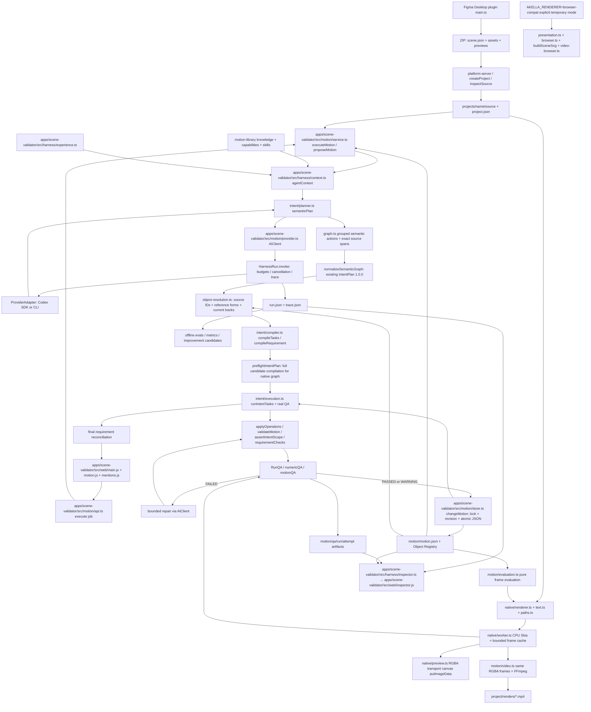
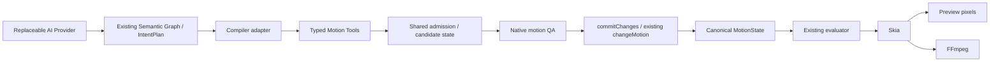

# Motion Platform — Architecture Handoff

## DOCUMENT STATUS

| Поле | Значение |
|---|---|
| Last Updated | 2026-10-20 (Europe/Moscow) — compound track timing edits; targeted update, not a full re-audit |
| Last Full Audit | 2026-10-13 — структурный аудит исходников перечисленных подсистем; не полный production E2E и не формальная верификация каждой ветви |
| Git Commit | Baseline `460aae5`; checkpoint `19d9b8e`. Compound timing changes are uncommitted at this documentation update. |
| Git Branch | `main`; локальный репозиторий создан после первоначального аудита |
| Working Tree Status | main; compound resolution/compiler/checks/tests/docs uncommitted at this update. User projects unchanged; saved provider response replay uses an isolated historical copy. |
| Documentation Version | 1.0.27 |
| Scope of Last Update | test30 saved-run diagnosis; synchronized compound timing groups; independent duration/start semantics; real-project saved-response replay and native production regression. |
| Code snapshot SHA-256 | NOT RECALCULATED for this update; use component version digests in actual run artifacts and subsequent Git commit. |

Git 2.54.0 (Apple Git-157): локальная история на main, без remote/network/push. В первоначальном P0 A01–A03 update были изменены context, semantic compiler/checks и coverage. Последующие text updates меняют текстовую часть applyFrame/renderer и техническую QA; общий математический evaluator инерции в quality repair не изменён. До этого обновления отсутствие Git было фактом на момент полного аудита. Source/config/tests/docs отслеживаются; пользовательские проекты, оригинальные экспорты, artifacts, зависимости и сборки исключены.

Snapshot вычислен над отсортированными файлами `apps/scene-validator/src/`, `figma-motion-exporter/src/`, `scripts/`, а также package.json, package-lock.json и manifest плагина: relative path, NUL, bytes, NUL. Это локальный идентификатор просмотренного состояния, не Git commit и не криптографическая аттестация запуска приложения. Документ и AGENTS.md не входят в этот hash.

Корень: `/Users/redcollar/Desktop/Работа/platform`. Все ссылки `path:line` далее относительны этому корню и относятся к исходникам, не к dist. Внешний читатель может передать эти ссылки разработчику, даже без доступа к репозиторию. Номера строк требуют актуализации при изменениях.

Источник технической истины — код. Исторические docs используются только как дополнительные материалы. Статусы: **IMPLEMENTED**, **PARTIAL**, **UNUSED IN PRIMARY FLOW**, **NOT IMPLEMENTED**. Описание реализованного механизма не доказывает качество всех возможных результатов.

## 1. Executive Summary

Motion Platform — локальное файловое приложение для импорта Figma storyboard, реконструкции статических сцен и создания/редактирования анимаций по текстовому запросу. Исходный экспорт хранится отдельно от Motion State. Пользователь выбирает проект, видит сцены/объекты, пишет prompt, получает автоматически применённые изменения, Preview и возможность Undo/Redo и MP4 export.

Реальный основной путь: **vanilla web UI → локальный Node HTTP job → semantic LLM call → validated IntentPlan → deterministic compiler → task-level scope/requirement checks → native Skia + numeric QA → final candidate reconciliation → revision-checked run commit → autoplay**. В удачном сценарии модель строит intent; первичные Motion Operations строит TypeScript. Модель получает операции для исправления только при repair. Это не открытый агент с произвольным исполнением tools/JavaScript.

Что существует:

- Figma plugin: structural JSON, исходные image bytes, SVG/geometry, text segments, Figma PNG previews, ZIP.
- Import/update проектов, сохранение notes/motion/renders, import history, несколько независимых проектов.
- Exact-name Logical Object Registry и структурные Object States; это не semantic object matching.
- Общий Motion Engine с easing, base-track subframe sampling, typed expressions, path/text reveal и object transitions.
- Codex SDK/CLI transports за ProviderAdapter, лимиты, cancellation, persisted Run/Trace/experience, selective QA, eval infrastructure и candidates.
- Agent Inspector поверх существующих файлов с copy report/ZIP, без дополнительных AI calls.

Основные выводы аудита:

1. **A01 FIXED:** semanticBindings разделяет animation/expression/easing/transition. Wiggle, spring и customCurve проходят create/edit, scope, requirement validation и реальный локальный QA.
2. **A02 TARGETED FIX:** clause guards отклоняют потерянные явные эффекты/тайминг/зависимости даже при full-text coverage; подозрительный план проходит selective semantic audit. Произвольная естественная речь не имеет формального доказательства полноты.
3. **A03 EXTENDED 2026-10-18:** полный компактный Object Index сохраняет IDs/names/types всех потомков всех сцен; детали выборочные, QR/куар aliases разрешаются только однозначно. Tool-based paging всё ещё отсутствует.
4. **A04 FIXED 2026-10-18:** реальный Chromium regression подтвердил смешение координат moveToCenter; compiler теперь переводит scene displacement через inverse parent linear transform.
5. Точное AE Easy Ease parity не достигнуто: сохранённая/пересчитанная ошибка ~0.652 px против допуска 0.15. Формула с предоставленной velocity проходит (~0.105 px).
6. SUCCESS означает выполненный **сформированный** контракт. Обязательный невидимый reveal и объективный FAILED блокируют admission; необязательные WARNING допускаются. Semantic/execution/render/artistic статусы разделены; полнота произвольной человеческой инструкции не доказана.

Critical confirmed defect с доказанным разрушением данных в этом аудите не установлен. Не следует путать отсутствие такого доказательства с гарантией безопасности при любом crash. Код приложения при исходном аудите не исправлялся; P0 update исправляет только A01–A03.

## 2. Architecture Diagram



Важен порядок: задачи проверяются на рабочем candidate и проходят QA, затем итог повторно сверяется с контрактом. Принятые независимые задачи публикуются одной revision-checked транзакцией в конце run. PARTIAL_SUCCESS сохраняет только явно принятые независимые задачи; crash до публикации не сохраняет их. Legacy direct callers используют тот же store/QA admission, но не этот semantic orchestration.

## 3. Repository Structure, Stack and Launch

```text
platform/
  package.json, package-lock.json, tsconfig*.json, AGENTS.md
  apps/scene-validator/
    src/
      apps/scene-validator/src/platform-server.ts, apps/scene-validator/src/importer.ts, apps/scene-validator/src/project.ts, apps/scene-validator/src/source.ts, apps/scene-validator/src/files.ts
      apps/scene-validator/src/renderer.ts, apps/scene-validator/src/comparison.ts, apps/scene-validator/src/validation.ts
      web/                 main.js, motion.js, mentions.js, inspector.js, CSS/HTML
      motion/              schema, operations, store, service, engine, browser
        intent/            schema, planner, compiler, execution, retime
        qa/                technical, numeric, render, geometry
      motion-library/      techniques, expressions, easings, presets, skills
      harness/             providers, context, runtime, qa, evals, experience,
                           metrics, improvements, versions, inspector, retention
    tests/                 TypeScript node:test suites
    dist/                  tsc output + copied web/skills
  figma-motion-exporter/    separate package, manifest, src, tests, dist
  harness/                 evals/dataset.json, config.example.json
  scripts/                 platform.sh, build-ui.mjs, eval/diagnostic scripts
  docs/                    architecture-handoff.md + topic-specific docs
  artifacts/               saved evaluation/render/debug results; not runtime truth
  projects/<slug>/         independent Motion Projects
  motion-project/          original standalone export, preserved
  motion-project.zip       original export archive, preserved
  node_modules/            local dependencies
```

Frontend: plain HTML/CSS/JavaScript modules, no React. Engine/browser runtime originates in TypeScript and is bundled by esbuild into `src/web/motion-runtime.js`; CSS and UI modules are copied into dist. Backend: Node.js ESM, built-in HTTP and filesystem, Zod schemas, no database/service/cloud storage. Rendering: browser SVG/foreignObject/CSS, Playwright Chromium; video: PNG image2pipe into ffmpeg-static/libx264.

Root package versions: @openai/codex-sdk 0.162.1, ffmpeg-static 5.3.0, jszip 3.10.1, playwright 1.62.1, zod 4.6.5; dev TypeScript 5.9.3, esbuild 0.28.2, tsx 4.23.15. Node requirement >=20.19 (`package.json:1`). Actual audit executable: cached Node v24.19.0. Plugin package separately declares @figma/plugin-typings 1.141.0, JSZip and its own build dependencies; several plugin dev constraints use version ranges, with reproducibility supplied by its lockfile, not those ranges alone.

Run:

```sh
cd "/Users/redcollar/Desktop/Работа/platform"
sh scripts/platform.sh dev
# With npm in PATH: npm ci; npm run dev
# Browser: http://127.0.0.1:4173/
# Built app: node apps/scene-validator/dist/src/cli.js dev
```

`scripts/platform.sh:1` falls back to cached Node if Node/npm are absent from PATH. It builds UI on dev. CLI is `src/cli.ts`: import/create-project/projects/validate/dev; web and CLI call shared importer. Browser/server bind and validate local Host/Origin (`apps/scene-validator/src/platform-server.ts:40,67`; listen at end of file). Codex inference is external/provider-backed despite local motion/rendering; `networkAccessEnabled:false` restricts Codex task tools, not the model transport itself. No new provider call occurred for this audit.

## 4. Component Responsibilities and Contracts

В таблице указаны полные пути относительно корня репозитория.

| Component / exact entry | File | Inputs → outputs | Main dependencies |
|---|---|---|---|
| servePlatform | apps/scene-validator/src/platform-server.ts:40 | projectsRoot/port + HTTP → local web/API/job responses | management, importer, motionApi, validation |
| createProject / extractZip | apps/scene-validator/src/importer.ts:132 / :38 | source ZIP/folder, name/update options → project path/config/inspection | JSZip, files, inspectSource, registry |
| inspectSource | apps/scene-validator/src/source.ts:13 | source root + relative scene/report paths → validated document/file inventory/fingerprint/counts | inventory, JSON/reference checks |
| loadProject / readProject | apps/scene-validator/src/project.ts:54 / :12 | project root → LoadedProject | project.json, source inspection |
| buildRegistry / resolveState | apps/scene-validator/src/motion/registry.ts:41 / :115 | SceneDocument + fingerprint / object+scene → logical identities / resolved geometry+hierarchy | geometry matrices, source model |
| projectMotion | apps/scene-validator/src/motion/service.ts:55 | LoadedProject → document, registry, scene/object UI data, provider configuration | store, registry, contexts |
| executeMotion / proposeMotion | apps/scene-validator/src/motion/service.ts:645 / :97 | validated request + revision + settings → applied result or failed run | HarnessRun, semanticPlan, runIntentTasks, RunQA, changeMotion |
| agentContext | apps/scene-validator/src/harness/context.ts:17 | project/state/request/mentions/recent/config → bounded context, bytes/digest/versions | buildContext, motionKnowledge, experienceSearch |
| semanticPlan / validateIntentPlan | apps/scene-validator/src/motion/intent/planner.ts (semanticPlan / validateIntentPlan) | human request + context + IntentProvider → IntentPlan | Zod, registry, source excerpts, deterministic ID validation |
| compileTasks / compileRequirement | apps/scene-validator/src/motion/intent/compiler.ts:60 / :210 | validated plan + MotionState → task DAG / typed operations | expandInheritance, retime, source geometry |
| runIntentTasks / assertIntentScope / requirementChecks | apps/scene-validator/src/motion/intent/execution.ts (runIntentTasks / assertIntentScope / requirementChecks) | plan/snapshot + repair/verify/commit hooks → tasks, requirements, reconciliation, next state | compiler, operations, typed task scope |
| applyOperations / validateMotion / motionDiff | apps/scene-validator/src/motion/operations.ts:177 / :26 / :406 | snapshot + operations + source project → validated new snapshot / diff | schemas, transitions, expressions, timing dependencies |
| readMotion / changeMotion | apps/scene-validator/src/motion/store.ts:45 / :91 | project or mutation + expectedRevision → MotionDocument, diff | schema, source refs, lockProject, atomicJson |
| evaluateAnimation / evaluateMotion / applyFrame | apps/scene-validator/src/motion/engine.ts:31 / :113 / :174 | animation/frame or state/frame/DOM → Values / composite values / rendered DOM | easing, expressions, reveal, transitions |
| valueAtTime / velocityAtTime | apps/scene-validator/src/motion/sampling.ts:6 / :16; apps/scene-validator/src/motion/engine.ts:255 | base Animation + seconds/FPS → per-property base values/derivatives | evaluateAnimation, finite difference helper |
| buildSceneSvg | apps/scene-validator/src/renderer.ts:100 | structured Scene/assets/readAsset/options → SVG, font CSS, RenderStats | geometry/paints/text/hierarchy/path capability |
| motionHtml | apps/scene-validator/src/motion/presentation.ts:13 | source project + validated MotionState → browser document/warnings | buildSceneSvg, statePresentation, bundled runtime |
| exportVideo | apps/scene-validator/src/motion/video.ts:19 | project root + progress callback → MP4/report in renders | motionHtml, Chromium, FFmpeg, project lock |
| numericQA / motionQA | apps/scene-validator/src/motion/qa/numeric.ts:12 / render.ts:47 | state/request/previous/optional target → objective checks and artifacts | evaluators, Chromium, motionHtml, geometry inspection |
| HarnessRun / RunQA | apps/scene-validator/src/harness/runtime.ts:22 / qa.ts:10 | project/config/provider calls/task QA → budgets, persistence, caches | ProviderAdapter, atomicJson, motionQA |
| inspectorRun / debugBundle / attachInspector | apps/scene-validator/src/harness/inspector.ts:96 / :421; apps/scene-validator/src/web/inspector.js:10 | saved files/runId → redacted projection/ZIP/UI | existing run/trace, tasks, history, QA files |

Supporting `apps/scene-validator/src/motion/context.ts` describes node summaries/trim eligibility; `apps/scene-validator/src/motion/mentions.ts:15` validates structured mentions and source spans. `apps/scene-validator/src/motion/transitions.ts:6,48` prepares/resolves state presentations and validates transitions. `apps/scene-validator/src/motion/transition-runtime.ts:85` applies them in browser.

## 5. Full AI Agent Execution Flow

Actual normal UI path (`apps/scene-validator/src/web/motion.js:388`, `apps/scene-validator/src/motion/api.ts:374`, `apps/scene-validator/src/motion/service.ts:97`):

1. `plan()` reads prompt and mention payload, selected/active scene and expectedRevision, disables only relevant generation controls; posts `/motion/execute`. **IMPLEMENTED.**
2. `motionApi` creates an in-memory job and AbortController; responds 202/jobId; updates stage; UI polls job and can cancel. These jobs are not persisted; Harness runs are. **IMPLEMENTED.**
3. `executeMotion` calls `proposeMotion(..., execute=true)`. `requestSchema` checks fields; readMotion validates persisted document and source-reference diagnostics; stale revision rejects. **IMPLEMENTED.**
4. Nonmanual execution creates `HarnessRun.start`: UUID, config, timeout, memory sampling, received trace. Full privacy uses project-local AI directory; metadata/off use scratch. **IMPLEMENTED.**
5. `validateMentions`; recent context comes from applied, non-undone Undo history. `agentContext` collects scoped source nodes, current motion, registry summaries, scene index, techniques/capabilities/skills, up to three experience cases, version refs and byte budget. **IMPLEMENTED with complete all-scene compact identities, selective detailed state, projection fingerprints and an enforced byte budget; arbitrary language/paging remain limited.**
6. `SemanticProvider.interpret` wraps `AIClient.structured` via the selected adapter. Whole human message is in compact user payload. Standard native response is **semantic-graph/1.0** (grouped actions and exact source clauses), normalized into the existing **IntentPlan1.0.0**; simple existing-expression edits retain the compact selector wire schema. The runtime parser accepts historical IntentPlan outputs. **IMPLEMENTED; no second planner/compiler.**
7. Production passes `auditAlways:false`. `validateIntentPlan` checks schemas/source excerpts, then uses shared canonical reference resolution against the full current state passed by service (not only the model projection), validates IDs/name consistency and inheritance, recovers eligible existing edits before coverage/compilation. Semantic planning permits at most one correction call (two semantic calls total, also bounded by global budget). Structural failure receives precise feedback; failed selective audit terminates without a third full interpretation. Provider/timeout failures do not re-enter semantic planning. Clause guards now validate explicit techniques, scene starts, inheritance and ordering. Suspicious coverage invokes the existing semantic audit selectively; a valid normal plan uses no audit call. **General natural-language completeness remains PARTIAL.**
8. `expandInheritance` unions techniques and copies null parameters from parent except absolute x/y and from/to scene IDs. `compileTasks` groups scene timing requirements into one task, creates object tasks, preflights masks/geometry, and builds requirement/task dependencies. **IMPLEMENTED.**
9. For native graph-derived plans or typed lifecycle requirements, `preflightIntentPlan` first compiles and validates the full candidate in topological order without committing or rendering. Failed compilation/coverage commits nothing. Legacy canonical plans retain their previous execution path. `runIntentTasks` then runs pending tasks topologically with real selective QA. `compileRequirement` creates deterministic operations using FPS, source geometry/defaults, current animations, timingDependencies. All17 declared Intent techniques have representation-aware compiler/check coverage; source geometry/identity/interval constraints may still block execution. Engine-only Operations/presets are not all separate semantic techniques. **IMPLEMENTED within these limits.**
10. `applyOperations` creates a cloned candidate, resolves dependencies, validates schema/targets/intervals/channels/expressions/transitions. `assertIntentScope` prevents unrelated changes; `requirementChecks` compares requested techniques/timing/relative edits. **IMPLEMENTED, with gaps §18.**
11. `RunQA.verify` selects scope, can reuse same-fingerprint/version/state QA, otherwise invokes local Chromium/numeric QA with frame budget. **IMPLEMENTED.** No default Vision LLM or MP4 generation.
12. `qaAdmission` allows PASSED/WARNING only when no objective FAILED check and no required non-PASSED check exists. Task acceptance changes only the candidate. `changeMotion` finally replays ordered operation batches under an owner lock, rechecks source/revision and expected candidate, validates the document envelope, and publishes one Undo entry plus commit receipt with durable atomic JSON. **IMPLEMENTED run-level publication for semantic execution.**
13. On failure, feedback carries task/target/expected/actual techniques, failed checks, capabilities, permitted repair actions and previous candidate. The next attempt calls LLM for Operations. Repeated signature/budget/auth/cancel failure stops. **IMPLEMENTED bounded task repair; generic deterministic pre-LLM repair PARTIAL.**
14. After all tasks, `requirementChecks` reruns against final in-memory candidate state before publication. Reconciliation counts requirements separately from tasks/operations. Result is SUCCESS/PARTIAL_SUCCESS/FAILED. **IMPLEMENTED relative to the generated contract, not independently proved human intent.**
15. Proposal/execution/tasks/Run/Trace/experience are persisted. UI reloads current document; if any requirements completed, refreshes Preview and autoplays from earliest relevant animation/retime frame. Wholly failed run does not autoplay as success. **IMPLEMENTED.** Actual first browser paint timestamp is **NOT IMPLEMENTED**; timeToFirstPreviewMs is null.

Technical stages do not each call LLM. Selection of relevant skills happens before interpretation, lexically, not as a model tool call. Preset definitions are available, but primary compiler does not automatically choose/instantiate every preset. No full task-resume execution after process restart: RUNNING records are marked INTERRUPTED.

`apps/scene-validator/src/server.ts` (serveReport) остаётся отдельным legacy viewer helper; текущий cli.ts импортирует servePlatform, а не serveReport. Основной UI — только Motion; прежняя static validation доступна через CLI/backend, не отдельные основные вкладки.

Legacy route: `proposeMotion(execute=false)` / manual-response / applyProposal / completeExecution retain older `runAutonomous`, `planMotionTasks`, `runMotionTasks`, `intentRequirements`, `validateTechnique`. They are not the semantic primary flow; they are not dead files. UI/manual/compatibility paths and tests still use them. This is one Engine/Renderer with multiple planning paths, not several Engines.

## 6. Semantic Intent Processing

### Unified effect lifecycle — 2026-10-14 (verified partial update)

**Exact saved-state audit:** `projects/test11/motion/motion.json` revision `7daee293-45e5-4bb2-a646-504c20de3520` contains two enabled animation tracks, not procedural expressions: `intent_1540d99b2765c9ae` on `54:1603`, scene `scene_54_3a_1594`, frame90/duration21/linear/from0/to1/direction forward; `intent_ae586274e4946856` on `54:1604`, same scene, frame111/duration21/linear/from0/to1/forward. `dependency_11c820403d30b997` links the second after the first with offset0. Creation run `7acb258f-c3d7-4e5c-9789-30e8f98dea23` persisted real tracks and committed history; previous audit's absence of motion.json described its earlier snapshot, not today's state. Preview uses those persisted tracks through the existing evaluator.

**Root cause:** Run `45f60170-0fe7-4709-8f51-19c4ed6315a1` identified both real objects but native semantic contract only offered expressionAction for removal. The model emitted grouped Trim Paths with expressionAction=remove. The selector was copied into both expanded requirements, and `resolveIntentSelectors` queried only state.expressions, unconditionally, regardless of capability kind. Correct object references therefore became NO_MATCHING_EXISTING_EFFECTS with objectCount0. Saved direction Run `d98554b0-16a7-4278-888a-107379a01d3c` is available: its model correctly returned direction reverse (expressionAction null), but the same explicit-object selector entered expression-only lookup and failed. The renderer already supported reverse spatial reveal; no new reverse evaluator or timeline reversal was required.

**Canonical taxonomy:** `motion-library/registry/capabilities.ts` already derived animation/expression kinds from real schemas. It now exposes lifecycle operation names in the same catalogue: animation → addAnimation/updateAnimation/removeAnimation; expression → setExpression/setExpression/removeExpression. Easing and object transitions are separate kinds, not independently removable tracks/expressions. `semanticBindings` remains the source of semantic technique classification: trimPath/Fade/Slide/moveTo/scale/rotation/maskReveal are tracks; inertialOvershoot/wiggle are expressions; spring/customCurve are easings. Composite techniques create multiple existing primitives; a mixed-storage deletion must not be mislabeled expression removal. Catalogue API operation availability is distinct from the narrower supported semantic parameter/selector set; the catalogue states that distinction. No second registry/Engine/compiler was created.

**Schema:** `intent/schema.ts` adds optional discriminated `effectOperation:{storage:"animation"|"expression",action:"update"|"remove"}` and backend-only animationIds. Creation retains kind objectAnimation and the existing creation operations, rather than adding nullable lifecycle fields to every requirement. Native graph and compact existing-effect wire accept the new optional contract; compact requirements now use the existing technique enum and allow direction/easing edits. Internal IntentPlan1.0.0 and semantic-graph/1.0 versions remain backward-compatible optional extensions. Existing stored MotionDocument/MotionState schemas are unchanged. Legacy expressionAction is retained for expression contracts; a track-only old expressionAction is migrated only when all techniques' authoritative capability bindings prove animation storage. Existing unambiguous single-track legacy edits acquire update storage/real IDs after ordinary object lookup; old composite edit paths are preserved.

**Resolution:** the existing `contextual-resolution.ts` dispatches typed track operations by capability kind. Object identity resolution precedes effect matching. Matching uses current state, exact scene/target and requested actual effect, including disabled animation tracks. Multiple independent same-effect tracks fail AMBIGUOUS_EFFECT_MATCH; absent tracks fail ANIMATION_TRACK_NOT_FOUND, missing identity OBJECT_NOT_FOUND, mismatched storage/action UNSUPPORTED_EFFECT_OPERATION. Typed expression missing lookup reports EXPRESSION_NOT_FOUND where applicable; historical expression-only diagnostics remain compatible. Explicit/current-selection/recent-committed/byScene/explicit-global-effect selectors work for tracks; unqualified commands cannot silently select all effects. byScene/global filters intersect actual existing tracks; unsupported filteredSet/byAnimatedProperty track selectors fail SELECTOR_UNSUPPORTED. Registry IDs are never synthesized.

Explicit grouped graph target lists resolve individually without copying the full redundant explicitObject selector into every child. Selector-only track groups expand once to stable per-target requirement IDs; revalidation collapses/requeries authoritative membership and recomputes animation IDs. Coverage accepts a single checked selector with actual animation membership just as it previously accepted expression membership. Object/effect provenance events include storage, actual object/animation IDs, separate objectResolution/effectResolution status/count, dependencies and expression lookup NOT_APPLICABLE. Reconciliation distinguishes selectedAnimationCount from selectedExpressionCount.

**Memory:** `recentSuccessfulActions(doc,true)` derives compact animation memberships from effective committed history (add/update/duration/start operations) using entry.after and the existing action grouping. Undo cursor controls effective history; current MotionState intersects memberships, and deleted tracks are not recreated. The default expression-only view remains compatible for existing inertia callers. This is one history-derived context index/view, not a second persistent state or duplicated event history. Failed model proposals remain excluded.

**Compilation / deletion policy:** typed track removal compiles real removeAnimation operations; direction/duration/easing edits use existing updateAnimation preserving ID/start/easing/geometry/other parameters unless explicitly changed. All lifecycle plans pass full candidate preflight before commits, including compact plans. Existing per-task revision-guarded commit/Undo semantics remain: one grouped request can create multiple Undo entries, and later QA failures may produce explicitly reported partial success, not silently reported whole-run success.

`operations.applyOperations` deletes dependency edges touching a truly removed track and leaves surviving dependent startFrames unchanged (freeze current absolute time). Removing both ribbons leaves zero dangling edges. Removing only the first preserves the second's frame111 and removes its obsolete anchor edge; compiler reports a warning when the dependent survives. No arbitrary rescheduling occurs. Remove+re-add of the SAME ID inside one validated transaction is replacement, so existing dependency references are retained. Dependent expressions referencing a missing base block the final candidate with ANIMATION_HAS_DEPENDENT_EXPRESSION; intermediate removal/re-add during valid existing compound compilation is allowed. Expressions/objects/source SVG are not implicitly deleted. Undo/Redo restore snapshots and dependencies through existing changeMotion; ordinary renderer rebuild naturally restores full source shape after removing path reveal.

**QA / rendering:** `motion/qa/render.ts` samples removed animations at their former intervals, rather than rendering only frame0 when no current effects changed. Removed Trim Paths receives PATH_REVEAL_REMOVAL: actual source target/path exists and no generated reveal mask remains. Invisible source target yields NOT_TESTED, never fake visibility PASS. Original masks/clips remain source data. Existing `path-reveal.ts` reverse changes the spatial mask endpoint/dash-offset sign while progress0 stays hidden and progress1 fully visible. Engine/path evaluator code was not rewritten. Disabled-track edits preserve enabled=false; presence validation must not imply enabling or visually executing a disabled effect.

**Context/performance:** simple known-effect edits/deletes use the same SemanticProvider with compact selector/effect schema, not another keyword agent. Lexical hints choose context depth only; the LLM still interprets natural language. Context contains actual relevant existing track IDs/type/timing, dynamic minimal lifecycle catalogue, bounded committed actions and conversation. Explicit named objects omit unrelated historical object members; expression descriptions are filtered to relevant existing types. No renderer geometry/full Motion Library/engine code is needed for this profile. State resolution/compilation remain deterministic, with no extra provider calls.

Archived failed deletion: input18417/output212tokens, provider10.726s, messages15297/schema8109/system2061/user13236bytes. Final saved-output replay compact request: messages8394/schema9154/system1708/user6686bytes, context6797bytes. User payload dropped about49.5%; the typed schema grew, so byte reductions must not be called measured token/cost reductions. Replay had1 fixture-provider call,0repair,2/2 requirements,2selected objects/2selected animations/0expressions,2removeAnimation operations,2QA and16rendered frames; local execution2.876s is not live-provider latency. New live-provider token/latency/cost NOT MEASURED. No new external Codex request in this update.

**Inspector/storage:** `harness/inspector.ts` includes effectOperation/animationIds/expressionIds in semanticTaskGraph, exposes the same resolution trace/preflight/actual operations, and labels the compact profile contextual-effect-edit. Diagnostic bundle includes actual relevant animation IDs/current tracks/dependencies, including deleted-ID references absent from current state, without unrelated fallback inertia when investigating tracks. Capability source is version-hashed in `harness/versions.ts`. Existing privacy/redaction policies and source immutability remain.

**Verified tests:** TypeScript/build PASS; full194/194 local tests PASS (16.54s in the final full regression before diagnostic projection-only fields); effect-lifecycle5/5 targeted PASS including scoped selectors, safe absence/ambiguity, disabled tracks, history, replacement safety/dependent-expression guard, Undo/Redo, real reverse endpoint pixels and full shape after removal. Existing Fade/compound regressions preserved. Saved deletion and direction outputs each replay through production pipeline on separate real test11 copies with1 mock call/no repair,2requirements/2operations/2QA. Final removal PATH_REVEAL_REMOVAL passes for both real source paths. Copy source inventory SHA256 matches original bytes, original revision remains7daee293-45e5-4bb2-a646-504c20de3520. Original user project is not modified.

Both reverse and deletion copies exported real MP4; five decoded frames40/55/100/120/155 match Chromium Preview within meanRGBA<3 (reverse1.561/1.977/1.946/1.978/1.969; deletion1.561/1.977/1.947/1.979/1.971). This is sampled technical parity, not artistic quality or a new live-provider test. MP4 is only exported for explicit verification, never routine removal preflight.

Permanent existing benchmark expanded39→46 (`harness/evals/benchmark.json`, version2026-10-14.effect-lifecycle.1): create/edit/remove track and expression, groups, dependencies, absent track rejection, create→reverse→remove. Same `harness/evals.ts`/CLI/framework, synthetic fixtures only. All46 pass (37 supported +9 expected rejections), compilation/persistence37/37; strict visual technical QA35/37 with2existing inertia-frequency warnings. Existing39 cases still pass. Same46-case comparison reports zero regressions; changed39→46 dataset is not a formal comparable baseline. Reference-provider semantic accuracy and artistic QA NOT_TESTED. Result artifacts are ignored, project materials are not in Git: `artifacts/harness/lifecycle-verified-46.{json,html}`, `lifecycle-real-project-summary.json`.

**Remaining unsupported combinations:** mixed-storage compound removal requires separate supported primitives and proper ordering; deleting a base with surviving expressions is intentionally blocked. Multiple same-effect tracks require disambiguation and are not silently bulk-deleted. Track filteredSet/byAnimatedProperty selectors and effect-level transition/easing deletion remain unsupported by this contract. Disabled procedural-expression lifecycle selection retains older enabled-only behavior. Whole grouped-run transactional atomicity, arbitrary natural-language completeness and crash recovery gaps remain as previously documented; only local render and saved-answer replays were performed for this update, no fresh semantic live test.

### Stabilization update — 2026-10-14 (verified implementation)

**Root cause of Run `9edb92d1-e9bc-47bf-ae87-ba634ac99a0a`:** the saved provider response correctly assigned r9 to Ribbon2 after r8 and r10 to Text2. Number-placement alias matching admitted a `текст 2` match beginning at the trailing `2` in `лента 2` and ending in the next clause. Coverage checked mention start, not end, so r10 contaminated the ribbon clause and generated UNLINKED_CLAUSE_REQUIREMENT. Coverage also mutated inheritance while inspecting. The provider returned successfully; the subsequent full semantic audit was skipped because its estimated duration exceeded remaining phase budget. This was a post-response coverage/repair-budget failure, not a provider timeout. Original test11 had no persisted motion.json; copies use the existing default state and never overwrite the original source.

**Boundary and contracts:** `apps/scene-validator/src/motion/intent/graph.ts` is the native wire representation, not a second execution IR. It stores `clauses[{clauseId,text,occurrence?}]` and `actions[{actionId,clauseId,kind,scene,targets[],techniques[],parameters[],start?,relation?,dependsOn?,inheritFrom?,selector?,expressionAction?,constraints[],unresolvedReason}]`. A grouped action expands deterministically into existing canonical requirements; IDs hash stable action/target references instead of incidental array positions. Frame starts are divided by actual project FPS. Parameter keys/values are typed and checked against the existing canonical schema. Unspecified durations use compiler/library defaults rather than mandatory model-generated values. Existing `IntentPlan1.0.0` adds optional semanticActionId/sourceClauseId/sourceClauses and entrance=offscreen; old stored plans remain readable. The native schema is graph-only, while the internal response parser permits historical canonical plans.

`provenance.ts` retains actual original source offsets. Unique exact quotes bind directly; whitespace/NBSP-only recovery is permitted. Duplicate source quotes require an explicit occurrence; paraphrases cannot silently replace source text. A source clause may contain multiple actions, but source provenance never becomes a timing edge. Coverage checks both mention boundaries, scene prefixes on either side of the number, explicit compound techniques, inheritance and sequence (including “в момент как она заканчивает”). Inspection is pure. Same-target actions in different clauses remain distinct.

`planner.ts` validates temporal cycles and canonical object references using full authoritative state, not model-supplied IDs. A missing coverage-row association may be repaired only when exact source/target linkage is provable. Safe inheritance correction is recorded and restricted to a real same-scene anchor; it does not invent missing Fade or targets. `repair.ts` merges targeted affected requirements/coverage rows and rejects unrelated edits, then revalidates the complete plan. A `GraphReferenceError` carries the precise failed dependsOn/inheritFrom edge; the existing provider gets a reference-only patch schema with real available action IDs and compact summaries. Generic malformed JSON/nonlocal ambiguity may still need the existing bounded interpretation retry: not every error has a local repair implementation. Retry/time budgets were not raised.

`compiler.ts` and `execution.ts` share `requirementAnchor`, which chooses the anchor's requested effect instead of the first arbitrary track on the same object. Conflicting anchor intervals fail explicitly. Timing dependency edges remain persisted by the existing scheduler, so Ribbon2 follows Ribbon1 after duration edits. Behavior inheritance may use a grouped action's shared parameters; a grouped timing anchor is rejected as ambiguous rather than choosing one member arbitrarily.

`entrance.ts` computes true offscreen displacement from transformed object corners, scene dimensions and conservative stroke/effect padding. Position/Fade run together; inertia attaches after the base endpoint through the existing evaluator. Axis-aligned positive-scale parents are supported; rotated/skewed/flipped parent entrances fail OFFSCREEN_PARENT_TRANSFORM_UNSUPPORTED. Ordinary entrances keep established defaults. No renderer, object registry, Motion Engine or Library was duplicated.

For graph-derived plans `execution.preflightIntentPlan` compiles the full expanded DAG into a cloned candidate, applies normal operation/scope/requirement checks and commits nothing on failure. Actual execution performs per-task numerical/render QA on a candidate, then one revision/source-guarded commit. Later QA can yield explicitly reported partial success with accepted independent operations in the final commit; this is not a distributed transaction with diagnostic files. Reconciliation separates semantic actions, requirements, targets, tasks and operations; grouped success requires all member requirements to pass. Inspector/bundle expose derived semanticTaskGraph, source links, resolved targets and compilationPreflight through existing lazy diagnostic trees.

**Context:** `semanticContext` now whitelists scene/object identity, current motion, bounded recent3 actions/recent2 conversations, compact relevant technique/capability descriptions, skill IDs and easing IDs. It omits engine source excerpts, complete SVG, duplicated geometry/full experience bodies and full Library docs from the semantic request. Full appropriate data remains available to deterministic compilation/QA. Existing expression-edit context remains compact; a request that also specifies a scene start does not incorrectly take the expression-only route. Version references include graph/provenance/entrance/repair/evals/video-eval and the actual graph/selector instructions.

**Measured performance, not token estimates:** original archived call input23498/output4824, latency≈107.4s; authorized one-call live isolated test11 input19797/output1126, provider24.840s, complete run50.368s, repair0, QA24.985s (194 rendered samples), sampled RSS604553216bytes. Messages34058→19164bytes, schema10189→8109, system7381→2061, user26677→17103. SDK usage includes transport overhead beyond visible context; input remains substantial. Pricing unavailable; cost=null. First preview-available marker26.774s is not a measured UI-visible first-preview latency (that field remains null). One live sample cannot establish live median/p95 or broad semantic accuracy. No global timeout was increased and ordinary requests do not render MP4.

**Permanent benchmark:** `harness/evals/benchmark.json` version2026-10-14.semantic-graph.1 contains39 artificial scenarios (31 supported +8 expected safe rejections), including eight-object real-request text, recent-four vs global-six, three-turn context and unsupported/ambiguous/missing techniques. `harness/evals.ts` reuses production executeMotion/transactions/QA; fixture construction is in `tests/harness-fixtures.ts`. `scripts/benchmark.ts`, `benchmark-report.ts`, `replay-agent-run.ts`, and optional `harness/video-eval.ts` provide quick/full/reference/live/report/replay modes. CLI commands are documented in `docs/agent-benchmark.md`; `scripts/platform.sh` supports machines without npm on PATH. No live benchmark runs automatically.

Results persist under ignored `artifacts/harness/benchmark/<git-commit>/<timestamp>.json` plus HTML, with dataset digest, provider/model/mode, component versions and dirty-tree status. Comparable baseline requires same dataset/provider/model/mode; a dirty run is not attributed solely to its checkpoint. Local comparison against the same39-case dataset had zero regressions, not a historical pre-refactor controlled baseline. Gold/reference responses cannot measure model semantic accuracy. Task success, expected safe rejection, compilation, execution, numerical/render QA and artistic QA are separate fields. Unknown tokens/cost remain null. Improvement candidates/evals remain outside ordinary requests.

**Actual verification:** TypeScript/build PASS;189/189 full local tests PASS (30.21s), including reference-only repair, missing sequence rejection, FPS24/30/60, stable grouped IDs, original clause boundary, shared effect anchor, state/Undo, real rendering and legacy workflows. Final reference benchmark39/39 passed; supported compilation31/31 and persistence31/31; strict visual technical QA29/31 PASSED,2 WARNING (`EDIT_05_FREQUENCY`, `CONTEXT_07_SPEED`), reflecting existing literal AE finite-cutoff residual checks. Warning is not relabeled as visual PASS. Reference-only semantic accuracy NOT_TESTED, artistic quality NOT_TESTED. Local fixture latency median1.133s/p952.596s is not live inference latency. Saved first-response production replay and native grouped fixture on separate real test11 copies both completed10/10 requirements with22operations. The separately authorized live Codex copy completed7/7 semantic actions,10/10 requirements,8objects,22operations,6inertias,20/20 technique checks and10/10 task QA; Scene2 frame30, Scene3 frame90 and sequential Ribbon2 persisted. Original test11 remains unchanged.

Explicit video checks (not normal execution): synthetic eight-object and path-sequence benchmark2/2 passed. The live real-project copy's five decoded H264 frames40/55/100/120/155 matched Chromium Preview with meanRGBA error1.561/1.977/1.956/1.985/1.969 (<3 tolerance). These sampled technical checks do not prove artistic quality or pixel-perfect Figma equivalence. Reports: `artifacts/harness/graph-release-39-final.{json,html}`, `graph-video-benchmark.json`, `graph-live-test11-summary.json` (ignored diagnostics, not client data in Git).

Remaining limitations: arbitrary natural-language completeness is PARTIAL; native graph max200 canonical requirements; large complete identity indexes remain costly; grouped temporal anchors are unsupported; rotated-parent offscreen entrances fail safely; existing finite-cutoff inertia warnings remain explicit; no controlled historical benchmark/live distribution baseline; only one authorized fresh complex model sample, not39 live cases. Existing crash-lock/multi-file consistency and other unaudited gaps remain REQUIRES REVIEW.


Authoritative schemas: `apps/scene-validator/src/motion/intent/schema.ts:3,23,108,135`. Short actual interface excerpts:

```ts
interface IntentProvider {
  interpret(context: unknown, request: string, feedback?: unknown): Promise<IntentPlan>;
  audit(context: unknown, request: string, plan: IntentPlan): Promise<IntentPlan>; // suspicious plans receive context.coverageFeedback
}
// IntentPlan and IntentRequirement are z.infer<typeof ...Schema>.
// Required top-level plan fields:
{ schemaVersion: "1.0.0", requirements: IntentRequirement[],
  coverage: {sourceText, requirementIds, classification, explanation}[], assumptions: string[] }
```

Requirement fields: requirementId, kind (`sceneTiming|objectAnimation|editAnimation|unsupported`), sourceText, nullable sceneId, target (`sourceNodeId|logicalObjectId|name`), techniques[], parameters, timing, inheritFromRequirementId, inheritanceExplanation, constraints[], unresolvedReason. Parameters include scene refs, center/x/y/scale, duration/distance/direction, amplitude/frequency/decay/easing, optional nullable property/seed and relative factors. Timing has startSeconds, relation (`sceneStart|sceneEnd|afterRequirement|withRequirement|beforeRequirement|unchanged`), anchorRequirementId, delaySeconds.

The standard model instructions in `motion/intent/graph.ts` describe grouped targets, misspellings, pronouns, context boundaries, inheritance, sequential references, exact source excerpts and artistic defaults; compact selector instructions remain in `selector-schema.ts`. These are **LLM interpretation instructions**, not proof that every phrasing is supported. Regex remains in lexical context/knowledge retrieval and legacy task parsing. Primary semantic interpretation is not exclusively regex.

Example structure — illustrative legal shape, not a newly executed provider answer:

```json
{
  "requirementId":"rLogo","kind":"objectAnimation",
  "sourceText":"а лого аналогично","sceneId":"scene2",
  "target":{"sourceNodeId":"logo-source","logicalObjectId":null,"name":"лого"},
  "techniques":["slideUp","fadeIn"],
  "inheritFromRequirementId":"rQR","inheritanceExplanation":"Same entrance character",
  "timing":{"startSeconds":null,"relation":"sceneStart","anchorRequirementId":null,"delaySeconds":0}
}
```

This excerpt omits required parameters/constraints/unresolvedReason for brevity and cannot be pasted unchanged into the strict API. IDs here are illustrative, not Figma data.

For QR + Logo: the provider should return rQR and inherited rLogo. `expandInheritance` copies techniques/duration/easing character, not QR absolute position. Each target keeps its Figma base geometry. For Ribbon2: provider emits afterRequirement anchored to Ribbon1; compiler computes frames and persists setTimingDependency. Duration changes can propagate via resolveTimingDependencies. Source IDs remain validated even after LLM selection; recognized aliases resolve only within unique scene candidates.

Ambiguity: candidate count must equal one; otherwise unresolvedReason=AMBIGUOUS_TARGET/TARGET_UNRESOLVED and task BLOCKED. Name+ID mismatch is rejected. This cannot prove that a **valid but semantically wrong** object was chosen. No full rule engine binds every sentence’s intended scene independently of model output. The compact complete relevant-scene Object Index now preserves all target identities, but there is no tool for retrieving omitted full geometry on demand.

Coverage: verbatim character coverage remains required. `intent/coverage.ts` also records original clause offsets, scene/target linkage, explicit techniques and inheritance source. Missing Fade/inertia/scene timing, wrong clause linkage, unresolved local inheritance and absent sequential dependencies yield `SemanticCoverageError` plus structured feedback. `semanticPlan` invokes existing provider.audit only for suspicious plans, revalidates before execution and records semantic-coverage events through HarnessRun. Guards are bounded lexical sanity checks around the LLM planner, not a complete semantic parser or a proof of every artistic instruction. Identity ambiguity remains tracked unsupported; independent valid tasks may proceed.

### Fade contract and composition repair — 2026-10-14

**Verified cause:** original Run `56b44d6c-08e8-4942-9275-5f3c254bfa91` retains raw structured outputs and provider schemas under the original project's `motion/ai/` (the previous exported bundle omitted them). First output correctly requested five objectAnimation/fadeIn requirements. `compatibleSchema` makes optional keys required and nullable for native structured output, while `AIClient.structured` previously parsed those nulls directly against non-nullable optional Zod fields. This deterministically rejected selector, selectionRequirementId, expressionIds, expressionAction and parameters.relativeIntensity. The second model response changed to compound edit requirements; this is observed, but the exact causal influence of conversation versus retry feedback is NOT VERIFIED.

`apps/scene-validator/src/motion/provider.ts` now uses the original generated runtime JSON Schema as the normalization authority: only null values on original optional object keys are omitted; required nullable values are retained, enums are not coerced, arrays are not invented and null expressionAction never becomes update. Unknown enums still fail runtime parsing. `$ref` objects and arrays recurse. This reverses the adapter's optional/null conversion for the existing IntentPlan contracts, without changing the internal schema or selector.effect enum. General arbitrary union-branch normalization is NOT IMPLEMENTED; current tested intent structures do not require it.

`intent/compiler.ts`: additional standalone fadeIn inherits the enabled entrance slide/moveTo interval when duration is unspecified, preserving base/expression IDs and parameters. Explicit starts remain explicit. Multiple entrance candidates fail AMBIGUOUS_ENTRANCE_TIMING; overlapping other opacity tracks fail OPACITY_ENTRANCE_CONFLICT. A later nonoverlapping fadeOut survives; repeated fadeIn reuses its stable ID. Fade no longer removes unrelated nonoverlapping opacity tracks. Existing engine channel composition keeps position separate from opacity; source opacity is in the inner rendered geometry and animated opacity is its outer multiplicative wrapper. No engine or renderer rewrite.

`service.ts` groups effective committed task-history rows by actual run prefix before projecting bounded recent conversation (four groups). Failed proposals are not committed conversation. Semantic guidance distinguishes additive Fade from inertia edits. `web/motion.js` clears old executionMessage/proposal/pendingPlayback on a new request; a failed job cannot redisplay the previous completion summary when refreshed preview becomes ready. Current-run reconciliation remains the success authority.

Diagnostics: each new structured call persists `contract-validation.json` with exact original runtime/provider schemas, SHA-256 hashes, redacted raw and normalized output, validation issues and actual null/missing/value classification. Optional project bundle adds planning-attempts with call directories, Harness-assigned callIndex when recorded (historical missing indexes explicitly unknown), schemas, raw output, validation artifact and actual input payload under full privacy only; metadata privacy excludes outputs/input. The 2MiB ZIP entry cap marks truncation and local artifact reference. Historical normalized validation artifacts are NOT_AVAILABLE, never reconstructed as if recorded. Existing qaAvailability reports NOT_TESTED when no QA ran.

Verification: typecheck/build and 181/181 full local tests PASS (14.04s), followed by 11/11 targeted tests after privacy propagation. Five new regressions exercise optional-null versus invalid enums, five-object Fade timing, stable repetition, actual adapter/parser/compiler/executor with real Chromium QA, inertia→Fade→inertia→Fade, opacity conflicts/exit preservation, no-entrance fallback, and zero commit/history changes on invalid output. Synthetic alias mapping is explicit; original aliases independently confirmed by saved response and successful source resolution. Existing contextual/revision/Undo/Redo/render regressions remain in the full suite. No new MP4 was exported for the smoke test.

Saved first-response replay on isolated test10: one mock adapter call, five successful committed Fade tasks and real local QA; source project untouched. Separately, authorized **live Codex SDK smoke** Run `b056335f-14d7-401f-aab2-8230cf8b9b65` on isolated copy `/tmp/fade-live-smoke-TyH5PP`: SUCCESS, 1 actual LLM call, 0 repairs, 5/5 local QA, fades start30/duration15, all original animation/expression structures preserved. Actual metrics: input23064/output1846/cached0 tokens, provider47172.06ms, total55813.87ms, QA8383.23ms, context30504bytes (Harness enriched context; provider projection differs), estimatedCost=null. Historical failure: 2 calls, aggregate input48793/output5166, total117542ms. These are two individual runs, not median/p95 or a controlled latency benchmark. Token/latency remain substantial; no claim of fast parameter-independent inference.

### Contextual selectors, project memory and diagnostic bundles — 2026-10-14

Confirmed Run d4043e2b-53d5-4f60-a096-8a36a842ccb7 in test10: archived context contained only active scene scene_54_3a_1594, nine Object Index rows, zero indexed expressions and an empty projected motion.expressions. Actual Motion Document revision81121237-35be-4f5c-965b-86ebe13fca72/cursor17/history17 contains five inertialOvershoot expressions in other scenes. The model correctly inferred amplitudeFactor0.5 but lacked both factual effect membership and a target-set contract. Existing resolution required a named/ID-bound single object, so a state predicate became TARGET_UNRESOLVED. This was neither actual absence of effects nor an inability to understand the requested intensity.

Flow: User Request → existing SemanticProvider (standard or compact expression-edit wire schema) → resolveIntentSelectors over authoritative current state and effective history → per-object canonical requirements + real expression IDs → existing compileRequirement/requirementChecks/scope checks → selective RunQA → revision/source-guarded changeMotion → existing preview workflow. No new agent, engine, registry, renderer, persistent Motion State or LLM call for querying targets.

Contracts: optional selector on IntentRequirement supports explicitObject/currentSelection/recentSuccessfulTargets/byExistingEffect/byAnimatedProperty/byScene/filteredSet. Filters include effect/property/scene/target IDs, filteredSet may intersect with base=project/recentSuccessfulTargets/currentSelection. New expressionAction update/remove, expressionIds and selectionRequirementId are normalized backend memberships. Revalidation recomputes memberships from current state instead of trusting provider-supplied resolved arrays. Internal selection IDs are requirement IDs, never synthetic sourceNodeIds. The compact wire schema omits backend membership fields and geometry, then normalizes into the same canonical IntentPlan. Schema versions remain1.0.0 with backward-compatible optional fields.

Implicit requests use the latest relevant committed effect group, then actual selection, then a unique relevant existing target (active scene can narrow a no-history candidate set). Multiple remaining targets without grounded context produce AMBIGUOUS_CONTEXTUAL_REFERENCE, never a project-wide default. Explicit state predicates use current enabled expressions across the project; explicit selection/scene/property filters intersect that set. Verbatim source guards prevent an unqualified request from authorizing a global query and reconcile an explicit global predicate incorrectly represented as recent targets. Historical unsupported target-null inertia edits get a bounded selector upgrade; this is compatibility around LLM semantic interpretation, not a separate keyword-only planner. Explicit object references retain the shared canonical resolver and are not overridden by unrelated recent actions or the active scene. Unsupported technical constraints remain blocked. Per-expression scope prevents changing another channel on the same object. Deleted/disabled expressions are not recreated; no automatic new inertia is emitted by an existing-expression selector edit.

`motion/contextual-resolution.ts:recentSuccessfulActions` derives compact action/effect/expression/scene/target/edit-ID references from MotionDocument.history[0:cursor]. Consecutive task commits share their real run prefix; manual entries use real editId. Only persisted operations contribute. Failed proposals do not establish committed actions; Undo excludes undone entries and Redo restores effective membership. Every query intersects current state, so removal after creation invalidates that member. No global/project-independent action cache or second experience DB is introduced. Existing history still stores full before/after snapshots for Undo; compact delta-history migration is NOT IMPLEMENTED. Current state, effective event history, derived recent action context, bounded applied-history conversation excerpts, repository knowledge and transient per-run context remain separate. Full chat/anaphora over failed/uncommitted conversations is NOT IMPLEMENTED; no claim that all conversational ambiguities are solved.

Early `harness/selector-context.ts` avoids full buildContext/geometry/skill retrieval for simple existing-expression edits. It uses the existing fingerprinted registry, named/selected/recent candidate rows, full-project effect inventory counts, latest relevant action summaries, bounded two conversation excerpts (1500chars, truncation marked), relevant expression descriptions and version references. Action samples are labeled samples; full memberships stay backend-only. Actor summary and query metadata are persisted as diagnostic context, not a new project-memory authority. `motion/intent/selector-schema.ts` supplies a compact wire schema/instructions to the SAME SemanticProvider; complex creation/position/easing requests keep the standard profile. Source-language routing hints choose payload depth only; LLM still interprets intent. No timeout/repair budget increases.

Relative intensity policy is typed: slightlyWeaker0.8/weaker0.5/muchWeaker0.25/slightlyStronger1.2/stronger1.6/muchStronger2; explicit numeric amplitudeFactor takes precedence. Deterministic normalization applies it to each current amplitude, preserving IDs/base/easing/frequency/decay/timing/dependencies. Engine bounds remain strict; no silent clamping. Removal uses existing removeExpression operations with explicit absence checks. Selection limits are200 objects per selector; larger batches are explicitly rejected, not truncated. This first implementation targets existing expression effects; animation-only set queries and natural-language grouped Undo are NOT IMPLEMENTED. Native editor Undo/Redo remain supported and invalidate derived context. Existing visibility QA may reject an extremely small/invisible oscillation; rules were not bypassed.

Diagnostics: actual actionId/edit IDs, original/effective selector, scope source, revision, selected/matched/candidate counts and per-expression old/new amplitude are in target-resolution events. reference-context captures actual projected conversation, relevant action references, context/instruction/native-compatible output-schema byte sizes and profile. Reconciliation separates userIntentCount, selectedObjectCount, selectedExpressionCount, task/requirement counts, compiledOperationCount and appliedOperationCount. STALE_PROJECT_REVISION is attached to existing revision errors while preserving Russian messages. Inspector Understanding/Actions expose these facts.

Optional GET /api/projects/:projectId/motion/inspector/:runId/project-bundle exports a media-free ZIP: manifest.json (current revision/schema versions/counts), relevant-state.json, recent-committed-actions.json (max20 groups), reference-context.json, run-trace.json, state-diff.json, versions.json and README.md. Existing ordinary report/debug ZIP remain. Project Bundle reads only this project's artifacts, uses redaction/local-path removal, honors run privacy for state/context/history, and caps each JSON entry at2MiB (NOT_AVAILABLE sentinel on overflow). It includes no source SVG/assets/screenshots/video and is never injected into routine model context. Missing historical provenance remains NOT_AVAILABLE rather than reconstructed as a claimed past event.

Verification: saved historical provider response replay on an isolated copy of test10 completes one user intent/five object tasks/five existing expressions/five setExpression operations with5/5 actual Chromium QA; base tracks unchanged, original project untouched, one mock adapter call/no repair/zero new live calls. Synthetic multi-turn tests distinguish recent4 of6 from explicit all6, consecutive edits, deletion, selection/scene/property scopes, single target, ambiguity, effective Undo/Redo/project isolation, stale revision, numeric waveform ratio, Inspector and compact redacted bundle. These are production-path mock/replay tests plus genuine local rendering, not live-provider NLU E2E.

Performance: historical provider reported19658 input/616 output tokens and27563.456ms generation. For the saved context, comparable standard profile measured18030 context/6992 instructions/10189 native schema bytes; early compact profile measured5513/1367/4184bytes. This measures serialized payload components, NOT new live token/latency/cost savings. Provider-dependent overhead and new live-provider multi-turn performance remain NOT VERIFIED. No full MP4 render is added to ordinary requests.

### Compound edit compilation / operation coverage — 2026-10-13

Confirmed saved Run `e6021bc9-3ee1-41e5-a2c8-e33b06b5ff26` requested linear base easing plus stronger after-arrival inertia for four Scene2 objects. Its valid editAnimation requirements include slideUp/slideDown + inertialOvershoot, easing=linear, property=y. Read-only reproduction against current test8 revision5bf8bea0-c170-451b-8041-428951375608 produced only updateAnimation for each object. Exact cause: compileRequirement's editAnimation branch iterated existing expressions, while creation existed only in the objectAnimation branch. An empty expressions array silently omitted setExpression. INTENT_REQUIREMENT_MISMATCH was the primary failure; subsequent repair budget refusal was secondary.

`motion/intent/compiler.ts:compileInertiaAttachments` is now the shared deterministic creation path for standalone requests and compound edits. Base updates apply to one candidate state first, then resolveBaseMotion samples that UPDATED trajectory and links expressions to its real endpoints. Compound edits preserve base IDs/keyframes/geometry/dependencies and create only missing per-channel inertia; existing expressions retain their IDs and are edited/retimed through existing operations. Existing easing+duration, amplitude+frequency, position+opacity tracks, reveal direction+duration and scale+spring editing paths compose; unsupported missing effects are rejected by coverage rather than committed partially. No new Motion Engine, formula, velocity impulse or renderer.

Intent parameters add nullable defaulted `intensity: subtle|normal|strong`. The existing expressions registry owns presets: amplitude0.1/0.25/0.4, frequency2.5Hz, decay3. Fresh effects use the selected preset, not a nonexistent prior amplitude. Existing inertia uses qualitative amplitude ratio against normal (strong1.6x/subtle0.4x) or an explicit amplitudeFactor/amplitude override; schema limits remain authoritative and out-of-range values fail. A bounded verbatim source guard backfills strong for historical plans containing explicit stronger wording and no numeric amplitude/factor; this supplements the semantic planner, not a replacement NLP planner. Qualitative intensity has deterministic candidate validation. New modern algorithm defaults remain unchanged.

`motion/intent/execution.ts:runIntentTasks` records per-task operationCoverage (expected update/create effect and parameter actions, actual operations, failed checks/status). Candidate validation, scope and requirementChecks precede real QA/commit; no base-only commit if expression fails. Deterministic compiler exceptions/missing checks become COMPILER_COVERAGE_ERROR; invalid compiled operations become OPERATION_VALIDATION_ERROR; these do not invoke LLM repair. Unsupported combinations include explicit UNSUPPORTED_COMPOUND_EDIT context where available. Real QA/model-output failures retain bounded repair. primaryFailureReason persists the first failure; a later budget/cancellation stop appends its repair decision rather than erasing the cause. Inspector Operations tab displays actual coverage and primary failure, historical missing artifacts remain NOT_AVAILABLE. Error classification is scoped to this path, not a wholesale reclassification of every platform error.

Performance evidence: saved provider usage was21508 input/2291 output tokens. Saved request text29175bytes/output schema24257bytes; knowledge contained custom easing parameter schemas duplicating the output contract. semanticContext now keeps their IDs/descriptions/defaults, excluding duplicate parameter schemas while retaining object IDs/motion/capabilities. Applying this projection to saved context yields22965→20353 compact UTF-8bytes. No new live-provider latency/token improvement measurement: NOT VERIFIED. No timeout/budget increase, extra planner, full project regeneration or per-request MP4 QA.

Isolated real-source replay of saved IntentPlan through executeMotion completed4/4 requirements,8 operations,4/4 genuine Chromium QA results and four persisted expressions. It used one mock historical-response adapter invocation, zero repair calls, zero paid/live model calls. The user's original test8/source/motion state was untouched. Original easeOutCubic-only attachment still has the previously documented near-zero-velocity limitation; the explicitly requested linear easing now provides nonzero measured incoming velocity. Generic creation of missing non-inertia expressions inside editAnimation remains unsupported and is diagnosed explicitly, not claimed implemented.

### Existing base-position attachment repair — 2026-10-13

Confirmed test8 incident at Motion revision `5bf8bea0-c170-451b-8041-428951375608`: all four Scene2 objects already had enabled position tracks (start30/end51, distance80, easeOutCubic), no expressions. Image source15:5225 and QR15:5212 use slideUp; text10:3707 and logo25:1637 use slideDown. Saved failed intent `a3a5ba4e-6a72-4a27-bb36-f7f00f05d64e` marked four unsupported requirements because reduced model context did not resolve IDs/base tracks. Post-plan recovery then searched effects matching inertialOvershoot instead of its base motion and required a non-null numeric edit parameter. These are confirmed resolution bugs, not missing saved animations.

`motion/base-motion.ts:resolveBaseMotion(state,sceneId,targetId)` uses existing channels/evaluateAnimation/subframe sampling. It resolves latest finite base movement per X/Y channel, rejects ambiguous equal endpoints, excludes disabled/oscillation tracks, preserves actual source IDs/easing/keyframes/dependencies and exposes interval/endFrame, base value sampler, computed incoming velocity and inspected-track reasons. Keyframes use their actual last key. Separate X/Y sources remain separate. Resolver failures distinguish BASE_POSITION_ANIMATION_MISSING from ANIMATION_RESOLUTION_FAILED; target failures stay separate. Requested inertia counts existing finite position tracks when narrowing duplicate object references.

Planner recovery recognizes attachment requirements with actual base motion even when model returned unsupported and no numerical parameters were requested. Existing relative expression edits retain the edit path; recovery does not turn a missing relative edit into a fabricated effect. Compiler uses the same resolver instead of first-array-match, creates/upserts procedural expressions per selected channel linked to sourceAnimationId, preserving base animations and timing. Existing evaluator/operations retiming remain unchanged. Compact Object Index now includes channels/start/end beside animation ID/effect, not full keyframes. Inspector targetResolution contains base tracks, end frames, measured incoming velocity/dependencies and checked/rejected tracks; task QA/stateChanges supply actual success/failure and persistence. Version fingerprints include base-motion.

IMPORTANT verified limitation: the exact saved test8 replay on an isolated copy resolves all four requirements and generates four valid attachments, but real local numerical/render QA FAILS visible inertia. With the unchanged modern evaluator, instantaneous speed at endpoint minus0.1frame is only ±0.0077748px/s; amplitude0.25 yields maximum offset0.001462px. Several rendered probes show no changed pixels. No false success, fabricated velocity, replacement easing or original-project mutation was used. The replay is historical model-output replay, not a fresh live-provider E2E. Source/easing preservation plus this near-zero incoming velocity cannot guarantee visible oscillation; improving artistic defaults/base velocity is separate work, not silently performed here.

### Natural-language target and existing-animation resolution — 2026-10-13

Confirmed incident: run `7ed9365c-2abb-4965-b54f-c25401f81e50` understood trimPath/reverse/unchanged timing but returned unsupported with null identity. Stored Object Index and motion projection contained Scene2 objects only; Ribbon2/its Trim Paths were absent. Current source/state contains Scene3 Ribbon2 and its enabled Trim Paths (diagnostic sourceNodeId25:1654, not a constant in code). Old retrieval failed to match accusative “ленту 2”, then matched the numeric root Frame name “2” because root Frames with external parentId participated in name retrieval. Validator skipped unsupported requirements instead of trying full-state target recovery. Edit compiler also ignored a requested path direction on update. The saved run took ~21.06s/one real Codex call and did no Operations/QA.

`motion/object-aliases.ts` now implements a reference-only layer: NFKC/case/е–ё/Unicode whitespace normalization, punctuation tokenization, conservative productive Russian noun/adjective endings, ordinal signatures1..20 and registered QR/куар/logo/логотип aliases. Number tokens participate separately; ordinal word order may change, but2 never equals20. Bare numeric names do not become mentions inside longer object references. No Levenshtein/phonetic fallback, confidence score or full morphology dictionary. Irregular forms, ordinals beyond20 and misspellings are not guaranteed by deterministic matching; the LLM still interprets meaning. Aliases/inflections do not change names, source IDs or exact-name logical hashes.

`motion/object-resolution.ts` exports resolveObjectReference and resolveExistingAnimation over the existing Scene Model, Object Registry and MotionState. Candidate metadata includes sceneId, sourceNodeId, logicalObjectId, canonicalName, original referenceText, resolutionMethod, existingAnimationIds/existingExpressionIds. Explicit IDs must agree with canonical state; supplied scene is a hard constraint. References match normalized/alias/morphological forms, with selection, existing technique/state and active-scene constraints only narrowing real candidates. Active scene is weaker than a uniquely existing requested edit effect. Equivalent aliases can remain ambiguous even with exact spelling; registry order is never a tie breaker. AMBIGUOUS_TARGET exposes actual candidates/rejected constraints. Existing lookup exposes actual tracks/parameters/timing/dependencies; missing/duplicate compatible tracks stay BLOCKED rather than fabricated.

Production service passes doc.state (revision checked before planning and commits), active scene and explicit selection to semanticPlan's deterministic validation. A null-target unsupported requirement can be recovered only when its reference uniquely resolves, an existing compatible effect uniquely resolves, structured edit parameters are present and timing is unchanged; explicit geometry/unsupported-technique failures are not overridden. A known object with no existing effect retains its canonical identity but stays blocked with EXISTING_ANIMATION_NOT_FOUND. Qualified objectAnimation with unchanged timing/current parameters can normalize to editAnimation; ordinary create instructions stay create. Recovery preserves sourceText, parameters and constraints, adjusts its coverage classification, and emits TARGET_RECOVERED_FROM_PROJECT_STATE. No additional LLM call. Reduced LLM context never becomes the resolver's source of truth. Bare isolated validateIntentPlan callers without MotionState use defaultMotion and cannot prove existing motion; production always supplies the authoritative state.

Compiler updates the existing track by animationId. Trim/mask direction is stored through the existing direction enum; reverse changes path origin, not time: progress remains0→1. Start/duration/easing/dependencies/from/to remain unless explicitly requested. Recognized existing moveTo x/y, scale endpoints and slide distance edits also update current parameters, with requirementChecks validating actual values. Existing expression amplitude/duration mechanisms remain reused; duration changes go through existing dependency retiming. No new Engine/Renderer/Registry/Agent. Source files are never changed by recovery/edit.

Context Builder excludes root Frames from name retrieval, uses shared reference resolution to identify relevant scenes and includes compact existingAnimations/effects and existingExpressions/types in each Object Index row. Detailed geometry/current parameters remain selective; whole SVG/source files are not sent. Inspector adds intent-target-resolution artifacts and targetResolution projections: reference/canonical identity, candidates/rejections, matching method, actual existing tracks/dependencies, whether target/track was present in model context, recovery/block reason. Existing stateChanges/QA provide actual edit before/after and validation. No invented confidence values. Legacy autonomy.resolveTarget reuses this resolver for named references, reports actual narrowing constraints and rejects unresolved named ambiguity; older unnamed artistic fallback remains compatibility behavior.

Conversation: primary flow uses last eight applied Undo entries and context last three recent entries, not the entire chat. “Сделай её мягче” can use selected target/current animations, but unselected ambiguous history is not a guarantee of correct pronoun resolution.

## 7. Figma Source, Identity and Scene States

Exporter files: `figma-motion-exporter/src/main.ts:21`, `exporter/scene.ts:28`, `nodes.ts:148`, `images.ts:6`, `vectors.ts:14`, `text.ts:5`, `transforms.ts:30`.

- Plugin reads **currently selected FRAME only**, dynamic-page access; child traversal preserves order/hierarchy. Multiple frame IDs are supplied by UI with numeric/position ordering and manual reordering. No semantic matching in exporter.
- Image paints call getImageByHash/getBytesAsync, detect actual format, registry.once(`image:<hash>`) deduplicates original bytes. Crop/imageTransform/filters and paint fields remain structural. Missing resources carry errors/missing status, not a fake file link.
- vectorPaths/fillGeometry/strokeGeometry/styles are read where supported; SVG_STRING uses svgSimplifyStroke:false, svgOutlineText:false. SVG is a fallback visual reference, not automatic trim support.
- Text characters and getStyledTextSegments retain mixed typography/fills/indices. Font files are not copied/downloaded.
- Scene-relative transform is inverse(root absolute) × node absolute; local and absolute matrices remain exported. Coordinate precision is not deliberately rounded.
- Preview comes from **Figma frame.exportAsync PNG SCALE 1**. It is a reference, never a reconstructed image.
- Main→UI binary chunks/acknowledgement and UI-local JSZip create downloadable archive; plugin has no arbitrary filesystem write. UI total byte cap 512 MiB (`src/ui/main.ts:17`).

Manifest has api 1.0.0, editorType figma, documentAccess dynamic-page, network allowedDomains none, existing ID `1691067265636252185`. ID is present in the actual manifest; this audit does not independently verify Figma account ownership or registration. Figma Desktop installation/execution **NOT RUN** during audit.

ZIP import использует stream decompression с общим пределом 512 MiB, до 50000 entries; запрещает path traversal, исходные unsafeOriginalName и symlinks. CRC32 verification выключена; проверяется целостность копии по SHA-256 inventory, а не доверенный внешний hash исходного ZIP. Наличие файла/byteLength не доказывает успешное декодирование каждого PNG/SVG (`apps/scene-validator/src/importer.ts:38-106,155-178`).

Platform `inspectSource` validates schemaVersion=1.0.0, scenes/nonempty assets arrays, scene index equals array position, dimensions >0, node ID uniqueness per scene, parentId/children links, registered asset paths/byte lengths, asset references, preview existence if specified. Node property records are largely open, not an exhaustive Figma property Zod schema (`apps/scene-validator/src/types.ts`, `apps/scene-validator/src/source.ts:39-145`).

Platform logical identity:

```ts
interface LogicalObject {
  logicalObjectId: string; name: string; matchingStrategy: "exact-name";
  sourceInstances: {sceneId: string; sourceNodeId: string}[];
  states: {sceneId: string; sourceNodeId: string}[];
  ambiguousScenes: string[];
}
```

`logicalId(name)` is SHA-256 of exact string code points; no case/space normalization. buildRegistry groups all descendants by exact name. Scene with duplicate names has no unambiguous state for that identity. Source Frames are not themselves collected as logical child objects. Rename changes logical identity; same name on unrelated things can falsely join them. Registry matching is deliberately simple; future semantic/geometric matching is **NOT IMPLEMENTED**. Natural-language resolution is a separate lookup over these immutable canonical identities; it does not merge grammatical variants into one logical object.

Object States are pointers into source, not duplicate canonical geometry files. resolveState extracts sceneTransform, parentTransform, normalizedTransform, ancestor opacity/visibility, layerPath, masks, appearance refs. `sourceNodeId` in platform means original exporter `figmaNodeId`; `targetId` for ordinary animations is that source node ID **plus sceneId** for disambiguation. ObjectTransition targets logicalObjectId with from/to scene states.

UI displayName exists in structured mentions (`apps/scene-validator/src/motion/mentions.ts:4`); logical registry uses `name`. There is no universal persistent `displayName` field replacing node.name.

Scene timing is `MotionState.blocks`, not exporter scene.index or Figma x/y. `defaultMotion` creates ordered initial scene intervals; source itself does not carry motion starts. retimeScenes uses project FPS, preserves order, shifts/compresses scene-local tracks/expressions/transitions, rejects keyframe interval collapse, adjusts neighbours and invalid too-long transitions. TimingDependencies persist animation-to-animation relations, not merely global frames.

## 8. Motion Engine Mathematics

Authoritative files: `apps/scene-validator/src/motion/schema.ts:44,173,213,221`; `apps/scene-validator/src/motion/engine.ts:31-172,174-263`; `apps/scene-validator/src/motion/sampling.ts:6-48`; `apps/scene-validator/src/motion/expressions.ts:6,128`; `motion-library/easings/*`; `expressions/functions.ts:6-132`.

Actual pipeline:

1. evaluateAnimation clamps normalized animation time; evaluateEasing maps it to progress. Property/moveTo/slide/fade/scale/rotation/path/text-reveal/keyframes effects return numeric Values.
2. evaluateMotion clamps **and floors final rendered frame** to project duration. It groups enabled tracks by `[sceneId,targetId,property]`, picks latest-started track (or first initial value), holds endpoints; effects on one channel are replacement tracks, not arbitrary sums.
3. composeExpressions sorts by expressionId and adds procedural offsets to base values. Expressions sample base tracks only, never recursively include another expression. Opacity clamps 0..1; scale >=0.001; nonfinite values throw.
4. Block visibility/crossfade weights are calculated; applyFrame applies values to motion wrappers, visibility, explicit text reveal and path reveal; object transitions apply last via applyObjectTransitions.

Base sampling at arbitrary seconds is separate from integer Preview: valueAtTime evaluates seconds×FPS without rounding. velocityAtTime finds the containing key interval and uses bounded finite differences with step min(1/(FPS×1000), interval/1000). Before first/after last sampled keys returns zero; nearest incoming segment is used by modern inertia. It is numeric derivative, not symbolic AE proprietary interpolation.

Keyframes store `{frame,value}` scalar points with one property per Animation and one easing per track, not per-keyframe AE handles. Each segment uses same easing. Points strictly increase within duration. A vector animation is represented by channels/moveTo or multiple scalar tracks; math.inertialVector exists as a helper, not a separate runtime Vector3 scene system.

Easing:

- cubicBezier solves X(time) to parameter u using bounded Newton then bisection, then evaluates Y(u); y can overshoot.
- aeEasyEase constructs cubicBezier(outInfluence/100,0,1-inInfluence/100,1), default 33.33/33.33; zero endpoint slope model.
- piecewise supports linear/Hermite points and slopes, with validated order/boundaries; not executable user code.
- spring easing solves under/critical/overdamped second-order response then uses a smooth settling window in the last quarter. This differs from literal AE inertia.
- wiggle is deterministic seeded scalar noise/interpolation; procedural spring/bounce/dampedOscillation/loop are registered expression variants. Some have endpoint windows; do not equate all of them with modern inertia.

Animation duration/settings are integer frames: FPS 1..60, canvas 2..4096 px each side; duration/frame bound 108000; schema supports 5000 animations, 5000 expressions/dependencies, 1000 blocks/transitions. Limits are validation caps, not performance guarantees at those sizes.

`resolveTimingDependencies` topologically recalculates after/with/before startFrames; cycles, missing tracks and multiple dependent entries reject. applyOperations invokes it before validateMotion; modern linked inertia is retimed when base end changes, subject to an unchanged-expression-start guard. §18 describes the `before` corner case.

## 9. AE Compatibility and Inertia Integration

“AE Mode” is an **internal persisted algorithm tag** `parameters.mode="ae"`, not a separate user feature/tab. New setExpression defaults to modern mode; compiler and expanded presets explicitly select modern. Existing absent/legacy mode stays old behavior on reads/edits (`apps/scene-validator/src/motion/operations.ts:243-264`; `apps/scene-validator/src/motion/intent/compiler.ts:537-558`; `apps/scene-validator/src/motion-library/presets/registry.ts:148`; `apps/scene-validator/src/motion-library/expressions/registry.ts:49`).

Modern inertia:

```text
key = most recent applicable base key
incomingVelocity = base.velocityAtTime(key/FPS - 1/(FPS*10))
offset(t) = incomingVelocity × amplitude × sin(2π × frequency × t) × exp(-decay × t)
final = eased base property + offset
```

The formula is literally `apps/scene-validator/src/motion-library/expressions/functions.ts:83-96`; dispatcher is `apps/scene-validator/src/motion/expressions.ts:45-97`. No frequency denominator is present. t is seconds after the incoming key. Modern mode uses actual base easing/geometry/FPS and no impulse override; literal duration cutoff returns zero. QA records a cutoff residual as WARNING when significant. Legacy uses averageVelocity over velocityLookbackFrames, optional incomingImpulse and a settling window; no automatic migration of stored state.

Fresh default entrance with inertia chooses cubicBezier(1/3,0,2/3,1), distance default 80, duration default 0.7 s, inertia amplitude default 0.25, frequency 2.5 Hz, decay 3, settling <=1.2 s fitted to scene. Real incoming velocity with flat arrival can be weak; evaluator cannot manufacture a large impulse while claiming true incoming derivative. User easing overrides remain respected.

Integration is real: expressionRegistry contains inertialOvershoot; Capability Registry uses expressionValue; retrieveTechniques recognizes natural Russian inertia/oscillation formulations; agentContext includes inertialOvershoot capability by default; compiler creates typed setExpression. Relative amplitude edit changes existing expression, keeps track/easing/IDs; duration/keyframe changes rescale keys and retime linked inertia. Unit tests in core-inertia/ae-parity verify these paths; saved live-provider artifact confirms previous Codex use on synthetic fixtures.

Reference evidence (`tests/ae-reference.ts`, `artifacts/ae-parity/reference-comparison.json`):

| Check | Actual result |
|---|---|
| Formula with supplied −60.5 px/s | max error 0.10535597379623596 px, PASS at 0.15 |
| Derived velocity from platform aeEasyEase | −50.9479736291496 px/s |
| End-to-end compared with supplied AE samples | max error 0.6520042811565645 px, FAIL at 0.15 |

The test named “AE reference B” **passes by asserting the discrepancy stays explicit**, not by proving AE parity. It was rerun in this audit. No After Effects process or new reference extraction was performed. The platform has the same broad velocity-driven principle, not exact reproduction of all AE temporal interpolation/handle semantics.

## 10. Motion Library and Knowledge Integration

Single implemented library: `src/motion-library/`; `harness/` root contains eval dataset/config examples, not a second library. Its layers:

| Layer | Loading / real consumer | Status / caveat |
|---|---|---|
| apps/scene-validator/src/motion-library/techniques/registry.ts:1,140 | retrieveTechniques lexically ranks query strings; sent via motionKnowledge | IMPLEMENTED; intent/compiler mismatch exists |
| registry/capabilities.ts:11 | generated from animationSchema, expressionSchema, easingRegistry; implementationReference/evaluator links | IMPLEMENTED runtime/context; spring/bounce names can span different kinds |
| apps/scene-validator/src/motion-library/registry/path-capability.ts:2 | source eligibility shared by context/renderer/validateMotion | IMPLEMENTED restrictive true centerline eligibility |
| apps/scene-validator/src/motion-library/easings/registry.ts:133,224 | engine evaluateEasing; schema accepts legacy strings or typed params | IMPLEMENTED |
| apps/scene-validator/src/motion-library/expressions/registry.ts / functions.ts | typed schemas/defaults/descriptions; expressionValue/composeExpressions | IMPLEMENTED engine; not all semantic create routes |
| apps/scene-validator/src/motion-library/presets/registry.ts:36,148 | instantiatePreset called by applyOperations; expands into editable normal tracks/expressions | IMPLEMENTED; not every named preset can be selected by primary semantic compiler |
| skills/*.md | motionKnowledge reads motion-timing plus conditional kinetic-typography/animation-principles/motion-guidelines | IMPLEMENTED lexical retrieval; all four have a route, no proof all are selected for every artistic need |
| apps/scene-validator/src/motion-library/knowledge.ts:7 | provider-independent context builder receives schemas/relevant docs/defaults | IMPLEMENTED, file reads per request rather than global immutable knowledge cache |

agentContext prunes capabilities/expressions to retrieved/current IDs plus common capabilities, includes at most two named relevant presets, versions skills via content digests. Recommendations do not mathematically constrain user intent. Technical constraints are enforced separately by schemas/evaluators.

A technique **can** exist in Engine and be advertised but fail in semantic execution. Capability metadata describes engine executability, not complete compiler/reconciliation coverage. The new `semanticBindings` map plus `p0-correctness.test.ts` gates all 17 declared Intent techniques through compiler/scope/requirement checks and numerical evaluation. Engine-only capabilities are explicitly separate from semantic technique mappings. No unused-skill proof should be inferred solely from presence of .md files; audit verified read paths, not retrieval quality on every language case.

## 11. Renderer, SVG, Text and Compositing

`apps/scene-validator/src/renderer.ts:100` builds SVG from structured source nodes/assets; reconstructProject (`:522`) captures PNGs via Chromium for static validation. `motionHtml` uses the same builder with motion wrappers. Figma previews are not sampled as source pixels; asset reads resolve registered relative paths. Unsupported/mixed vector geometry can use exported SVG image fallback, with explicit warning/provenance.

Geometry/hierarchy: local transform is inverse(parent.sceneTransform) × node.sceneTransform; nested render preserves parent/child order, masks and clipping. Background and fills are reconstructed; gradients use inverse normalized Figma gradient transforms and ordered stops. Source masks remain separate from motion masks. Auto Layout reverse paint order is honored where exported itemReverseZIndex exists. Layout constraints/Auto Layout are not recomputed; exported coordinates are used.

Native stroke vs outlined stroke:

- Native centerline uses vectorPaths with fill none and actual stroke paint/width/cap/join/dash.
- Filled outline uses Figma strokeGeometry as visible filled path, preserving gradient paint. Original vectorPaths supplies centerline metadata for reveal mask.
- pathCapability permits VECTOR/LINE with visible centered stroke, source centerline and no visible fills; rejects compound multi-subpaths, unsupported/decorated caps, mixed widths and ambiguous outline mapping. Arbitrary SVG `<image>` cannot reveal centerline just because it is vector.

`apps/scene-validator/src/motion/path-reveal.ts:16-175` creates a separate alpha mask wrapper around the unchanged visible path. White dashed centerline of exact stroke width reveals the original paint; source masks/clipPaths are not overwritten. Length is centerline getTotalLength. At progress=1 the effect mask is detached from visibility, preserving full original geometry; at undefined the wrapper/mask are removed. Mask bounds come from independently measured source getBBox plus cap/miter extents and local transforms, not from hidden scene visibility. leftToRight uses endpoint scene/screen orientation to pick forward/reverse; it is not an X-position sweep and cannot make an arbitrarily looping path globally monotonic in X.

Limit: a width-exact centerline reveal intersected with a complex filled outline can clip outline regions at intermediate progress, particularly sharp joins; final full reveal restores original. Eligibility/bounds and render QA reduce risk, not a universal exact trim solution for any outlined Figma vector. Multiple eligible paths reveal simultaneously; no individual path stagger unless separately modeled.

Text uses SVG foreignObject with XHTML spans/paragraphs, text/lineHeight/spacing/alignment/case/decoration and local font aliases. Browser loads local fonts; absent fonts fallback and warn. Renderer supports solid text fills; gradient/mixed text paints are approximated. Figma shaping/text wrapping/font metrics are not reproduced by a dedicated shaping engine. Explicit text Mask Reveal unions SVG bbox and loaded HTML line boxes using inverse CTM; motion wrapper/clip is separate. Plain Slide/Fade never activates maskReveal merely because node is text (`text-reveal.ts:16`, engine applyFrame).

Known limitations are in code: drop shadow approximated with CSS filter, spread unsupported; other effects warn; corner smoothing unsupported; unsupported node types fallback; rotated SVG fallback export bounds may differ (`apps/scene-validator/src/renderer.ts:406-453,467-506`). Source clipping and viewport clipping are intentional; QA must distinguish them from unexpected effect clipping. Animation of clipping masks themselves is rejected.

Preview/MP4 share motionHtml and bundled applyFrame, wait motionReady/fonts/resources. Preview can CSS-fit to iframe; MP4 captures canonical canvas at deviceScaleFactor=1, integer FPS frames. H.264 yuv420p/CRF18/padding odd dimensions makes decoded MP4 not pixel-identical to PNG. Fonts/browser versions still affect output; no blanket Preview=MP4 bitwise guarantee. WebM/audio/video clips/font packaging are NOT IMPLEMENTED in this path.

## 12. Validation and Motion QA

| Layer | Code / inputs | PASS / FAIL / NOT_TESTED |
|---|---|---|
| Import/schema/reference | apps/scene-validator/src/source.ts:13; apps/scene-validator/src/project.ts:12; inspectSource export files | PASS valid schema/root/IDs/relative refs; FAIL malformed/missing assets/duplicate IDs/parents/index; missing optional preview warns |
| Plan schema | intentPlanSchema / planSchema / operationsSchema | FAIL unknown fields/unsupported discriminator/ranges/shape; structured validity does not mean semantic completeness |
| Target validation | planner.validateIntentPlan; operations.validateMotion | unique source target/name/scene → resolved; ambiguity/blocking/missing node/mask → FAIL/BLOCKED |
| Source path capability | apps/scene-validator/src/motion-library/registry/path-capability.ts; validateMotion | genuine eligible centerline+stroke → support; unsupported geometry → reject Trim, not substitute Scale |
| Technique/requirements | execution.requirementChecks / compiler.validateRequirement | requested typed techniques and timing/parameters exist → PASS; missing Fade/timing relative to plan → FAIL; some engine variants not accepted, §18 |
| Task scope | apps/scene-validator/src/motion/intent/execution.ts:33 (assertIntentScope) | compare canonical expected state including deterministic dependency propagation; unrelated changes → TASK_SCOPE_VIOLATION |
| Mathematical QA | qa/numeric.ts:12 | finite composed values, sampled oscillation amplitude/frequency/decay/rate/continuity/endpoints; low visible offset or invalid math → FAIL; short sampling interval → NOT_TESTED; literal AE cutoff can WARNING |
| Geometry/render QA | qa/render.ts:47; apps/scene-validator/src/motion/geometry.ts inspection utilities | real DOM geometry, unchanged paths, reveal/dash/direction, source masks/CTMs, actual sampled frame differences; invalid geometry/changed source/mask bounds → FAIL |
| Static visual difference | apps/scene-validator/src/validation.ts + apps/scene-validator/src/comparison.ts | PNG comparison against Figma preview, MAE/changed pixels/difference maps; optional/CLI, not automatically whole storyboard for every prompt |
| Artistic / Vision QA | report.subjectiveQuality/artisticQuality | NOT_TESTED; no automatic Vision provider/artistic judge implemented |
| Final reconciliation | apps/scene-validator/src/motion/intent/execution.ts:561-611 | rechecks contract against final state; requested/completed/qaPassed/task/operation counts and status; no independent final reparse of human text |

Trim QA specifically evaluates reveal progress/dash offset against **actual centerline length**, expected direction and actual SVG mask rendering. Rendered reveal compares actual PNG with full-reveal counterfactual at the **same frame**, not pixel-count monotonicity across different frames (`qa/render.ts:520-577`). Source geometry, transforms, gradients, isolated target full-endpoint integrity and masks/text glyph checks exist. Offscreen/occluded endpoints can be NOT_TESTED; no sampled visual contribution can produce WARNING. These are declared coverage limitations, not fabricated passes.

QA stores report.json, numeric-samples.json, frame-*.png, contact-sheet.png and effect-*.json. Some counterfactual intermediate buffers are transient and not persisted. Report includes checks with name/target/status/reason/metrics, stateDigest, sourceFingerprint, request, samples and rendererWarnings. Examples below are excerpts of real stored data, not a new render:

```json
{"status":"PASSED","scope":"objective checks only; inspect per-check NOT_TESTED coverage",
 "checks":[{"name":"realPathGeometry","status":"PASSED"},
           {"name":"renderedPathReveal","status":"PASSED"}],
 "subjectiveQuality":"NOT_TESTED"}
```

Source: `artifacts/harness/example-qa-report.json`; its detailed metrics are omitted. QA status aggregation can admit warnings; per-check NOT_TESTED coverage must still be read. SOURCE/Figma matching is not the same as counterfactual integrity against the platform's own baseline renderer.

Selective QA is real but limited: numeric target scope filters that target; rendered effects are selected by changes from previous state; full motionHtml/source composition is still assembled for the project. Scene timing/object transitions remove narrow scope. Numerical samples can evaluate full state, and unchanged target expressions may still be numerically checked. This is not a general optimal dependency-aware incremental renderer.

## 13. Repair, Scope, Transactions and Recovery

`runIntentTasks` has request plan scope, per-task requirement IDs/techniques, repair feedback scope. Scene timing task aggregates timing requirements and applies exact deterministic retiming; object repair cannot silently change another object/blocks. Fade remains within a composite object task if intent plan contains it; fixing inertia does not inherently revoke Fade (`apps/scene-validator/src/motion/intent/execution.ts:33-125`; service repair context :266-293).

Primary first attempt is deterministic compilation. On exception/failed technical or QA checks, current successful state remains untouched for that task. Next attempts generate typed operations via provider. Per-task default is up to three attempts (1+maxRepairAttempts=2), but **global maxLLMCalls=3** includes interpretation, semantic retries and all task repairs. The first failed task can consume the budget, preventing later semantic repairs; later deterministic independent tasks can still succeed if checkpoints allow. No unlimited retry; repeated identical operation/error signatures stop; transport/auth/cancel/timeout/budget errors stop.

Feedback example fields (actual source `apps/scene-validator/src/motion/intent/execution.ts:511-542`): taskId, requirementIds, targetId, expectedTechnique/expectedTechniques, actualTechnique/actualOperations, failureReason, failedChecks, availableCapabilities, allowedRepairActions, previousResponse. “Available capabilities” here is a compact list of the task techniques and scene interval, not the full registered model capability catalogue.

Deterministic normalization: plan target/name resolution, default parameters, FPS rounding, inherited parameter expansion, dependency retiming and schema defaults. There is **no general deterministic repair dispatcher** that first fixes arbitrary malformed range/schema/path/reference failures before invoking LLM. Such failures typically enter model repair. Do not describe normalization as an already complete deterministic auto-repair layer.

Task-level commit uses `changeMotion`: project lock, latest project load/source fingerprint, expectedRevision, cloned snapshot and atomic motion.json replace. Failed task before commit is discarded; successful earlier tasks are not rolled back with it. Mid-run external change makes revision conflict and rejects remaining commit. There is no distributed transaction spanning run/tasks/QA/history; a post-commit trace/file-write failure can leave an applied state with failed/incomplete diagnostics. Undo entries are per commit/task, not necessarily one Undo for entire original user request.

Crash recovery: servePlatform marks RUNNING runs with different ownerPid INTERRUPTED, does not resume task DAG. `lockProject` is a directory lock without lease/owner metadata/automatic stale-lock removal. Crash while held can block future imports/edits/video until a deliberate stale-lock recovery. Atomic rename covers individual files, not the whole multi-file update/history transaction or power-loss fsync guarantee.

## 14. Harness Implementation Status

| Component | Status | Actual production integration / boundary |
|---|---|---|
| Orchestrator | IMPLEMENTED | service.executeMotion/proposeMotion + runIntentTasks; not a second orchestrator class |
| Context builder | IMPLEMENTED, PARTIAL semantics | agentContext in normal execution; complete compact selected-scene Object Index; relevant-scene selection remains lexical, context budget errors possible |
| Provider abstraction | IMPLEMENTED | ProviderAdapter/factory registration used by AIClient/HarnessRun |
| Knowledge retrieval | IMPLEMENTED, PARTIAL sophistication | lexical skills/techniques + defaults/current effects; no embeddings/dynamic model inspection tools |
| Capability registry | IMPLEMENTED, PARTIAL alignment | generated schemas/evaluators plus semanticTechniques bindings; 17-technique semantic coverage regression |
| Tool execution | IMPLEMENTED typed Operations; interactive tool calls NOT IMPLEMENTED | LLM returns JSON; add/update etc validated by applyOperations; unsupported provider toolCalls reject |
| Persistent execution state | PARTIAL | motion/tasks/run/report files persist; in-memory job/abort maps not resumed |
| Tracing | IMPLEMENTED | received/context/intent/task/provider/tool-execution/QA/finished events; not every conceptual stage has separate event |
| Motion QA / repair | IMPLEMENTED, PARTIAL quality | real local checks, bounded task repair; warning acceptance and generic deterministic repair limits |
| Agent eval framework | IMPLEMENTED offline | runAgentEvals and CLI use executeMotion, separate live/mock metadata; never on every prompt |
| Metrics/regression comparison | IMPLEMENTED offline/API | sample counts, success/repair/technique metrics, missing values null; not artistic quality |
| Experience store | IMPLEMENTED | finish → persisted objective cases; lexical top-three retrieval on next run |
| Improvement candidates | IMPLEMENTED offline / PARTIAL lifecycle | collect repeated failures, isolated overlays, baseline/candidate checks, accepted-for-review; no production auto-apply |
| Knowledge versioning | IMPLEMENTED content hashes / PARTIAL reproducibility | code/skill/technique/schema/config digests; not archived exact runtime executable for replay |
| Vision quality judge | NOT IMPLEMENTED | artisticQuality NOT_TESTED |
| Model weight learning | NOT IMPLEMENTED | experience/config improvements do not train model weights |

No autonomous production source-code editing/knowledge rewriting exists. Candidate patch is limited to extraGuidance/retrievalBoosts; evaluator requires complete live datasets, same dataset version, improved passes and no regressions for ACCEPTED_FOR_REVIEW. Acceptance does **not** deploy the patch. Candidate creation uses deterministic grouped failure patterns after >=2 cases, not an extra LLM call per prompt.

## 15. Provider Abstraction and Codex Transport

Actual lower-level interfaces (`apps/scene-validator/src/harness/providers/types.ts:1-47`):

```ts
interface ProviderAdapter {
  readonly id: string;
  readonly mode: "live" | "mock";
  capabilities(): ProviderCapabilities;
  generate(request: ProviderRequest): Promise<ProviderResponse>;
}
// request: messages[], responseSchema, model?, signal?, timeoutMs,
//          maxOutputTokens, tools?
// response: output:unknown, usage:null|{inputTokens,outputTokens,cachedInputTokens?},
//           estimatedCost:null|number, latencyMs, diagnostics[], toolCalls[]
```

Upper `apps/scene-validator/src/motion/provider.ts:29` still has AIProvider generateMotionPlan/editMotionPlan; AIClient aliases CodexProvider for compatibility. SemanticProvider aliases SemanticCodexProvider. Names are historical; actual adapter selection is factory-based from settings.provider. Provider settings validate registered IDs; manual-response is a compatibility option, not a live adapter.

Provider settings contract is centralized in `src/provider-contract.ts` and `src/motion/provider-settings.ts` (paths under apps/scene-validator). The browser consumes a local generated ESM bundle; `scripts/build-ui.mjs` builds it, and only that generated file is ignored. IDs retain `/^[a-z][a-z0-9-]{0,63}$/` and must also exist in the registry (manual-response remains non-live compatibility). Registration checks syntax and factory/adapter ID agreement. UI labels are never IDs. Missing whole request settings use persisted/default settings; missing provider in an explicit settings object defaults to codex-sdk; explicit empty/unknown IDs fail. Only stored labels Codex SDK/Codex CLI migrate; unknown or malformed settings never silently fall back. UI can still display the project with invalid settings, but generation stays disabled until explicit valid selection. POST provider-settings persists live/manual selections without invoking the model; transient mock/replay adapters cannot overwrite durable settings.

Confirmed incident: a prior authorized saved-intent replay incorrectly persisted temporary `saved-intent-replay` in test8. That factory existed only in the replay process. Assigning that nonexistent option to the native select produced `""`, submitted as settings.provider and rejected before any LLM call. A real Chromium regression test reproduces that native select behavior. test8 was restored from its previous saved request to codex-sdk with empty model; Motion State/authentication were unchanged. This is a specific repair using verified previous settings, not a generic alias or fallback rule.

`prepareMotionRequest` validates settings before API job allocation; invalid values return HTTP400 with the Russian friendly message and PROVIDER_SETTINGS_INVALID. A failed preflight Harness Run records validationPath, safe actualValue, expectedFormat, source and NOT_INITIALIZED, with zero model calls. Unknown strict-object keys are diagnosed as invalid settings objects, not unregistered IDs. Secrets/opaque tokens and malformed JSON contents are not exposed. Inspector projects settings validation and successful settings provenance; runtime also checks live adapter registration. Version fingerprints include the shared contract/settings/registry implementation.

Only `codex-sdk` and `codex-cli` register in providers/index.ts. CodexAdapter passes structured schema, messages/context and optional model. SDK starts a read-only Codex thread, disables shell/edit/MCP/web/plugins features and rejects forbidden runtime tool items. CLI uses `exec --json --ignore-user-config --ephemeral --sandbox read-only`, schema/output files and disabled tools; CLI events/SDK finalResponse are parsed into JSON and persisted with redaction. Model-specific execution policy/engine knowledge lives above adapter, not in the transport. Если settings.model пуст, Run записывает provider-default; фактически обслужившая запрос модель отдельно не определяется и остаётся NOT_AVAILABLE.

Cancellation combines external/Harness signal and timeout. SDK signal propagates; CLI kills subprocess on abort. Harness wraps even an adapter that ignores cancellation via abortable. Errors are typed ProviderError codes UNAVAILABLE/UNSUPPORTED_CAPABILITY/TIMEOUT/CANCELLED/INVALID_OUTPUT/TRANSPORT, plus budget errors and schema parse errors. Shared retry policy is in semantic/execution logic, not unlimited transport retry.

Tool calling: interface can describe tools, but Codex advertises nativeToolCalling:false; adapter rejects req.tools and forbidden tool events; Harness rejects nonempty response.toolCalls. Typed Motion Operations are the supported mechanism, not native interactive tool calling. Switching to a model with tool calls requires an explicit dispatcher/policy, not simply setting a capability flag.

OpenAI API, Claude API and local LLM adapters are **NOT IMPLEMENTED**. To add one: implement/register ProviderAdapter, supply model/config/auth transport without persisting secrets, convert messages/schema/output/usage/errors/cancellation, pass same strict motion schemas/QA/evals, expose selection. No project state migration is required solely because provider changes. ProviderRequest lacks a general multimodal/vision payload or provider-specific credentials object; actual native capability negotiation is mostly advertised metadata plus explicit unsupported-tool checks, not a complete cross-provider feature router.

## 16. Inspector and Observable Execution

Target Resolution diagnostics now include actual matching/recovery provenance via intent-target-resolution.json, targetResolution view and existing stateChanges before/after.

Semantic diagnostics now project coverage failures, retry reason/source/category, affected requirement IDs, planChanged and provider phase/time/request-byte measurements. Categories distinguish COVERAGE_VALIDATION_FAILURE, SEMANTIC_PLAN_FAILURE, PROVIDER_FAILURE and TIMEOUT. Failure traces persist even after abort through diagnostic(), which never authorizes further execution. Raw Inspector includes selective-audit and failure artifacts; missing historical data remains NOT_AVAILABLE.

Inspector files: `apps/scene-validator/src/harness/inspector.ts`, `apps/scene-validator/src/web/inspector.js`, `apps/scene-validator/src/motion/api.ts:70-97`; wiring `apps/scene-validator/src/web/motion.js:514`. Existing old diagnostics remain in settings. UI is a right resizable panel, five tabs, persistent localStorage tab, scroll/mobile fallback; on desktop shrinks workspace. It reads project-local run/trace/tasks/Undo history/QA. It does not run provider or renderer.

Observable: original prompt (full privacy), provider/model/calls/usage, status/times, intent/targets/inheritance/dependencies, generated operations, technical/QA outcomes, commit revisions, before/after/diff matched by run request prefix, repair feedback, knowledge versions, saved thumbnails, raw responses where available. Copy Markdown and user-initiated Debug ZIP include redacted run/intent/operations/QA/state-diff/trace/environment and existing frames.

Event shape (`apps/scene-validator/src/harness/runtime.ts:37,120`): `{stage,at,durationMs,data}`; runId is parent file/directory rather than repeated in every event. durationMs is elapsed from run start, not exclusive stage duration. Separate provider-started/completed and run-finished events were added; legacy runs lack them. Source geometry and incoming derivative numerical inputs are not always logged independently; evaluatorDetails points to real files and persisted effect parameters. Hidden chain-of-thought is neither promised nor used.

Panel polls every two seconds only while open/visible browser tab. History summary cache uses run mtime; raw snapshots/responses fetched on Raw Data tab; JSON tree children created lazily. No SSE stream. Missing data NOT_AVAILABLE, absent/per-check unperformed QA NOT_TESTED, omitted sections explicitly marked when caps are hit. API still reads saved JSON on backend; large files cap rather than stream parse.

Caps: 100 visible recent runs; 4 MiB per JSON read; 2 MiB response projection; 500 array elements/6000-character strings/depth 20; 20 QA attempts, 16 image names each; Markdown 200000 chars; frame bundle total 25 MiB, 8 MiB/image. Bundle includes bundle-limits.json. These caps make full historical debugging incomplete in large runs. Images without valid source files are not fabricated. Counterfactual/difference frames not saved by QA cannot be shown by Inspector.

Privacy: full includes project prompt/operations/artifacts, metadata redacts content, off skips Run/experience files and cleans scratch QA. Known keys/tokens/Bearer/personal `/Users/` prefix/SVG geometry/base64 are redacted in Inspector export. This is not general PII/confidential-text detection. Auth settings/files outside the project were not read in audit.

## 17. Storage and Persistence

```text
projects/name/
  project.json
  source/scene.json, export-report.json, assets/, previews/
  notes/brief.md, scenes.md
  validation/reconstructed/, differences/, report.html, report.json
  history/imports/<importId>/source/, project.json, validation/, registry snapshot
  motion/
    motion.json
    object-registry.json
    source-reference-report.json
    ai/provider.json
    ai/<runId>/request.json, context.json, intent-*.json, tasks.json,
                proposal.json, execution.json, error.json,
                semantic-*/ and task_*/attempt-N/ provider files
    qa/<runId>/<task-attempt>/report.json, numeric-samples.json,
                            frame-*.png, contact-sheet.png, effect-*.json
    harness/config.json                        optional project override
    harness/runs/<runId>/run.json, trace.json
    harness/cache/qa/<digest>.json
    harness/experience/<runId>.json
    harness/improvements/<candidateId>.json
  renders/motion-<UUID>.mp4 + render report
```

| Data | Format / truth / lifecycle |
|---|---|
| project.json | versioned project metadata + relative source/validation paths; importer creates/updates; project.readProject validates |
| source/* | immutable imported reference until explicit reimport; copied/staged, relative asset links; reconstruction never writes source |
| scene.json | exporter schemaVersion 1.0.0 source graph; platform validates structure/refs, not exhaustive Figma property semantics |
| Object Registry | schemaVersion 1.0.0 generated exact-name identities + source fingerprint; regenerated when source changes; source geometry remains canonical |
| MotionDocument | documentVersion 1.0.0, revision, sourceFingerprint, state, history[], cursor; state contains MotionState schemaVersion 1.0.0; changeMotion source of saved changes |
| History | full before/after snapshots + operations/request/origin per edit; undo/redo persist; redo branch dropped after a new edit; no automatic size cap |
| AI provider settings | motion/ai/provider.json: provider/model; not secret store; app-level Codex authentication external to project |
| HarnessRun | schemaVersion/runId/projectId/createdAt/status/privacy/config/outcome/versions/calls/metrics/failures/result; record/persist overwrite whole JSON atomically |
| Trace | array of persisted events; no append-only journal or crash-resume queue |
| QA | reports/artifacts tied to candidate stateDigest/source fingerprint; offline counterfactual images sometimes transient; cache stores pointer to folder/report |
| Experience | objective run summaries + failure/technique refs, persisted finish; top-three retrieval; no artistic-learning claim |
| Knowledge/skills/presets | repository TS/Markdown, read/bundled; source version digests per run; no project copies of library code |
| Evals | harness/evals/dataset.json version/cases + script-selected output JSON in artifacts/harness; live/mock mode and full run reports recorded |
| Improvements | declarative candidate JSON + baseline/candidate metrics/eval results/status/versionHistory; offline controlled comparison, no live production auto-write |

All listed project files survive restart; UI playback position, in-memory jobs/controllers and context caches do not. Import update preserves notes/motion/renders and snapshots old source/metadata/validation, marks new validation stale/empty and diagnoses stale motion refs. It does not migrate old animations to renamed/deleted nodes. New project import stages then renames; update has sequential multi-path rename/rollback on caught exceptions, not power-loss atomic transaction.

Retention config defaults: 200 Harness runs, 90 days, 100 MiB. retainRuns removes only eligible old run/trace directories; current/RUNNING and run.json >8 MiB are exempt. It does not count/remove QA folders, AI traces, Undo snapshots, experience/import history, source/renders. Therefore this is **not** a project disk quota and can leave orphaned artifacts/reference IDs. QA-cache eviction removes pointer records, not physical render folders.

## 18. Architectural Inconsistencies, Bugs and Risks

Historical full-audit findings (before P0 update): no fixes were applied during that audit. Findings distinguish confirmed local probes, direct source evidence, and hypotheses. Pure probes used existing synthetic fixtures under temporary directories; no provider/render/source-project writes. Outputs are recorded below for reproducibility.

### A01 — FIXED: semantic representation parity

Original cause: compiler omitted wiggle/spring/customCurve, checks expected ordinary animation effects. Existing evaluators were present but unreachable through primary semantic create.

Repair: `motion-library/techniques/registry.ts` exports semanticBindings; capability entries expose semanticTechniques. Wiggle creates/edits a typed expression; spring creates/updates structured spring easing on a base track; customCurve uses cubicBezier/piecewise easing. Existing procedural spring expressions remain accepted on compatible edit. Parameter-only edits preserve prior easing and unrelated tracks. New property/seed fields are optional nullable; amplitude has a broad intent range and actual expressions enforce technique-specific bounds. No new engine/evaluator/library.

Verification: all 17 Intent techniques compiled, technically/scope/requirement validated, numerically evaluated; the three repaired paths passed actual Chromium QA. Default semantic spring is easing, not the distinct low-level procedural spring expression. Named preset execution remains the existing Operations path; not every preset has a dedicated Intent technique.

### A02 — TARGETED FIX: explicit intent coverage and selective audit

Original cause: a full-message excerpt could conceal missing Fade while satisfying character coverage. Repair in `motion/intent/coverage.ts`: original clause ranges + named target/scene linkage, explicit effects, scene starts, sequential anchors, inherited instructions and relative modifiers. Unambiguous local inheritance enriches the validated clone before compilation; source geometry is never copied. “Также” does not mean “так же”.

Suspicion triggers existing provider.audit with compact issue/affected-clause feedback, bounded by two semantic calls and global/time budgets; successful normal requests retain one interpret call. Bad audited contracts cannot execute. Persisted semantic-coverage trace includes clauses/issues/status. Existing final reconciliation still checks compiled requirements, not every possible meaning of human language.

Verification: full-text-but-incomplete Fade/inertia plans rejected; missing timing/sequence/modifiers and wrong-object linkage rejected; local Logo inheritance and cross-scene boundaries tested. Arbitrary synonyms, broad negation and artistic ambiguity remain LLM-dependent; no claim of universal semantic completeness.

#### Semantic timeout incident repair — 2026-10-13

Saved run `f60350a7-2f37-4e31-b79d-dd69855d69dc`: both saved responses contain ten correctly scoped requirements. Coverage split the postfix target “trim paths лента 2” into an object-only fragment, queued Ribbon2 in pendingIds and carried it into the following Discount Text/Shape clause. Thus it falsely expected slideDown on r8 and demanded a coverage link to the discount clause. First call took 92.39s; audit took 108.77s and returned the same correct requirements. Revalidation failed identically; outer attempt loop started a third interpretation with only ~38.8s left, then hit the unchanged 240s total limit. No Operations/QA ran. Interpret directory was reused, so its request.txt was overwritten by the third call; first-response raw JSON survived. Exact original first-call prompt bytes cannot be established from that overwritten file.

`coverage.ts` now uses precise verbatim requirement source spans as candidate boundaries, retaining postfix targets with their action. Spans never alone prove coverage: scene, target, each explicit technique, linked coverage row and dependencies remain checked. Frame-start instructions are normalized through actual context motion.settings.fps (optional fps argument for isolated validation; defaultMotion fallback for legacy callers). `semanticPlan` validates normal first-pass before spending another call, sends exact issues for selective audit, records changed requirements and stops after rejected correction. It never sends a third interpretation after failed audit. Invalid-source/schema plans may receive one structural correction. Global task repair/LLM budgets are unchanged.

`SemanticProvider.semanticContext` keeps the complete relevant-scene Object Index, selected geometry, current motion, scene references, knowledge constraints and identity ambiguity. It removes duplicate userRequest, detailed low-level capability/expression operation schemas and duplicate logical-state matrices/hierarchy. This projection is used only by semantic interpret/audit; actual repair uses full appropriate Operations context. Stable provider phase suffixes preserve earlier request/response artifacts on structural retry.

### A03 — FIXED: complete relevant-scene Object Index

Original cause: one exact match removed other targets from detailed context, with no recoverable index. `harness/context.ts` now includes every descendant of relevant scenes in objectIndex: name, sceneId, sourceNodeId, logicalObjectId, objectType, aliases. Geometry remains selective. Explicit scene/mentions take priority; otherwise shared names respect current scene context. `motion/object-aliases.ts` resolves QR/куар and logo/лого without changing exact-name logical identity or guessing duplicates.

Verification: Image exact match plus QR alias retains all selected-scene IDs; multiple explicit scenes supported; duplicate aliases produce AMBIGUOUS_TARGET. The original byte budget remains enforced (no silent truncation). Huge selected-scene indexes can still exceed budget; paging is not implemented.

### A04 — FIXED 2026-10-18: scene-space center movement applied in parent space

Current: `parentLocalDelta` inverse-linear conversion in compiler; actual Chromium nested rotation/nonuniform-scale test passes. Historical audit evidence follows; ordinary rotated offscreen slide remains a separate supported-geometry limitation.

**Symptom:** moveToCenter or scene-vertical Slide on a node nested in rotated/scaled group can move in wrong direction/distance.

**Root cause:** compiler calculates desired center offset from sceneTransform; applyFrame writes ordinary translate inside nested renderer parent wrapper. Parent rotation/scale acts on that vector. ObjectTransition has separate world-space machinery; ordinary movement does not use it.

**Evidence:** `apps/scene-validator/src/motion/intent/compiler.ts:414-453`; `apps/scene-validator/src/renderer.ts:400-405,456,503-506`; `apps/scene-validator/src/motion/engine.ts:194-206`; `apps/scene-validator/src/motion/geometry.ts:2-30`. Parent rotation R90 maps requested local Δ=(0,−100) to scene Δ=(100,0), not scene upward. This matrix implication is confirmed; a full rendered center-request reproduction was **NOT RUN** in original audit; it is reproduced and corrected in the 2026-10-18 reliability test.

**Impact:** correctness may hold for unrotated parent but fail after reparenting/rotation.

**Recommendation:** explicit coordinate-space contract and inverse parent linear transform for scene-space offsets; add nested rotated/scaled ordinary-animation tests distinct from existing transition tests.

### A05 — FIXED 2026-10-18: before dependency shifts inertia start when endpoint stays fixed

Current `applyOperations` recomputes endpoint-attached modern inertia from the original base-end delta even when scheduler already moved expression start. Explicit authored start overrides remain authoritative. Apply-level regression and repeated dependency idempotence pass. Historical diagnosis follows.

**Symptom:** modern inertia window starts too early and ends early after lengthening an animation that ends “before” a fixed anchor.

**Root cause:** resolveTimingDependencies shifts expressions by base-start delta; applyOperations endpoint-sync guard skips expression already shifted. Before relation can move start while end remains unchanged.

**Evidence:** `apps/scene-validator/src/motion/intent/retime.ts:86-128`; `apps/scene-validator/src/motion/operations.ts:378-403`; `apps/scene-validator/src/motion/expressions.ts:16-20,66-78`. Pure probe: A starts30, B starts20/duration10, B before A, inertia start30. Set B duration20 → B start10/end30, inertia start20. Actual key remains30; outer expression interval is now based on20. Modern validation permits pre-end start.

**Impact:** inertia can be clipped prematurely, inconsistent with “after stop”. Probe checked retime function directly; full applyOperations/render transaction **REQUIRES REVIEW**.

**Recommendation:** distinguish start-relative expressions from endpoint-relative inertia when propagating dependencies; regression with before+duration edit+cutoff.

### A06 — Medium — CONFIRMED LIMITATION: incomplete AE parity and literal cutoff

**Evidence:** `apps/scene-validator/tests/ae-reference.ts`; `apps/scene-validator/src/motion/expressions.ts:66-97`; reference numbers §9. Formula parity passes supplied velocity; platform derived easing differs. Cutoff can create residual jump; QA warns but does not automatically choose envelope/extend interval.

**Impact:** cannot promise exact AE output or perfectly settled finite duration for every frequency/decay. **Recommendation:** keep truthful versioned algorithm contract, capture actual AE reference handles if exact parity later required; do not fit a hidden velocity multiplier.

### A07 — TARGETED FIX 2026-10-18: required reveal visibility now blocks success

Shared `qaAdmission` rejects required non-PASSED reveal and objective FAILED checks in semantic/manual/legacy application paths. Invisible actual-render Trim Paths regression passes (correct rejection). Universal artistic/visibility proof remains unavailable. Historical diagnosis follows.

**Evidence:** `qa/render.ts:554-577` gives WARNING when reveal produces no sampled visible contribution; `intent/execution.ts:473-478` accepts WARNING, final checks mostly state/parameters. qaPassed count separates actual PASSED but SUCCESS can still result.

**Impact:** user says “появляется”, state is technically correct but whole effect may be offscreen/occluded. No universal proof of visibility. **Recommendation:** explicit expectation-dependent visibility policy; preserve warning coverage and distinguish technical completion from visible intent success. Never fabricate artistic PASS.

### A08 — TARGETED FIX 2026-10-18: durable semantic run publication and owner recovery

Motion State/Undo/receipt now share one atomic durable publication; SIGKILL and stale revision checks pass. Source import directory swaps, arbitrary power failure, legacy empty locks and historical diagnostics are not a distributed transaction. Historical diagnosis follows.

**Evidence:** `apps/scene-validator/src/files.ts:94-121`; `apps/scene-validator/src/motion/store.ts:91-151`; `apps/scene-validator/src/importer.ts:328-405`; `apps/scene-validator/src/motion/service.ts:307-382`. Individual JSON atomic rename, directory lock without owner/lease, multiple writes/renames with caught-error rollback only.

**Impact:** stale lock after crash; committed motion with failed logging; update snapshot can be midway at process death. No destructive crash reproduced. **Recommendation:** crash-injection tests and explicit recovery journal/lock ownership, keeping source snapshots safe.

### A09 — Medium — CONFIRMED PERFORMANCE/STORAGE LIMIT: caches and history have bounded visibility, unbounded physical artifacts

**Evidence:** `apps/scene-validator/src/files.ts:65-86`, `apps/scene-validator/src/source.ts:18-24` inventory hashes all source bytes before cache lookup; `apps/scene-validator/src/motion/store.ts:130-150` stores full before/after each edit; `apps/scene-validator/src/harness/runtime.ts:120,237` rewrites whole trace/run; `apps/scene-validator/src/harness/qa.ts:40-61` copies cached image folders; `apps/scene-validator/src/harness/retention.ts:29-66` exempts >8 MiB/current/RUNNING; `apps/scene-validator/src/harness/inspector.ts:9-19,96,125-150` 4 MiB read/20-attempt cap.

**Impact:** hashing/copying/serialization scales with project/history; large motion.json can make Inspector lose state diffs; disk can grow despite retention config. **Recommendation:** measure real large projects, content-addressed QA artifacts/inventory caching, snapshot compaction and coherent retention/pagination. No invented load benchmarks.

### A10 — TARGETED FIX 2026-10-18: explicit categories and commit evidence

New render/artistic checks carry typed categories (legacy names retain fallback); Inspector exposes candidateCommit and commitEvidence. Corrupt diagnostic JSON is marked CORRUPT_DIAGNOSTIC. Size/paging/history retention limits remain. Historical diagnosis follows.

**Evidence:** `apps/scene-validator/src/harness/inspector.ts:277-307` regex classifies names; generic artisticIntentAndTextClipping can appear under render even if NOT_TESTED. Before/after extracted only from retained Undo entries matching `[runId/task]`; redo-branch deletion can remove historical applied diff evidence (`apps/scene-validator/src/motion/store.ts:129`).

**Impact:** grouped QA headings are projection labels, not an authoritative QA phase schema; past Run can exist without state change detail. **Recommendation:** explicit typed check category and commit reference/snapshot digest in run records, lazy artifact paging.

### A11 — Low — ARCHITECTURAL RISK: cycles and duplicate planning/matrix abstractions

**Evidence:** `apps/scene-validator/src/harness/context.ts:1,11` imports codeVersions; `apps/scene-validator/src/harness/versions.ts:2` imports digest from context; compiler imports operations; operations imports intent/retime. `apps/scene-validator/src/renderer.ts:8-49`, `apps/scene-validator/src/motion/geometry.ts:2-31`, exporter/transforms have separate affine helper implementations. Legacy MotionTask (`apps/scene-validator/src/motion/tasks.ts:9`) and semantic IntentTask (`intent/compiler.ts:12`) coexist.

**Impact:** current function-level ESM cycle works in tests; future top-level initialization can create temporal-dead-zone risk. Multiple planners/matrix copies increase maintenance burden; no proved numerical mismatch from merely having copies. **Recommendation:** track contracts and shared math tests; refactor only with a scoped future task, not during audit.

### A12 — Medium — ARCHITECTURAL RISK: safety/latency budgets are not native provider cost caps

**Evidence:** Codex capabilities nativeOutputTokenLimit:false (`apps/scene-validator/src/harness/providers/codex.ts:41`); Harness validates output token count only after response (`apps/scene-validator/src/harness/runtime.ts:183-198`); estimatedCost currently null from Codex transport. Context cap is bytes, not actual tokenizer count; renderDurationMs includes whole motionQA call.

**Impact:** cannot guarantee an expensive generation was prevented or exact cost/render-only latency. **Recommendation:** adapter-specific native budgets when available, truthful missing/null metrics, dedicated stage timings and provider-independent cost accounting.

Additional unverified hypotheses: animated GIF synchronization, browser font variation across machines, complex outline mask reveal exactness at acute corners and multipage/component edge cases. These require fixtures/renderer checks; none is claimed fixed or newly reproduced here.

## 19. Real Execution Walkthrough and Evidence

Requested audit example is a subset of a previously saved broader multi-scene request. No fresh paid call was made. Evidence: `artifacts/harness/real-project-result.json`, `example-run.json`, `example-trace.json`, `example-qa-report.json`; saved run `57cb762d-d08f-4365-b609-50fbcf72a24a`, created 2026-10-13T06:34:34.833Z, provider codex-sdk. This is a historical execution on a copy of real source; it is not a freshly rerun current-code proof.

Saved plan/outcome:

| Requirement | Source target | Actual recorded techniques / timing |
|---|---|---|
| r1 Scene2 timing | scene_10_3a_3702 | startSeconds=1 → startFrame30 |
| r2 Image | 15:5225 | slideUp + fadeIn + inertialOvershoot |
| r3 Main text | 10:3707 | same three techniques |
| r4 QR / куар | 15:5212 | same three techniques |
| r5 Logo | 25:1637, Scene2 | same three techniques, not Trim |
| r6 Scene3 timing | scene_10_3a_3704 | startSeconds=3 → startFrame90 |
| r7 Ribbon1 | 25:1653 | trimPath, sceneStart |
| r8 Ribbon2 | 25:1654 | trimPath, afterRequirement anchor r7 |
| r9 Discount text | 25:1642 | slideUp + fadeIn |
| r10 Discount shape | 25:1640 | slideUp + fadeIn |

Recorded: requested10/completed10/qaPassed10, taskCount9 (timings grouped), operationCount24, SUCCESS. Blocks start0/30/90, durations30/60/90 at 30 FPS. The originally requested short audit example would contain six requirements (two timings, QR, Logo, two ribbons), but that exact short string was **NOT RUN** here.

Function path: UI mentions → service request/agentContext → SemanticProvider / validateIntentPlan → expanded inheritance → compileTasks timing task + object tasks → compileRequirement retimeScenes/addAnimation/setExpression/dependencies → candidate validation/scope/requirement checks → RunQA → per-task changeMotion → final reconciliation → run artifacts → refresh/autoplay. Possible failures at each edge: omitted context, semantic missing component, ambiguous ID, unsupported technique compiler, path capability failure, interval fit, QA visibility/masks, scope mismatch, revision conflict/budget/cancellation.

Saved real successful run is evidence that this route **has executed**, not that it can handle every new phrasing or that the current compiler/registry has complete technique parity. Historical live artifact `artifacts/core-inertia/live-provider.json` contains four previous Codex runs (natural inertia requests and amplitude edit) on synthetic fixtures. Those must not be relabeled real Figma-document E2E or a new audit test.

## 20. Performance, Cost and Caching

### Natural-language editing verification update — 2026-10-13

TypeScript check/application/runtime builds PASSED. Full local regression **155/155 PASS**, zero failures/skips, ~11.92s measured test invocation (not live model latency). object-resolution.test.ts covers accusative/dative/instrumental/genitive references, ordinal word order, case/Unicode spaces, general noun/adjective inflections, numeric1/2/20 separation, aliases, root-Frame2 false retrieval, ambiguity/scene/ID/state narrowing, authoritative post-plan recovery when identity is omitted, missing/duplicate tracks, direction-only immutable edit, dependent duration retiming, existing inertia amplitude and position/scale/slide parameter edits. Primary executeMotion uses one registered mock provider call plus real local Chromium QA, persists the same animationId and unchanged independent state/source. Inspector asserts actual recovery and before/after direction. Explicit local MP4 export was decoded with FFmpeg and compared to Preview (<3 mean channel error threshold); intermediate reverse reveal retains0→1 progress.

Code reading and a read-only replay first resolved the historical request to the real existing track. After local regressions, the explicitly requested direction edit was applied to real test8 through executeMotion with a recorded-response adapter (mode=mock, not an external model). Run `31f91d50-5b51-4ad4-afa2-619e0f24b738` finished SUCCESS; requirement and real Motion QA PASSED. Exactly one updateAnimation changed existing `intent_332e77c4b1b6b9b7` to reverse; an independent deep state comparison confirmed all other values unchanged. The existing Undo snapshot is persisted. Source/Figma files were not edited. This is real-project execution/QA with historical intent replay, not a fresh live-provider language E2E. MP4 decoding comparison remains a synthetic-fixture test. No paid/new live model call. Normal edit uses one semantic call; reference matching/recovery use no extra call. No full-video render is introduced into ordinary QA; the test's MP4 export is explicit. The existing context byte/global call/time/QA frame budgets remain enforced.

Known limits: conservative morphology is not a comprehensive lemmatizer; unsupported spelling/irregular forms depend on the model. Enabled existing tracks are looked up; multiple compatible tracks of one requested effect block without an explicit unambiguous choice. General semantic completeness, rotated-parent A04 coordinate issue and older unnamed artistic fallback are not fixed by this update. No new live-provider latency/token measurements or real-client pixel parity claim.

### Semantic timeout verification update — 2026-10-13

Full local regression: **147/147 PASS**, zero failures/skips, measured ~10.26s for this test invocation. TypeScript check and runtime build verified separately. New semantic-timeout.test.ts replays both redacted saved contracts on synthetic geometry (real Figma identifiers/assets removed), detects actual missing Fade and incorrect frame timing at 30/60FPS, asserts no third interpretation, preflight before adapter invocation, state preservation on timeout, complete ten-requirement primary executeMotion with one mock call + real Chromium QA, correct directions/sequence and absence of unsolicited Fade/inertia. Existing engine/rendering/timeline/Undo/import regressions ran. No paid/live provider test was invoked.

Observed historical usage was 25504/29095 input tokens for two successful Codex calls. contextBytes34824 counts only stored context, not instructions/schema/provider internals. Saved instruction text ~5741 bytes (interpret), ~6036 (audit); response schema compact8622 bytes, pretty disk24257. Audit adds candidatePlan12525 bytes and coverageFeedback1610 bytes. Interpret request.txt includes third-call feedback because it was overwritten. SDK source writes a compact response schema file and reports aggregate turn usage; it does not expose token attribution across these components or internal model instructions. No exact token decomposition or live latency gain is claimed.

Measured deterministic projection on the stored context: 34824 → 26020 UTF-8 bytes (~25.3% reduction). Per-call traces now separately measure messages/system/user/schema bytes and purpose; these remain byte measurements, not tokenizer estimates. Provider calls use min(providerTimeout, phase remainder, total remainder). Retry preflight requires enough remaining phase/total time for max(minimumRetryBudgetMs, 1.05 × observed successful call latency) plus execution reserve. First call respects deadlines without retry-estimate gating. Planning and motion-repair have separate deadlines; total timeout stays240s. A budget refusal reports a precise skip event rather than starting a doomed call. Estimates are conservative heuristics, not a provider latency guarantee.

Remaining limits: free-form language still depends on the LLM and bounded sanity guards; huge contexts fail explicitly; response schema and native Codex internal overhead remain. No new live-provider latency/token benchmark. Real-source saved plans were accepted read-only, while full QA used synthetic paths/assets; no claim of new real-project render/MP4 E2E.

### P0 A01–A03 verification update — 2026-10-13

TypeScript check/build and browser runtime build PASSED. Full local suite: **141/141 PASS**, 0 fail/skip, ~10.28 seconds for this measured test run (not provider latency). New `p0-correctness.test.ts` covers all 17 Intent techniques, create/edit representation parity, genuine Chromium QA, primary executeMotion with a registered mock ProviderAdapter, deceptive full-text coverage, scene timing, inherited/faster instructions, sequencing, relative edits, complete Object Index and ambiguous aliases. Existing AE/engine/QA/timeline/import/export/Undo compatibility regressions also ran. No real AI provider invocation or paid E2E was performed in this update.

Successful primary workflow infrastructure test asserts one provider call, zero unnecessary audit/repair, persisted state and actual local QA. Suspicious coverage test asserts one selective audit; correct coverage asserts none. Byte budget unchanged; no full-video render introduced. No live-provider latency/token benchmark is claimed. Original findings/test probes below are historical evidence from the full audit, superseded by these P0 results for A01–A03.


Defaults (`apps/scene-validator/src/harness/config.ts:5-27`): maxLLMCalls3, maxRepairAttempts2, maxContextBytes60000, maxOutputTokens16000, maxRenderedQAFrames300, maxDurationMs240000, providerTimeoutMs180000, semanticPlanningTimeoutMs180000, repairBudgetMs60000, minimumRetryBudgetMs15000, executionReserveMs10000, maxEstimatedCost null, qaCacheEntries30. MaxRepairAttempts schema is 0..2, so increasing beyond two is currently rejected even if conceptual requirements once suggested three repairs. Standalone older MAX_AGENT_ATTEMPTS=3 is a separate compatibility policy.

Normal successful semantic create: one LLM call for intent; TypeScript computes operations/FPS/dependencies/easing/expressions, validates and renders QA. Contract or motion repair consumes additional bounded calls. Ordinary QA renders sampled PNGs/counterfactual/isolated images, not full MP4. Video generation runs only explicit export. No default Vision call.

Caches: source parsedCache after full inventory/fingerprint, exact-name registry by fingerprint (20), context base by state/source/retrieval digest (20), scene SVG (40), aeEasyEase curves (128), browser reveal geometry/path lengths WeakMap, QA pointers by source/state/before/scope/request/knowledge digest (30 default), Inspector summaries by mtime (200). No general persistent rendered-frame/LRU/easing-result cache independent of these exists. Knowledge/codeVersion files are read and hashed per context build; parsed/source/assets aren't all optimally cached.

Selective QA: target numeric checks and changed rendered effects; shared Chromium per RunQA; full markup/state evaluation still possible. Dependency retiming persists, but general minimal transitive-property sampling planner is PARTIAL. Real broad scene timing changes are understandably expensive.

Run metrics include llmCalls, aggregate usage/cached tokens, estimatedCost|null, latency, qaDuration, renderDuration, renderedQAFrames, repairAttempts, cache counts/rate, contextBytes, sampledPeakRSS. Node RSS sampled every 500 ms is not total Chromium/FFmpeg peak. timeToFirstPreviewMs=null; firstPreviewAvailableMs is time to successful commit, not first paint. renderDuration covers motionQA including setup/numeric work, not purely GPU paint. Metrics' “repair” can count multiple semantic calls as well as task repairs; it is not a precise independent failure taxonomy.

Stored Inspector benchmark (`artifacts/agent-inspector/performance.json`) is a prior read-only 10-sample measurement on test6: median projection2.91 ms (~59 KB), raw7.59 ms (~224 KB), history0.60 ms. These numbers are not agent latency or scalability evidence. The audit did not run new performance/video render benchmarks. Global p50/p95 on tiny eval datasets is descriptive, not production SLA. Model price is unavailable where estimatedCost=null; no cost figure is invented.

## 21. Tests, Verification Status and Recommended Priorities

Existing suites (all under `apps/scene-validator/tests/`):

| Files | Covered implementation / limits |
|---|---|
| projects.test.ts, workflow.test.ts | import/update1/3/15 scenes, paths/assets, notes/history preservation, web workflow; synthetic fixtures |
| renderer.test.ts, render-integrity.test.ts | source reconstruction/matrices/gradient/image/text/masks, target clipping and local Chromium render; not complete Figma rendering parity |
| motion.test.ts, timeline.test.ts, mentions.test.ts | Operations/history, UI direct execution, timeline click/drag/FPS, selection/inline mentions; provider fixtures/mocks in tests |
| identity.test.ts | exact-name identity/duplicate states, hierarchy, reparent transitions, masks, Preview/decoded MP4 samples |
| advanced-motion.test.ts | easing/expression/preset math, relative edits, knowledge, custom easing and sampled render consistency |
| ae-parity.test.ts, apps/scene-validator/tests/ae-reference.ts, core-inertia.test.ts | provided AE samples, derivative/keyframe/inertia algorithms/defaults/compatibility; explicit end-to-end AE discrepancy |
| motion-tasks.test.ts | older task-level target/scope/partial commit planning, not proof of modern semantic completeness |
| semantic-intent.test.ts, intent-fixture.ts | composite ten-requirement eval, inheritance, scene retime, missing technique checks, scoped repair/dependencies; most model answers are fixtures |
| harness.test.ts | adapters/budgets/privacy/context/versioning/experience/candidate decisions, mock calls plus some real local Chromium QA |
| inspector.test.ts | persisted projection, binding/fade/QA/repair/evaluator diagnostics, redaction/bundle/retention; synthetic stored data, not live LLM |

Plugin separate tests: `figma-motion-exporter/tests/` cover pure transforms/dedup/format/serialization/ordering and ZIP; in-Figma runtime is not simulated fully.

Agent Evals: `harness/evals/dataset.json`, `apps/scene-validator/src/harness/evals.ts`, `scripts/harness-cli.ts`, semantic/core-inertia live scripts. runAgentEvals uses actual service and mode-tagged provider; deterministic checks require successful reconciliation. Mock results cannot be promoted to live E2E. Improvement comparison requires same complete live dataset/no regression/improvement. Datasets are static developer-authored fixtures; no production continuous eval per prompt.

**Actual audit checks:**

- **TEST PASSED:** TypeScript noEmit, `node node_modules/typescript/bin/tsc --noEmit -p tsconfig.check.json`.
- **TEST PASSED:** targeted rerun15/15: easing registry/Bezier/Hermite/spring/helpers; AE A/B discrepancy checks, velocity/FPS; common subframe sampler; context/version schema; one-call semantic plan; identical failure termination; semantic coverage audit; scope missing Fade check.
- Initial broader attempt51 tests: **46 PASSED, 5 TEST FAILED due environment**. Chromium launch aborted with macOS bootstrap permission denied in sandbox; Harness/QA assertions failed downstream of that launch. No successful render/video run resulted from these attempts. Do not interpret them as five confirmed engine bugs or label them passed.
- **TEST NOT RUN:** full current suite under unrestricted Chromium/FFmpeg, build emitting artifacts, Figma Desktop, new paid provider E2E, exact short walkthrough prompt, whole-project visual comparison/load benchmarks.
- Historical `artifacts/agent-inspector/regression-tests.txt` records133/133 passing in the previous task. It is historical evidence, not today's fresh full audit verification.
- Additional **pure audit probes** (not permanent regression tests): A01 create technique gaps, A02 deceptive coverage, A03 context omission, A05 before-dependency shift. Results are recorded verbatim in §18. No provider or browser used.

Reproducible safe command used:

```sh
NODE="/Users/redcollar/.cache/codex-runtimes/codex-primary-runtime/dependencies/node/bin/node"
"$NODE" node_modules/typescript/bin/tsc --noEmit -p tsconfig.check.json
"$NODE" --import tsx --test \
  --test-name-pattern='AE reference|AE velocity|AE sampling|Core subframe|all easing registry|cubic Bezier|piecewise Hermite|finite spring|seeded expressions|Context progressive|Single-pass semantic|Identical semantic|semantic coverage|scope comparison' \
  apps/scene-validator/tests/ae-parity.test.ts \
  apps/scene-validator/tests/core-inertia.test.ts \
  apps/scene-validator/tests/advanced-motion.test.ts \
  apps/scene-validator/tests/semantic-intent.test.ts \
  apps/scene-validator/tests/harness.test.ts
```

Coverage gaps worth prioritizing after A01–A03 regressions: arbitrary language completeness and very large scene indexes, rotated/scaled ordinary moveToCenter, before dependency+inertia duration, crash-injection/lock recovery, large histories/Inspector caps, visibility expectation under WARN, provider switching beyond Codex, fonts on another machine, comprehensive Figma properties. Existing renderer self-counterfactual tests do not establish pixel-perfect Figma equivalence.

Priorities (future tasks; no implementation in this audit):

1. **P0 remaining:** A01–A03 repaired and regression tested in this partial update; confirm/fix A04 coordinate contract independently.
2. **P1 reliability:** dependency/inertia corner case; visibility success policy; crash recovery and transaction/report consistency; test without sandbox launch restriction.
3. **P1 reproducibility:** локальная Git-история уже создана по запросу пользователя; далее сохранять проверенные checkpoints; treat native/derived budgets and code/knowledge versions honestly; add missing compiler-path agent evals.
4. **P2 performance/observability:** persistent artifact retention/compaction/paging, source inventory and trace I/O optimization, true first-preview timings and process-wide memory accounting.
5. **P2 future providers:** implement one additional adapter and run same isolated evaluation set before claiming real provider independence beyond the interface.

## 22. Permanent Documentation Policy and External Handoff

This file is the canonical architecture entry point. Topic docs remain supporting material; do not create architecture-handoff-v2.md. Root AGENTS.md now instructs future sessions to read relevant sections before substantial changes and update affected contracts/diagrams/limits/status/tests before finishing. This is an instruction policy, not an automated guarantee that every future agent will comply. No watcher/background process was created.

Update incrementally: code/function and dependencies → affected interfaces/flow → actual tests → relevant sections → Document Status and short change-history entry. Do not replace last full audit date with a partial update date; mark not reviewed areas REQUIRES REVIEW. Before handoff check exact paths, exported symbols, schemas, Operations, engine limits, connections and stale assertions. Code remains authoritative if text differs.

External AI can review **this complete Markdown file alone**. It explains data models, supported paths, exceptions and evidence without requiring prior chat history. For a deeper code review send requested source excerpts or an explicitly generated redacted Debug Bundle; no secrets/auth files are included here. Download/copy `docs/architecture-handoff.md` directly; no export service required.

## Temporal-reference reliability update — 2026-10-15

**IMPLEMENTED, targeted audit.** Production path remains service → existing semantic planner → canonical IntentPlan → existing compiler/execution → existing timing dependency scheduler → QA → revision-checked persistence. No second planner, registry, renderer or Motion Engine was introduced.

### Verified failures

Saved Run `88fb3c0c-9764-40e1-bd8b-8a226b9a4340` requested Ribbon 2 after Ribbon 1. Both actual tracks existed at recorded revision `e977a545-ef4f-426b-b05e-c7b61e0225fd`. The model emitted a fake empty edit for the read-only anchor. Expression-oriented selector resolution rejected that anchor; the dependent's explicit singleton effect selector was misclassified as unauthorized broad selection. Independently, the existing-track compiler branch ignored timing changes, and identity checks prohibited start-frame updates. These are verified code defects; absence from a scoped prompt projection is not evidence of missing persisted state.

Historical Run `18b5b177-2afc-47a8-9691-afc5628425bc` had only Ribbon 1 at its recorded revision. Coverage treated its fake anchor requirement as a mutation and demanded an inverse sequential relation. The saved coverage-audit response added A-after-B while B already depended on A. Thus the repaired graph really was cyclic; the original requested dependency was not. Strict cycle validation remains enabled.

### Contracts and execution

- `motion/intent/schema.ts`, `graph.ts`, `selector-schema.ts`: optional `timing.reference` separates an existing animation read from mutations; endpoint start/end, actual object/effect/animation reference, source clause and signed offset are explicit. Compact wire supports `temporalReference`, `delayFrames`, `startFrame`, `timingRelation`; actual project FPS performs conversion. Old canonical plans remain accepted. Persisted Motion State/dependency schema is unchanged.
- `motion/intent/references.ts`: deterministic resolution against authoritative state; unique actual animation required. Missing/ambiguous anchors produce precise terminal errors, without semantic retry to invent data. Recent committed references use real action membership intersected with live state. Deleted tracks are not recreated. `existingExpression` and `sceneBoundary` reference kinds are explicitly unsupported; existing scene timing relations remain available.
- Compatibility normalization removes only structurally empty, single-target anchor edits used exclusively as references. Real edits, parameters, dependencies and inheritance remain mutations. Provenance and temporal dependencies are distinct edges. Coverage still rejects genuine missing effects/targets; maximal contained-name matching avoids counting a shorter alias twice.
- `contextual-resolution.ts`: explicit target IDs/names constrain effect selection rather than expanding globally. Unique-track timing edits also support generic keyframes via actual animation IDs, without advertising unsupported creation techniques.
- `compiler.ts`, `execution.ts`, `retime.ts`: existing-track timing updates preserve ID, duration, direction, parameters and geometry. Existing `setTimingDependency` upsert is reused; after/end and with/start edges carry signed offsets. Absolute timing removes the incoming edge. Actual canonical cycles/self-cycles report their path and reject. Duration edits propagate through the live graph. Existing removal freezes dependents and clears dangling edges; existing Undo/Redo restores state.
- Full-plan preflight validates compilation/scope before writes. Commit remains per task with explicit partial-success reconciliation, not a new whole-run atomic transaction. Revision guards remain authoritative.

### Context and diagnostics

`service.ts` chooses the existing compact context profile for likely existing timing edits; this is context routing, not a keyword semantic planner. LLM still interprets the instruction. `harness/inspector.ts` records readSet/writeSet, actual canonical anchors, reference failures, compilation/preflight duration and proposed dependency graph diff. Diagnostic bundles distinguish archived filtered planning state at its recorded revision from a current authoritative filtered snapshot; include actual candidate tracks for failed references. They do not imply that omitted tracks are absent.

`scripts/replay-agent-run.ts --recorded-state` verifies a saved scoped projection against full current/history states and requires one unique matching full state. Replay uses a disposable copy; it never replaces original project state. Saved provider output is not a live LLM test.

### Verification and limits

TypeScript passes. Full local suite: **200/200**, including real Chromium QA and existing integration checks. Six dedicated tests include 32 seeded acyclic graph metamorphisms, 24/30/60 FPS, start/end/signed offsets, cross-scene timing, generic keyframes, committed-action lookup, ambiguity, actual/self cycles, duration propagation, edge replacement/removal, Undo/Redo and stale revisions. Final deterministic benchmark: **50/50 PASS**, including expected safe rejections; results are recorded separately in `artifacts/harness/temporal-final-50.json`; reference-provider semantics/artistic quality are NOT TESTED.

Both saved failures replayed successfully through production execution on isolated copies, one saved-response adapter call each. Primary replay: one mutation, two operations; A stays frames90–111, B moves150→111 and ends132. Actual Chromium SVG Preview samples B progress: frame110=0,111=0,112=0.047619,120=0.428571,132=1. Reverse direction retained. This demonstrates actual path-reveal timing, not equivalence to Figma pixels. A fresh MP4 comparison for this particular saved case was NOT RUN; existing video tests do not substitute for that claim.

No new external provider call, live token reduction, live latency improvement or arbitrary-language completeness was measured. Saved-response local execution (~3.086s) is not provider latency. Unsupported reference kinds, genuinely ambiguous tracks and task-level partial commits remain explicit limitations. Original client projects/source assets were not modified by these replays.

## Native text animation integration — 2026-10-15

**IMPLEMENTED with shaping limits.** Main flow: native Figma TEXT metadata → existing renderer foreignObject/style runs → explicit font preparation → immutable browser layout snapshot → existing animation/easing/expression evaluators on local slices → existing Preview/frame renderer/MP4 → existing QA. No new renderer/agent, animation registry or persisted source of project state.

### Import audit and instability diagnosis

`figma-motion-exporter/src/exporter/text.ts` exports characters, UTF-16 styled segments, font family/style/weight/size, line height, tracking, case/decoration, alignment, paragraph settings and missing-font flag. Scene hierarchy/transforms remain separate. `renderer.ts` renders native text as styled HTML inside SVG foreignObject, not raster text. Original metadata remains in source/scene.json. SVG outlines/raster images have no independently addressable text and cannot acquire character animation by this implementation.

Before this change there was no actual segmentation subsystem: existing slide/fade moved the whole wrapper; maskReveal was a block-level measured clip. At v1.0.13 no saved Run or specific Motion State for the exact singular three-line example was supplied/found; the original-jitter diagnosis was NOT VERIFIED at that time. The exact later Run identified in the quality-repair section below supersedes this earlier diagnostic gap. A concrete readiness weakness was found: runtime awaited fonts while every scene block was display:none and only then exposed text. That does not explicitly request each hidden scene's font before animation/layout. Runtime now exposes fixed-size blocks under a hidden canvas, explicitly loads styled text fonts, awaits fonts/images, prepares snapshots, then evaluates the requested frame and reveals the canvas. Premature seeks are deferred. Missing font aliases are recorded in DOM and QA warnings, not declared exact font parity. Font loadingdone invalidates snapshots in a controlled rebuild.

### Data contracts and layout

`motion/schema.ts` adds optional animation.text: `{segmentation:block|line|word|character, timing:simultaneous|staggered|sequential, staggerFrames, reverse, origin:local|outsideViewport|masked}`. Old projects omit this field and retain their old evaluator semantics. Total track duration includes all stagger slots; unitDuration=total-step*(count-1), sequential step=total/count. Explicit invalid/too-short intervals are rejected, not silently stretched. Quality repair replaces the earlier all-grapheme duration upper bound: absent explicit duration, compiler uses source text-box/line-height hints for lines, Unicode words plus possible line fragmentation for words, exact grapheme count for characters, and a .35s minimum unit interval with configured stagger. Hints choose defaults only; actual snapshot determines placement/scheduling and QA validates fit. Explicit durations remain strict. Fixed-height or unavailable/mixed font metadata can overestimate these hints; they are not a substitute for actual visual line measurement. Timeline dependencies continue to reference one grouped track's full interval.

`motion/text-layout.ts` measures complete already-shaped source via DOM Ranges in an isolated, fixed-size, untransformed SVG after fonts are ready. It never sums widths of separately rendered glyphs. Snapshot retains original text, UTF-16 ranges, explicit newline offsets, actual visual line boxes (including automatic wraps), word/grapheme ranges, unit positions and preparation time. Intl.Segmenter handles combining marks/emoji. Mixed-size vertical boxes are grouped by overlap within a paragraph. These are browser line boxes, **not exact glyph ink bounds or measured baselines**; no fabricated baseline values are stored.

`motion/text-animation.ts` uses clipped copies of the entire shaped source, rather than replacing its content with independent character spans. The generated root sits in the source's original parent, preserving base transforms, source clipping, opacity and filters. Original source is retained; at rest it becomes visible verbatim and generated slices are hidden. Snapshots are cached per source DOM node; edits rebuild wrappers only when necessary, font changes invalidate, reimport/rebuilt iframe creates fresh DOM. Fixed scene resizing changes presentation scale, not text wrapping. Limits: 4096 UTF-16 source units and 512 visible slices; exceeding limits produces explicit errors. Copies cost more memory than span splitting; no claim of unlimited text scalability.

### Composition, offscreen and procedural behavior

Block motion stays on the normal outer motion wrapper. Line/word/character position and opacity operate inside the immutable source plane. Existing evaluateMotion/evaluateAnimation/easing and attached expression evaluator compute each unit at an offset within the same track interval. No frame accumulation, glyph-specific persisted animation IDs or per-character LLM calls. Expressions attached to sliced base tracks are excluded from the global wrapper and applied with per-unit shifted base endpoints; independent block effects remain outer transforms. Supported sliced effects: slideUp/Down/Left/Right and fadeIn/Out. Existing attached positional inertia is supported. Unsupported sliced scale/rotation/keyframes/maskReveal effects are rejected explicitly. Block effects keep existing capabilities. One segment granularity/settings set per node is supported, plus block transforms; simultaneous independent line+word+character hierarchies are **NOT IMPLEMENTED**.

For outsideViewport, each unit's four layout corners are transformed by the cached full source CTM into scene viewport coordinates. A displacement beyond the relevant viewport edge is mapped back by the inverse linear matrix; this can generate local X+Y movement for rotated ancestors. Masked origin instead uses a fixed local unit clip outside its moving slice. These semantics differ from an ordinary local offset. Static rotated/scaled CTM is implemented; independently animated ancestor transforms at entrance time are **REQUIRES REVIEW**, not a universal offscreen guarantee. Existing block offscreen logic remains the existing entrance calculation and its previously documented parent-space limitation.

### Harness integration and validation

The same IntentPlan parameters.text, compact selector edit schema and graph parameter union carry high-level text settings; existing compiler copies them to animation create/update operations. Semantic instructions and kinetic-typography Skill describe granularity/timing/origin and editing existing tracks. Capability catalog advertises the typed text contract and bounds; component hashes include both new runtime modules. No new text-specific semantic planner exists. Existing revision/history/Undo APIs continue to own state. Validation rejects non-TEXT targets, unsupported sliced effects and incompatible segment settings; block+segment position compose independently, while same-level property conflicts retain existing rejection. Requirement reconciliation explicitly checks requested text settings persisted on the selected tracks.

QA adds actual TEXT_LAYOUT_AND_SEEK comparisons of snapshot/local transforms after nonsequential seeks, plus font availability and character-shaping warnings. Existing rendered contribution, source clipping, numerical expression checks remain active. Inspector receives these checks and persisted text operations through the existing report, not a new diagnostic storage system.

### Library research and decision

Reviewed public official documentation, no package source was copied or library installed:

- [GSAP SplitText](https://gsap.com/docs/v3/Plugins/SplitText/): font/resize resplitting, line/word/character wrappers, masks and revert lifecycle. [Standard license](https://gsap.com/community/standard-license/) has restrictions on competing visual animation tools; not selected.
- [Anime.js splitText](https://animejs.com/documentation/text/splittext/): independently importable split/clone/wrap utility and lifecycle; [MIT license](https://github.com/juliangarnier/anime/blob/master/LICENSE.md). Technically viable HTML utility, but does not remove the need to preserve AKELLA SVG source shaping/transforms and deterministic seeking.
- [Motion splitText](https://motion.dev/docs/split-text): HTML span replacement, font readiness/accessibility; the documented utility requires Motion+ membership, not assumed to have the core library's license/access.

Decision: independent extension of existing SVG/foreignObject rendering with Range snapshots, immutable shaped slices, generated aria-hidden wrappers and existing frame evaluator. Generated copies are aria-hidden and original source HTML is retained; accessibility during its visibility:hidden animation interval was NOT VERIFIED. External realtime animation timelines are not introduced.

### Actual verification, performance and limits

Full suite **205/205 PASS**, TypeScript and builds checked. Dedicated text tests cover exact requested three lines, true offscreen geometry, simultaneous fade, local resting coordinates, attached inertia, nonsequential seeking, exact final-source screenshots, word/grapheme segmentation, Cyrillic/Latin/numbers/punctuation/repeated spaces, automatic wrapping, combining marks, emoji, mixed weights, alignment and fixed masks. Actual MP4 exported from the artificial fixture and decoded frames10/20/45 compared against Preview: mean absolute RGBA errors about **0.583 / 0.963 / 1.581 of255**, below test threshold3 (H264 is lossy). Test performance logs are in ignored local /tmp artifacts; no production client state was edited.

Permanent benchmark now **55 cases**, including four text granularities and a create→speed-up→convert-to-block multi-turn workflow. Reference provider exercises production compiler/execution/Chromium QA; **55/55 PASS** in `artifacts/harness/text-final-55.json`. These fixtures do not measure live semantic interpretation. Original 50 scenarios remain covered. Regression comparison across dataset digests remains NOT COMPARABLE, not an invented rate.

Local short Unicode fixture: snapshot preparation around4.4ms for4 wrapped lines,9 word slices/27 visible graphemes (measurement varies by run); snapshot reused across granularity changes. Targeted80-frame JS evaluation: word p50 at browser timer resolution0ms/p95≈0.2ms; character p50≈0.1ms/p95≈0.1–0.2ms. These small-fixture measurements exclude rasterization/encoding and are not a production p95 guarantee. Browser peak memory, live LLM tokens and total live-provider latency were NOT MEASURED. No extra provider calls per unit. Runtime cloning is bounded, not claimed allocation-free.

**Fundamental limits:** character slices preserve the shaped source but do not expose true glyph/ligature cluster outlines. Independent fi/Arabic/Indic/variable-font glyph animation is NOT guaranteed; character mode produces a QA warning. Exact font availability/Figma shaping parity and precise ink bounds/baselines are separate problems. The final original-layout invariant holds for the actually loaded browser fonts; it is not proof of equivalence to unavailable Figma fonts. Complex-script/variable-font behavior was not exhaustively tested. At v1.0.13 original client jitter diagnosis was NOT VERIFIED; the exact Run investigation below provides new evidence. New live natural-language prompts remain NOT VERIFIED. These limitations are not hidden behind a claim of complete typographic parity.

## Exact multiline raster quality repair — 2026-10-15

**VERIFIED on saved project, implemented in the existing text path.** Run `86608df3-f7f5-4d73-a15a-2cbe45e27fd8`, project test14, Scene `scene_9_3a_332`, native TEXT `9:339` (`текст 1`). The archived execution revision `b00431ff-212d-469c-8a27-f9fa0db772a5` matched actual current state before repair. Font X5 Sans Bold51.532974px was available locally; three automatically wrapped visual lines were measured. This is the actual imported text/typography, not the generic singular-text fixture.

### Verified causes and negative findings

1. **Renderer pixel snapping, not motion-state accumulation.** Native foreignObject text moved through an SVG group was rasterized on integer vertical baselines. At frame52 the unchanged evaluator requested +0.367563px but line0's alpha centroid moved0px; at frame53 it requested +0.576053px while the centroid jumped1px. Other lines also changed glyph mass slightly. Full29–90 frame sequences were captured in four controlled ablations: A Slide, B Slide+Fade, C Slide+Inertia, D Slide+Fade+Inertia. The first defect already exists in **A**; small decaying C/D motion makes it especially visible. On the fully visible45–86 subset, all variants showed about0.47px maximum residual against the intended curve. Thus the defect exists in deterministic frame output and is not merely interactive dropped frames.
2. **Zero stagger came from the provider response.** The model emitted timing=staggered, staggerFrames=0 and a constraint saying the compiler would choose the interval. The compiler previously preserved0. This is a planning/default contract omission, not a font-layout measurement fault. All three clocks therefore coincided.
3. **Segment inertia wiring was already local.** Each source animation was retimed per unit and its expression attached at that unit's endpoint; the global wrapper excluded expressions sourced from segmented tracks. With gap0 all local clocks happened to be identical. No duplicated global-plus-local inertia or frame accumulation was found in this Run. Expression amplitude/frequency/decay math was not changed.
4. Layout Range boxes overlap by about8px because their62px natural font box is taller than54.09px line spacing. This was investigated rather than assumed to be the cause. Same-timing whole-source counterfactual differed by only a few clipping-edge pixels; it did not explain the1px glyph-centroid jump. Layout hashes remained stable.

### Shared rendering correction

`motion/text-animation.ts` now uses one `placeTextUnit` path. The SVG wrapper remains stationary; its shaped HTML plane inside foreignObject receives absolute CSS translate3d with a persistent will-change transform layer. The source sampling rectangle follows the plane; an optional outer local reveal mask remains fixed. Base source transforms, original paints, content/styles and layout coordinates stay immutable. Slide and Fade are applied to that same HTML plane (transform plus opacity). The shaped unit planes remain active at rest: the renderer no longer swaps them for the original source at the endpoint. `clearTextAnimation` restores the source only when segmented animation is removed. `renderer.ts` also provides a native HTML compositor plane for block motion. Only motion rendering receives this compositor style; static reconstruction is unchanged. No global coordinate rounding, pixel snapping, amplitude reduction, per-line expression duplication or new renderer was introduced.

A will-change/translate3d applied only to an SVG group was experimentally ineffective and is not the fix. Moving the actual HTML plane succeeded. With original distance80, duration21, original easing and original inertia unchanged, measured45–89 maximum centroid residuals for the full Slide+Fade+Inertia variant dropped to **0.032 /0.069 /0.089px** for the three lines. Persistent native block compositing also measured about0.032 /0.054 /0.085px. These are local rendered measurements, not a promise about every browser/GPU/font. A second defect appeared at the Fade→rest representation switch: Slide+Fade residuals reached **0.528 /0.479 /0.418px** even after active transport was corrected. Retaining the unit planes through rest reduced those to **0.027 /0.041 /0.074px**. These final measurements use rebuilt browser runtime and original gap0/easing/distance/inertia, isolating rendering from the subsequent rhythm correction. A geometricPrecision/font-smoothing experiment failed and was not added to production.

### Timing and defaults

`motion-library/techniques/text.ts` is a small policy module inside the existing library, advertised in the existing capability catalog. `text-rhythm/1`: unspecified staggered/0 becomes a positive gap based on segmentation and actual FPS (line.08s, word.045s, character.025s, bounded relative to duration); positive explicit frame gaps remain unchanged. Explicit all-together/no-delay uses simultaneous. Planner records resolved defaults in canonical assumptions, compiler and requirement checks share the same policy. Old documents remain readable and are not rewritten on load; contradictory multi-unit staggered/0 now fails technical QA when evaluated.

Local default entrance distance is .85×available font size rather than one universal80px offset. Explicit distances/offscreen origin remain authoritative. Duration hints use source box/line-height/Unicode metadata only for defaults; actual browser line boxes still control rendering. Existing track edits preserve their geometry/parameters unless asked otherwise. This changes no shared inertial equation or non-text technique.

In the user's existing test14, exactly **two updateAnimation operations** changed Text1's gap0→2 through the normal revision/source-fingerprint guarded transaction after target QA PASSED. Current revision `2c6c4ebe-d812-4185-8211-b9d4fe47d9b1`. Stored start30 and total duration21 stay unchanged: starts30/32/34, base ends47/49/51, inertia starts47/49/51 and ends83/85/87. Opacity uses the same per-line clocks. Distance80, easing, amplitude.25, frequency2.5, decay3, original expression ID and all other motion data were preserved. Source inventory and unrelated-state deep comparisons passed. Undo history contains this targeted edit; no source/, notes or renders were changed. Manual QA is stored under new UUID `08fe4524-70ad-4255-aee2-08ab4fd25564`, not by overwriting the historical Run's report.

### Objective QA and Inspector

- `TEXT_SEGMENT_FRAME_CONTINUITY`: evaluates every frame in bounded changed-text intervals (≤240-frame span), compares actual computed HTML offsets against the existing independent evaluator and checks immutable layout hashes plus continuous use of the same shaped compositor planes through rest. It does not reject intentional acceleration/bounce using an arbitrary velocity cap. Hidden pre-scene/post-scene rows are retained as not rendered, not falsely compared to a rendered identity matrix. Longer intervals are explicitly NOT_TESTED for this exhaustive check.
- `TEXT_STAGGER_CONTRACT`: rejects multi-unit staggered/0, reports actual line starts/ends, expression endpoints/scope, current revision context, source ranges/bounds, CSS/world matrices, font readiness and layout hash. Baseline is explicitly null/NOT_EXPORTED_BY_BROWSER_RANGE: no fake font baseline is inferred; rendered centroids provide a separate measured visual reference.
- `TEXT_RENDERED_SUBPIXEL_TRANSPORT`: clones the actual local text plane into a controlled transparent diagnostic surface and measures alpha-centroid translation at fractional offsets. Maximum residual limit **0.125px** was defined independently of artistic quality; old SVG transport fails, corrected transport passes. The same placement helper is used by the production renderer and probe. Probes are bounded to first3 line units (one unit for other granularities); additional units/out-of-viewport probes are explicitly NOT_TESTED. All screenshot calls consume existing render budgets/cancellation.
- Actual per-frame trace JSON is stored beside existing QA report PNGs. Inspector shows text-specific metrics, classifies subpixel render checks as objective visual checks, includes bounded trace files in report ZIPs and states that SUCCESS is operation execution, not artistic approval. Subjective artisticQualityReview remains NOT_TESTED; historical reports are not forged/reclassified retroactively.

`window.motionTextDiagnostics()` is a read-on-demand developer diagnostic over current cached layout/evaluation; it is not another Motion State. `text-probe.ts` creates/removes an isolated diagnostic DOM surface and restores the canvas/background; it never mutates the project.

### Reproduction artifacts and verification

Ignored local `artifacts/text-quality/` contains original A–D PNG sequences/contact sheets, numerical traces, whole-source counterfactual, unsuccessful SVG-group-only experiment, successful HTML experiment, same-parameter corrected sequences and final independent-rhythm sequences/videos. `scripts/diagnose-text.ts` / `npm run diagnose:text` / `sh scripts/platform.sh diagnose-text` provide a reusable bounded export on a disposable project copy. --run requires the recorded revision to match, rather than inventing an old state; --stagger is clearly copy-only. Output cannot be placed inside the source project. No full history or unrelated project data is required in the exported JSON.

Full saved-response replay verified historical before-revision `1416122e-9d50-4c8c-8282-6d8034b96390` against full history and completed **10/10 requirements,22 operations,9 tasks,one saved-response adapter call**. No live provider was called. A first repair replay correctly withheld the Text1 task because a newly added continuity check mistakenly treated an inactive pre-scene frame as rendered; this diagnostics bug was fixed using actual visibility semantics, without loosening the raster threshold.

Actual production exportVideo on an isolated repaired project was decoded and compared against motionHtml Preview on **every frame29–90 (62/62)**. All mean-RGBA errors were below the existing3/255 codec tolerance, maximum **2.265627**. A separate36-frame white-text matte/centroid comparison measured up to **0.32605px** Preview/video centroid difference; this is descriptive lossy-H264 output evidence, not pixel-identical typography or artistic PASS. Original raw raster snapping was about1px for a0.208px intended step. Physical wall-clock interactive cadence/dropped frames were not benchmarked; the reproduced defect and fix were verified in deterministic rendering.

At this update: TypeScript and builds pass; **206/206 tests**, including a negative old-renderer alpha-transport regression, positive compositor transport including DPR2, every-frame constant resting raster/layer lifecycle,24/30/60FPS gap policy, segment endpoints/inertia, amplitude edit without layout rebuild, masks, seek, Preview/MP4, word/grapheme and rotated parents. Existing benchmark expanded to **56/56 reference-provider cases** with TEXT_06_LINE_INERTIA_QUALITY through production execution/real Chromium QA. Existing Trim Paths/multi-scene regressions remain covered. These results do not measure fresh LLM interpretation or subjective professional art direction.

Remaining limits: native browser Range does not expose true baselines/complex glyph clusters; text effects beyond supported sliced slide/fade+attached expressions still reject; fixed-height/mixed-font duration hints can be conservative; probes are local/limited and do not prove arbitrary occlusion/complex clipping quality; H264 is lossy; GPU/browser-dependent raster transport requires continued regression testing. Source typography/geometry is retained, but grayscale antialiasing may differ from the former integer-hinted native raster. Regression tests explicitly assert immutable source layout, final offsets/opacity and repeatable resting raster rather than requiring a swap to byte-identical native-source pixels, which reintroduced the measured jump. No claim of complete Figma raster parity is made.

## Reliability hardening — 2026-10-18

This is a targeted cross-layer update, not a declaration of production readiness or a full architecture audit.

### Root-cause map and boundaries

| Broken boundary | Verified cause | Correction / remaining boundary |
|---|---|---|
| Context → references | selectedScenes filtered compact identities; selector context hid unmentioned identities | all-scene compact identity/effect index, selected details, source/state digest. Read visibility never grants mutation scope; full authoritative state still resolves IDs. No additional provider call. |
| Candidate → saved state | semantic service committed each accepted task before final reconciliation | tasks advance one in-memory candidate; ordered batches replay and match expectedCandidate under one final revision/source guard. Accepted independent partial work is explicit, not SUCCESS. |
| QA → admission | top-level PASSED/WARNING could hide failed or unobserved required checks | shared qaAdmission, required renderedFrames/path/text reveal; rendering/artistic categories and four reconciliation levels. |
| Scene → parent coordinates | center offset composed in parent frame | inverse parent linear mapping; 200 seeded affine invariants and actual browser regression. |
| Scheduler → expression interval | before relation changes base start but not end; guard skipped endpoint correction | final modern inertia interval follows actual endpoint delta; explicit expression timing stays authoritative. |
| Process → ownership | ownerless lock never recovered; different PID incorrectly treated as dead | host/PID/nonce ownership; ESRCH-only recovery, retained nonempty tombstone prevents concurrent stale reclaimers stealing a fresh lock. |
| Commit → diagnostics | diagnostic failure could report failure despite saved motion | canonical receipt wins; diagnostics failure returned separately, no automatic replay. |

Existing Semantic Graph, IntentPlan, canonical resolver, lifecycle compiler, scheduler, Engine, renderer and QA are reused. Their existing scope/technique/dependency checks remain active. There is no new planner, second state model or second engine. Regex/lexical retrieval remains for detailed context/skills; arbitrary language completeness remains PARTIAL. No schema-level guarantee can prove all human intent understood.

### Contracts, persistence and recovery

`motion/store.ts` accepts ordered operationBatches, expectedCandidate and optional transactionId. The MotionDocument 1.0.0 envelope adds optional lastCommit `{transactionId, previousRevision, revision, operationsDigest, createdAt}`. Existing documents load without it; older application versions with strict schemas may not accept newly written documents. Individual batches retain the normal Operations schema; aggregated history still has a 500-operation limit and rejects before publication if exceeded. Each semantic run becomes one Undo entry; Undo/Redo restores exact state snapshots. Last-receipt replay is idempotent only for the same transaction/digest before another edit; subsequent edits remove/replace the receipt. It is not an unlimited deduplication journal.

Authoritative `motion/motion.json` is written to a unique temporary file, file fsync, atomic rename, then directory fsync. Diagnostic JSON retains atomic rename without fsync overhead. A post-rename durability error is reported separately after verifying the actual saved document; this is not proof against every OS/storage/power failure. Unknown/foreign/legacy locks fail closed for inspection. PID reuse may conservatively keep a lock busy. Crash-recovery tombstones and abandoned prepared/temp files are not automatically garbage-collected.

`motion/ai/<runId>/candidate-commit.json` is PREPARED evidence, never proof of commit. Canonical lastCommit and effective history establish commitEvidence. Run/Trace/proposal are separate diagnostic writes; they are not an atomic multi-file transaction. Recovery checks process liveness and marks genuinely orphaned runs INTERRUPTED, reports CONFIRMED/NOT_CONFIRMED commit evidence, never reruns the model automatically. UI HTTP jobs remain in-memory. Source import directory-swap crash recovery is NOT VERIFIED by this update.

### Truthful status and diagnostics

`validationLevels.semantic` means validated structured contract with humanIntentCompleteness=NOT_PROVEN; execution represents requirement completion; render is PASSED/WARNING/FAILED/NOT_TESTED; artistic is NOT_TESTED. Required reveal without observed viewport effect is rejected even if its parameters are mathematically correct. Other warnings remain visible without vetoing subjective artistic decisions. Legacy/manual/task-runner paths use the same admission helper; their orchestration is not otherwise unified. Full preflight remains graph/lifecycle-dependent for compatibility.

Inspector exposes explicit QA categories, candidate preparation and actual commit evidence; corrupted diagnostic JSON does not invalidate Motion State. The 4 MiB diagnostic read cap and historical Undo-derived diffs remain limited. A discovered benchmark reporting defect compared final edit intent against initial creation expectations in multi-turn cases; it now collects interpreted requirements across turns and labels turn numbers independently of check count. Historical live report retains the original erroneous semantic stage rather than silently rewriting evidence.

### Actual verification

- Baseline before edits: 206/206 tests, 17.543 s. Full post-change tests: 214/214, 17.437 s before the final invisible-render test; final suite: **215/215**, zero failed/skipped,18.587 s. TypeScript typecheck/build and UI bundling passed. These different test counts are not a speed benchmark.
- Nine new reliability tests: actual Chromium nested-center positioning; before+duration inertia; seeded affine properties; real SIGKILL lock owner, post-commit receipt recovery/replay/Undo/Redo, interruption at atomic publication entry; invalid/mismatched candidate no mutation; contradictory QA rejection; real invisible Trim Paths rejection. Killing at publication entry does not guarantee termination precisely inside fsync/rename; power-loss testing NOT PERFORMED.
- Existing 56-case reference-provider benchmark: final **56/56**, zero regressions against the preceding same-dataset reference run. Production parser/compiler/executor, local Chromium QA and multi-turn state persistence are real; model semantic understanding is NOT_TESTED for reference responses. Multi-turn receipt assertions now require one commit/history entry per successful run.
- Actual MP4: WORKFLOW_04_EIGHT_OBJECTS and WORKFLOW_05_PATH_SEQUENCE both passed; seven decoded H264/Preview samples, mean absolute pixel differences 0.903–2.628 under tolerance3. Not an exhaustive every-frame/artistic verification.
- Live Codex SDK synthetic multi-turn: creation of Slide+Fade+inertia for QR+Phone, then two contextual reductions; all final-state/QA/receipt checks passed, three actual calls, zero repairs, input53527/output772 tokens. Per-run latency12.080/9.594/10.392 s. Historical report stage.semantic incorrectly FAILED due last-turn-only comparison, corrected in evaluator code after this run; no claim that the uncorrected stage was PASSED.
- Separate final live compound case NEW_09_COMPOUND: semantic/compilation/execution/visual PASSED, one actual call, zero repairs, input17987/output198 tokens, total10.767 s, QA0.953 s, preview-ready10.765 s. Actual browser first paint NOT_MEASURED; artistic NOT_TESTED. Four live commands in two cases are a smoke test, not a production success-rate estimate.
- Artifacts: ignored `artifacts/harness/hardening-reference.json`, `hardening-final-reference.json`, `hardening-live.json`, `hardening-live-compound.json`, `hardening-video.json`, `hardening-comparison.json`. Synthetic fixtures are removed after evaluation; reports persist. No client project was mutated for these tests.

### Measured performance and remaining priorities

Same five reference-provider cases, same Node/Chromium, baseline isolated git archive df3a4e5 versus current sources: baseline median556.40 ms / nearest-rank p95(max of5)1520.21 ms; after436.20 /1557.22 ms. All five pass on both; five reference adapter calls each, no real token metric. Small one-shot sample, not a statistically established speedup. Baseline archive benchmark completed cases but its final git-status metadata command failed because archive lacks .git; per-run measurements persisted before that error. Original baseline result preserved in `/tmp/hardening-baseline-benchmark.json`.

Context bytes for those five cases increased from26094/26994/25506/5852/25054 to26946/27846/26388/6292/25906 to retain cross-scene identities. This is an explicit completeness tradeoff, not token optimization. Detailed geometry remains selective; budget unchanged; large indexes can exceed it. Live token cost remains high (~18k input per command) despite much smaller state payload; adapter instructions/output schema/runtime overhead remain relevant. No comparable live before/after run was performed, no monetary cost available.

Remaining priorities: compact schema/provider overhead with measured live evidence; bounded retrieval/paging for large identity indexes; history/artifact storage bounds; full source-import crash protocol; broader live and rendered quality coverage. Ordinary offscreen slide through unsupported rotated parents still rejects safely; arbitrary font/complex mask fidelity and AE easing parity remain limited. No guarantee of artistic quality or universal natural-language coverage.

## AI-native product / provider portability review — 2026-10-19

**Scope:** code inspection of ProviderAdapter/registry, AIClient, settings, Harness budgets, existing evaluation/persistence/UI boundaries; no new external provider call, no local LLM execution, no new provider installed. Existing source is technical truth. This does not supersede earlier measured reliability results.

### Confirmed coupling and implemented corrections

- `motion/provider-settings.ts` rejected `/` and `:` in model IDs. Model names now accept bounded namespace/tag identifiers (200 chars), reject whitespace, endpoint URLs, absolute paths and detected credentials. Model IDs are labels passed to adapters, never executable commands or filesystem paths. Provider ID registration remains strict.
- `motion/provider.ts:AIClient.structured` used Codex strict JSON adaptation for every adapter. ProviderCapabilities now optionally declares `schemaDialect: "strict-json-schema" | "json-schema"`. Omission preserves legacy adapter behavior. Codex declares strict explicitly; plain adapters receive the unexpanded schema and their output is parsed directly by the same runtime Zod contract. Optional-null normalization only applies to strict wire. Native tool calling is not required for motion planning.
- `structuredOutput` capability is now checked before calling the adapter. An adapter without native schema enforcement can still implement JSON prompting/parsing and declare structured output, but it must return parsed data; downstream validation remains mandatory. Unsupported output fails before generation. Unsolicited tool calls are rejected even in AIClient paths without a Harness runtime; primary Harness already rejected them.
- These changes do not implement OpenAI/Claude HTTP clients, local model serving or automatic model routing. Existing adapters, project states, compiler and QA remain shared. No provider-specific Motion Knowledge added.

### Historical findings before v1.0.17 (current disposition below)

| Priority | Evidence | Product consequence / next step |
|---|---|---|
| P1 | `motion/provider.ts:plannerInstructions` legacy instructions permit nearest-effect substitutions and say line text is unsupported, while current text compiler supports it | Capability/instruction drift in legacy/manual or repair paths; consolidate instruction generation around versioned capability contracts, retain strict prohibition of silent technique substitution. Primary semantic graph path differs; no claim every request uses old instructions. |
| P1 | `harness/runtime.ts:invoke` bounds message bytes, records schema bytes separately; no model-specific context-window profile | Smaller local model can overflow even when common budget passes. Add model profile with total prompt+schema/token budget and explicit refusal/compression policy; do not silently drop objects or constraints. |
| P1 | `motion/provider.ts:providerStatus`, API provider action and settings UI explicitly check/display Codex | A new registered adapter can generate without rewriting the engine, but health UI would be misleading. Before adding a live adapter introduce optional adapter-owned health status, truthful UNKNOWN/auth-needed states; connection success is not task-quality proof. |
| P1 | Live evidence from prior task ~18k input tokens/command; schema/runtime overhead substantial | Compare API/local transport on identical benchmark and actual quality; smaller model is not inherently cheaper once failures/repairs are included. No new token/latency measurement this review. |
| P1 | Reference benchmark supplies prepared semantic answers; four prior live commands are not broad model evaluation | Require same dataset/schema versions and independent live suites per model; report semantic, state, render and artistic quality separately. Do not enable a model simply because JSON validates. |
| P2 | ProviderError lacks explicit auth/rate-limit/context-exhausted/overload classification; capabilities have no context-window/cancellation-strength profiles | API/local failures need typed actionable diagnostics and bounded retries specific to cause. Cancellation must stop generation at adapter transport where possible, not only reject a waiting Promise. |
| P2 | Model provider.json lives in project; connection secret/profile mechanism not implemented | Keep provider/model preference portable. Future endpoint/auth/inference settings belong to machine configuration or environment/secret references, never project exports/traces. No credential collection added here. |
| P2 | Full source inventory hashing, full before/after history snapshots, finite Inspector read cap and retained crash artifacts | Larger customer projects can be expensive/opaque. Measure large-project workloads before incremental inventory/history compaction; never delete user history silently. |
| P2 | ~1205-line compiler,1108-line planner,1081-line execution plus legacy paths | New capability requires synchronized schema/compiler/check/instruction changes. Add per-capability contract conformance tests; split by responsibility only when covered, not a replacement planner. |

### Future adapter integration boundary

Machine configuration/credentials → registered ProviderAdapter → messages + schema + model + signal/budgets → parsed structured response + real usage/errors → existing Semantic IR → deterministic compiler → candidate/scope/QA → canonical commit → renderer.

To add an adapter: implement generate/capabilities, register a stable ID at startup, own HTTP/local transport/auth/schema mapping inside that adapter, preserve timeout/cancellation and nullable real usage/cost. Do not place provider logic in compiler/renderer or store model-generated IDs as authoritative state. Tool responses are intentionally unsupported by this motion execution contract; typed intent is the interoperability surface. There is no automatic production fallback to another provider, avoiding unannounced data disclosure or different artistic behavior. If fallback is later added it needs an explicit configured policy and its own trace/evals.

### Verification

Four new adapter-contract tests cover namespaced/tagged model IDs, raw JSON-schema optional fields, strict/default backward compatibility, runtime rejection of malformed output, unsupported structured capability with zero calls and forbidden tools without Harness runtime. They use mock adapters; they do not verify a real API/local model. Actual verification: TypeScript typecheck/build and UI bundling PASS; full suite **219/219**, no failed/skipped tests,18.250 s; five reference-provider production-path benchmark cases **5/5** (`artifacts/harness/provider-portability-reference.json`). No live provider calls in this update.

## AI product hardening — 2026-10-19 (v1.0.17)

This increment reuses the existing planner, compiler, provider registry, QA and benchmark. It does not introduce a second engine, provider router or model-specific knowledge base.

### Runtime changes and contracts

- `motion-library/guidance.ts:capabilityGuidance` derives text capabilities/constraints from the existing registry. `motion/provider.ts` adds this guidance to structured calls and compatibility prompts. Contradictory legacy text restrictions and nearest-effect substitution instructions were removed. Explicit unsupported techniques must remain diagnosed; true path reveal and evaluator-based inertia cannot be substituted. Large legacy modules remain; this is not a complete compiler refactor.
- `harness/providers/budget.ts:providerBudget` accounts for messages, response schema and tools in the serialized request, retaining the common byte limit. Optional exact provider/model profiles in `motion/harness/config.json:modelProfiles` reserve output and transport overhead against a context window. Adapter `estimateInputTokens` is optional; fallback is a conservative UTF-8 byte bound, not measured tokenizer usage. Actual transport hidden overhead needs a configured reserve. No model window specifications are invented. Smaller models may require further schema reduction; unknown profiles do not provide a model-window guarantee. Output is capped by the configured profile; content is never silently truncated.
- `ProviderAdapter.health()` owns connectivity. The API reads the selected project provider; absent health support yields UNKNOWN. Codex keeps its existing login check with a five-second timeout. Typed transport categories include authorization, rate limit, overload, context exhaustion and timeout. No blind retries added. API/local adapters and machine credential provisioning remain NOT IMPLEMENTED.
- `motion/intent/planner.ts:semanticContext` factors repeated object-type sets into references and omits redundant capability descriptions. IDs, constraints and technique contracts remain available. `harness/runtime.ts` traces per-component bytes and full input budget. This change does not establish a token-cost reduction (actual evidence below).

### Qualification and consistency

`harness/qualification.ts` and `scripts/benchmark.ts --live --qualify` require an explicit model and eight existing representative cases: single/compound creation, sequencing, complex scenes, multi-turn editing, lifecycle deletion, ambiguity and text. Qualification checks execution and actual render evidence in addition to case outcomes. This is a developer report, not a runtime model allowlist. Lifecycle semantic expectations are incomplete in the existing dataset; NOT_TESTED is not semantic proof. Artistic quality and production readiness remain unproven. Mock/reference reports cannot qualify a model. Catalog/guidance contract tests verify semantic bindings and lossless compact capability references; they do not prove every possible technique combination.

### Storage and diagnostics

- `files.ts:inventory` streams hashes instead of loading entire assets. `source.ts:inspectSource` opts into a bounded 2,048-entry hash cache keyed by path and file identity/size/mtime/ctime/mode. Before/after metadata checks reject changes during hashing. Imports/copy verification retain strict hashing by default. Cache validity assumes ordinary filesystem metadata, not malicious metadata restoration or arbitrary remote-filesystem guarantees.
- `motion/store.ts:archiveMotionHistory`, exposed by `scripts/harness-cli.ts archive-history`, explicitly archives the complete original motion document durably before shortening active history under the existing lock and revision check. Current state and redo tail are preserved; retained undo depth is limited by the requested count. No automatic deletion. This reduces active JSON size, not total disk consumption; full snapshot archives remain. Tested on synthetic data only; no client history was archived.
- `motion/service.ts` persists compact `commit-receipt.json` with actual commit receipt, state digests and changed-path digests. Inspector can report HISTORICAL_COMMIT_RECEIPT when the full motion document exceeds its 4 MiB read cap or history is archived, explicitly marking current effective state NOT_CONFIRMED. The cap still limits full historical state/diff inspection. Receipts are diagnostic evidence, never a second authoritative Motion State.
- `harness/versions.ts` includes the new budget/guidance/qualification and affected source components in run version fingerprints. Diagnostics follow existing privacy/redaction settings.

### Actual verification and measured limits

- TypeScript check, application build and UI bundle: PASS. Full local suite: **227/227**, no skipped/failed tests, 18.767 s. Eight new hardening tests cover request budget, model reserve, health fallback, qualification rejection, capability contracts, large asset cache invalidation, archival/undo/redo/stale revision, transport errors and large-history receipt fallback.
- Full prepared-response production-path benchmark: **56/56**, repeated with comparable baseline: **56/56**, zero regressions (`artifacts/harness/ai-product-final-reference.json`). Semantic language understanding and artistic quality are NOT TESTED by reference responses.
- One real Codex NEW_09_COMPOUND smoke: PASS, one LLM call, zero repairs; semantic/compilation/execution and sampled-render checks passed (`artifacts/harness/ai-product-live.json`). Input/output 18,494/197 tokens, total 9,379.6 ms, QA 622.9 ms, rendering 543.8 ms, 23 sampled frames. First-preview-available time is backend availability, not measured browser paint.
- Prior same-case artifact: 17,987/198 tokens and 10,767.5 ms. Current user message 8,913 vs 9,963 bytes; system 4,774 vs 3,857; total messages 13,687 vs 13,820; schema unchanged at 10,471 bytes. Input tokens **increased by 507**. These single runs with provider-default model are not a controlled latency study; no median/p95 or cost improvement claimed.
- Synthetic 32 MiB asset: cold hash 30.754 ms, warm inventory 1.396 ms, zero binary bytes rehashed on warm hit. This is one local sample, not a general large-project benchmark.
- Full eight-case live qualification, API/local-model integration and a new dedicated Preview/MP4 comparison were NOT RUN in this increment. Previous MP4 evidence remains historical. Model admission, full diagnostic scaling, token reduction and gradual module decomposition remain ongoing engineering work.

## Text placement regression — 2026-10-19 (v1.0.18)

### Confirmed cause and actual boundary

Reproduced on existing `projects/test14`, text `9:339`, parent `9:332`, scene `scene_9_3a_332`, using actual Chromium and Playwright WebKit 26.5. No Figma/source edits or coordinate compensation. Imported source has parent-local/scene translation `(22,27)`, absolute translation `(-1997,-2142)`, width444.6559753417969, height162, rotation0. At the measured viewport scale1.021759697 the screen matrix translation is `(22.47871334,27.58751183)`.

The first divergence is **painting/compositing**, not exporter/importer, snapshot layout, source matrix or animation state. WebKit reports a correct CTM and bounding rectangle but paints HTML with `will-change:transform,opacity` / CSS transform inside SVG foreignObject at the SVG origin. Even with all animations disabled this occurs in Motion Preview; ordinary static reconstruction has no promoted HTML plane and retains position. The HTML-compositor optimization introduced in `efcd2f2` is the relevant regression trigger. The later provider portability change does not alter text geometry.

Measured white-glyph pixel bounds in the header crop (x0,y0,x1,y1), frame89 in animated mode:

| Renderer | Before static | After static | After segmented resting text |
|---|---|---|---|
| Chromium |23,34,466,183|23,34,466,183|23,34,466,183|
| WebKit |0,6,442,156|22,34,465,183|23,34,465,183|

Pixel glyph origin differs legitimately from the object-box origin. Cross-browser1px edge differences are not a new layout offset or a claim of identical fonts. The local artifacts `artifacts/text-position/coordinate-trace.json`, `before-*` and `after-*` contain source values, DOM matrices and actual PNGs. They are ignored client diagnostics, not repository fixtures. Actual Figma Desktop re-export was NOT RUN; existing exported source and repeated synthetic imports were checked.

### Coordinate ownership and correction

- Exported `sceneTransform` remains canonical. `renderer.ts:render` recovers parent-local matrices through `inverse(parent) * sceneTransform`; SVG ancestry owns scene/object transforms, unchanged.
- `text-layout.ts:snapshotText` stores shaped line/word/grapheme boxes in text-object-local coordinates. These are not scene positions and never replace source matrices.
- `motion/text-transport.ts:configureTextPlane` selects the paint transport. Chromium retains its original HTML compositor initialization. WebKit removes HTML promotion before layout/readiness and uses `svg-native`; no source properties are modified. This is a narrow tested engine policy based on browser identification, not a general raster feature detector. Future WebKit versions require revalidation.
- `browser.ts` configures all native text planes before preparing snapshots and revealing the canvas. `text-animation.ts:prepareTextAnimation/placeTextUnit` uses the same transport for clones: Chromium offsets/alpha on HTML with following slice bounds; WebKit offsets/alpha on the SVG mover with unchanged local slice bounds. Optional masks remain fixed in source-local space. Both preserve persistent units at rest and existing inertia evaluation, segmentation, typography and alignment.
- `textDiagnostics` and `text-probe.ts` report the actual transport and measure its actual offsets/opacity. The probe is not silently labeled compositor when using native SVG. Geometry/readiness checks are not substitutes for pixel tests.

A proposed `position:fixed` HTML workaround was rejected: it fails with transformed preview ancestors/scaling. SVG filters/compositing isolation did not correct the measured defect. No such workaround, fixed correction, alignment change or new renderer is shipped.

### Verification and limits

`tests/text-placement.browser.ts` uses actual pixels in Chromium and WebKit, source reconstruction as a per-browser reference, and a negative control restoring the old composited HTML style (which loses placement). It covers static/resting block slide/fade, line slide/fade/compound/inertia, word/character motion, three alignments, auto-resize metadata/fixed boxes, missing-font fallback, empty text, nested rotated/scaled parents, viewport resize, nonsequential seek, edit/removal, actual save/reload, repeated imports and unchanged source/non-text pixels. It is a synthetic fixture; the real project PNG evidence is separate. Existing text tests exercise Chromium subpixel transport, Unicode/mixed typography, clipping and decoded MP4 comparisons.

Browser raster tests are run sequentially in `npm test`, with cross-browser placement as a separate final stage (`npm run test:text-placement`). Parallel runs exposed an intermittent Chromium DPR2 raster test failure (0.25px residual against0.125px threshold), including a run without concurrent WebKit. This is not proven to be a WebKit-only contention issue. Extra requestAnimationFrame waits did not reliably fix it and were removed; thresholds and checks remain unchanged. Actual commands: `node --import tsx --test --test-concurrency=1 apps/scene-validator/tests/*.test.ts`: **227/227**, 77.356s; `node --import tsx --test apps/scene-validator/tests/text-placement.browser.ts`: **2/2**, 6.172s. TypeScript check/application build/UI bundle PASS. No tests skipped. Chromium DPR2 residual0.000379px against unchanged0.125px tolerance; the negative legacy SVG test still fails as expected. Existing Chromium Preview/decoded MP4 frame10/20/45 mean-RGBA errors0.605/1.120/2.151 (<3). New WebKit Preview/decoded Chromium MP4 frame4/7/10 mean-RGBA errors0.907/0.977/0.977 (<3), with different glyph/codec threshold edge bounds; this is a codec-tolerance comparison, not pixel-exact or arbitrary-frame parity. Source placement is separately checked against per-browser static reconstruction (2px edge tolerance) before codec conversion. No live AI calls were needed or made.

**Remaining limitation:** WebKit native SVG transport preserves placement but does not inherit Chromium's subpixel-compositor quality. An isolated fractional SVG transport experiment measured up to0.75px centroid residual. No claim that WebKit passes the0.125px jitter criterion. Chromium/MP4 keep the existing compositor; Preview and video may differ in subpixel/font rasterization. This repair restores source placement, not complete cross-browser motion-raster parity or every Definition-of-Done quality criterion. The source/segmentation/math have not been weakened to hide this limitation.

## Native Skia rendering migration — 2026-10-19 (v1.0.19)

**IMPLEMENTED, default runtime; targeted migration, not a complete feature-parity audit.** Earlier browser/compositor sections above describe the retained `browser-compat` path and historical evidence. Their browser-specific limitations do not describe the default pixel generation anymore. Existing `buildSceneSvg`/`motionHtml` remain compatibility utilities; production Preview, reconstruction, QA and video choose native unless `AKELLA_RENDERER=browser-compat` is explicitly set at process startup. There is no automatic hidden browser fallback. Unsupported native features report a code/warning; explicit compatibility mode remains available while coverage is extended.

### Boundary and dependency choice

- `motion/evaluation.ts`: the existing keyframe/easing/velocity/expression frame mathematics moved out of DOM-facing `engine.ts`, which reexports it for old callers. No second Motion Engine, planner or library. Existing transitions use `statePresentation`/`interpolateState` and the same source hierarchy.
- `native/skia.ts`: official Google `canvaskit-wasm@0.42.0` (BSD-3-Clause), software CPU Skia in a Node Worker. This is **WASM Skia, not a C++ Node addon and not browser Canvas rendering**. It provides SkParagraph/HarfBuzz and contour measurement without DOM/GPU/browser installation. `@resvg/resvg-js@2.6.2` is a native Rust addon used only to decode fallback source SVG assets; animated Trim Paths never use rasterized fallback geometry. macOS verified; Windows implementation path exists but runtime NOT VERIFIED.
- `native/renderer.ts`: source scene graph plus pure evaluated state → PNG or straight RGBA8888. Same frame/options/state/font environment yields the same pixels. Raster fills/crop/alpha, source vector geometry, linear/radial gradients, strokes/caps/joins/dashes, transforms, hierarchy/order, blend/opacity, clipping, sibling alpha/vector/luminance masks, layer blur/drop shadow, state transitions and text motion are implemented. Figma previews are not renderer inputs.
- Three-scene UI smoke on the actual local server verified native Preview, all thumbnail images loaded, and no page JS errors. Source/stored motion schemas remain compatible. Additive optional Trim Path `startFrom/startTo` and text segmentation `paragraph`; existing documents need no rewriting. The browser compatibility text adapter explicitly rejects paragraph motion instead of pretending support.

### Text and geometry

`native/font-index.ts` reads bounded OpenType/TTC family metadata. `fonts.ts` indexes/hashes system fonts once per worker lifetime; loads only requested/fallback families into shared ref-counted FontMgr. `AKELLA_FONT_DIRS` overrides roots (OS path delimiter). Frame metadata records resolved family, candidate font basenames/digests and font-catalog digest, **not a claim of a uniquely selected font file when several faces are candidates**. Missing source family is an explicit warning. Install/replace fonts and restart the server to refresh the catalog. Font files are not copied into user projects by this migration.

`native/text.ts` shapes mixed runs through SkParagraph/HarfBuzz, lays out paragraphs/lines in the original source box, preserves native UTF-16 ranges/spacing/alignment/line heights/decorations and caches layout. Block/paragraph/line/word/grapheme transforms use the existing evaluator. Native CPU paragraph baseline snapping was reproduced during development; ephemeral in-memory Skia glyph planes (density2, up to4 for scaled output) preserve stable fractional transport. They are derived render caches, not permanent PNG replacements: editable text/source/styles remain authoritative. No per-frame HTML clones, browser font metrics or source coordinate compensation. Word/grapheme slicing may split ligatures or connected-script clusters and emits a warning; arbitrary-script segmented fidelity is NOT PROVEN.

`native/paths.ts` measures actual curved contours and extracts arc-length segments with Skia `ContourMeasure.getSegment`. Start/end intervals, multiple contours, closed/open geometry, reverse direction and original transforms/stroke appearance are retained. Full closed contours retain closure; invalid wrapping/reversed intervals fail explicitly. Missing centerline is not inferred from an outline; scale/opacity/rectangular clipping do not substitute Trim Paths. SVG asset fallback is decoded locally and reports a warning; it cannot become a trim source.

### Preview, API, export and resource policy

- `native/preview.ts` displays server pixels via `putImageData`, never evaluates scene content. Existing Timeline/AI/selection messages remain; polygon hit testing is approximate (not mask/alpha-aware). Obsolete distant seeks are aborted, completed obsolete results discarded, playback may skip displaying frames under CPU load. One synchronous Skia frame cannot be interrupted halfway; cancellation applies between frames/queued jobs.
- `GET /api/projects/:id/motion/frame?frame=N&scale=1`: PNG. `transport=packet`: 4-byte big-endian JSON length, metadata JSON, RGBA bytes. Optional revision guard rejects stale state. `POST .../render-sequence` warms up to30 frames through existing cancellable job/progress endpoints; `POST .../render-cache-clear` releases sessions/cache. Ordinary preview requests use the same frame service as export, not a full video render.
- `motion/video.ts`: identical native RGBA frames stream with backpressure into existing FFmpeg, retaining lock/source-fingerprint checks and atomic publication. H264 YUV420 adds padding at right/bottom for odd dimensions; `encodedSize` is recorded. Input pixels before codec are identical to Preview; decoded lossy MP4 is tested with the existing mean-RGBA tolerance3, not claimed pixel-identical. Video QA crops only the documented padding, not source content.
- `native/worker.ts` serializes CPU work; at most2 state sessions, shared unchanged source renderer, frame LRU120 entries/**64MiB**, queue64, cancelled-ID bound512. Source/state/options digests invalidate frames; fonts are part of QA environment identity. Decode cache256MiB; loaded font bytes max192MiB, per text glyph planes64MiB, effect-plane cache128MiB. Max32M frame/SVG pixels, scale4, source file128MiB, decoded raster64M pixels, text16384UTF-16 units/512 animation units. These are component limits, **not a total RSS guarantee**. Font indexing and decoded images still have workload-dependent memory costs. Disposal releases Skia objects; worker close releases WASM heap. New session opening plus its first render is one atomic queued operation, so concurrent15-scene thumbnails cannot evict their state before drawing. Resolved first-frame Promises release their pixel buffers.
- `management.ts:findProject` resolves small manifests and inspects only the requested project, avoiding source inventories of every unrelated project on each frame request. No stale project cache was introduced. `native/service.ts` reads canonical motion with inode/mtime/ctime/size+source stamp (8-project cache); no second Motion State. `harness/versions.ts` fingerprints native components and pure evaluator. AI reasoning/provider/intent/compiler/store semantics unchanged.

### QA and verification actually executed

`native/qa.ts` retains numeric QA and performs actual Skia frame rendering, repeatable random access, immutable source/layout, sampled segment continuity, nonzero stagger contract, independent alpha-centroid fractional glyph probe, native trim geometry/parameters plus visible counterfactual image differences. Counterfactuals preserve animation IDs/dependencies: deleting a reveal track had incorrectly invalidated Ribbon2 timing during initial integration; fixed by replacing only its reveal interval. No global pixel-count monotonicity assumption. Segment continuity samples nine evenly spaced interval frames; it is not the old exhaustive every-frame DOM transform check or proof of artistic quality. Existing render budgets/cancellation/admission still apply. Warnings remain visible, absent checks are not marked PASSED.

Actual evidence, macOS/Node24.19:

- TypeScript/application build/worker/UI build PASS. Final native regression suite **21/21 PASS**, no skips (5.304s): includes fifteen-scene concurrent thumbnails, actual Chromium/WebKit pixel transport and FFmpeg. Compatibility **227/227 PASS** (95.415s) plus **2/2** cross-browser placement (6.113s), unchanged assertions/tolerances. One initial native three-scene failure exposed invalid thumbnail duration and an undefined Paint passed to CanvasKit asset drawing; fixed and native suite rerun21/21.
- Full56-case existing benchmark: **56/56 PASS**, `artifacts/harness/native-migration-final.json`, production compiler/execution/native QA/persistence with prepared reference provider responses. Semantic model understanding and artistic quality **NOT_TESTED**; no live AI call made. No comparable old-renderer performance baseline was fabricated.
- Native subpixel alpha-centroid maximum residual **0.093747px**, unchanged threshold0.125px. Real Chromium/WebKit UI canvas bytes equal backend RGBA in HTTP regression; synthetic export input SHA-256 equals Preview frame bytes.
- Existing Figma-derived `test14`: nine actual native PNGs rendered and frame170 visually inspected; installed X5 Sans resolved, no renderer warnings on those samples. Isolated copy rendered actual MP4; decoded frames40/110/170 mean-RGBA error **1.578/2.090/2.070**, all below3. Original source/motion26 files verified byte-identical to the isolated test copy after validation. Comparing against the Figma reference additionally exposed a FontWeight integration bug: passing CSS numeric700 instead of CanvasKit Embind enum produced Regular despite Bold metadata. Fixed with supported enum mapping and a real Regular/Bold alpha-mass regression; nonstandard variable-axis weights warn about mapping. Frame170 re-rendered and visually inspected against the original Figma PNG. Artifacts ignored, not Git content.
- Real480×1057 raw-RGBA sample: cold first frame including worker/font/source setup **892ms**; uncached frame170 **68.68ms** wall (68.14 draw); repeated cached170 **0.233ms**. One local sample, not median/p95 or a30FPS guarantee. Earlier PNG frame170 draw137ms + encode54ms; leaf effect-plane cache reduces observed draw to~65ms, raw transport avoids PNG compression. No controlled cross-version speedup claim. Unit workload measured~0.5GiB process RSS; not a leak proof or large-production-project bound.

### Remaining limits / requires review

Exact Figma typography/pixel parity is NOT PROVEN. Native metrics can differ from Figma despite the same installed family; multi-face selection, complex scripts, wrapping and font versions require visual validation. Gradient text, paragraph indent and tiled image fills explicitly require compatibility; image color filters and unsupported effects emit warnings. Angular/diamond gradients and unavailable structured features are not silently approximated. SVG fallback is asset rasterization and may have resolution limits. Native leaf blur/shadow supported; full Figma inner/background blur and every mask/blend interaction not verified. Glyph planes are finite-resolution caches, not unlimited-resolution vector glyphs during zoom. CPU cache misses are not reliably real-time30FPS. Large-project/long-playback soak, GPU acceleration, Windows runtime and full old/new visual parity remain unverified. Existing tests prove their fixtures, not arbitrary client designs. Temporary browser compatibility retains previous browser-dependent behavior and limitations.

## Motion Agent startup failure — 2026-10-19 (v1.0.20)

**Targeted fix; no motion mathematics, source assets, animation contracts or renderer behavior changed.** Investigated saved `be581329-4ef9-4d60-ac00-bc5630089808` in test21: received→FAILED in113.785ms, zero calls/context/QA, failures `["Error"]`. The original exception/stack was not persisted, and `motion/ai/<id>/error.json` is absent. Therefore the exact historical browser “Load failed” transport error cannot be proven retrospectively. No fabricated backfill was added to the legacy run.

Verified reproduction on the current original source/state/request: `codeVersions()` successfully read **all78 original registered modules**, including native renderer/evaluation. No missing source file or Skia initialization was involved in this context build. `agentContext()` threw `CONTEXT_BUDGET: 60621 > 60000`. Expanded diagnostic context included logical object states14335 bytes and knowledge25420 bytes. Admission incorrectly measured this internal representation **before** the existing semantic planner discarded redundant implementation/layout details. The existing wire projection was only **21966 bytes**. This is a confirmed current reproduction of the pre-provider failure class; historical inputs beyond the saved prompt/trace are incomplete.

### Implementation and contracts

- `harness/semantic-context.ts` contains the **unchanged existing** `semanticContext()` extracted from `motion/intent/planner.ts`; the old import remains a reexport. Both context admission and provider planning now use one projection. No second planner or alternate IR. `harness/context.ts` measures `bytes` on that semantic representation, separately records `internalBytes`, retains the full local diagnostic value and complete object index. Final ProviderBudget still checks messages+schema/tools/model reserve. No limit increase, target truncation, timeout/retry increase or validation bypass. Service adds revision/recent actions after the projection measurement; final provider preflight remains authoritative for the complete request.
- `harness/failure.ts`: typed `HarnessStageError`/`duringStage` preserves original cause, plus `FailureDiagnostic { failureStage,errorCode,errorMessage,rootCause,safeStackTrace,providerInitializationStatus }`. Tracked stages cover request/settings preparation, project context, knowledge retrieval, source versions, experience search, provider initialization/call and native dependency initialization/QA. Source versions remain required; missing modules fail with `SOURCE_VERSION_REQUIRED_MISSING`, other fallback read errors with `SOURCE_VERSION_READ_FAILED`, never silently skipped. Registry now also fingerprints these two new shared modules (**80 components**).
- `harness/runtime.ts: captureFailure` writes `run.failure`, a `run-failed` trace event and, in full privacy, `motion/ai/<id>/error.json` before finishing. It bypasses the execution checkpoint so an already aborted/timed-out run can still persist diagnostics; a finished run cannot be resurrected as RUNNING. Provider status distinguishes not started/settings validated/adapter ready/started/ready/call failed. Existing privacy off still stores no run; metadata keeps stage/code but redacts message/cause/stack. Credentials and repository/home prefixes are redacted before persistence. Permission/storage failure preventing all diagnostics is not magically recoverable.
- `motion/service.ts` captures outer pre-context failures and request/settings preparation failures. Existing ProviderSettingsError diagnostic path is reused rather than creating duplicate runs. `harness/qa.ts` only labels native initialization/QA stages; renderer/QA algorithms unchanged.
- `harness/inspector.ts` exposes `startupFailure`, includes failure in summaries/debug report. `web/inspector.js` prominently shows stage, code, message and provider state. Legacy runs lacking this information show `NOT_RECORDED_LEGACY_RUN`; their unknown original exception is not guessed.

### Verification and evidence

- `tests/startup.test.ts`: five deterministic regressions: all native source versions/required missing module; oversized internal context with valid wire projection and unchanged target index; actual production mock planning→native QA→commit plus failing4000-byte admission with unchanged canonical Motion State; aborted failure persistence and metadata privacy; simulated native dependency failure with path/credential redaction.
- Full regression: **232/232** base/startup tests, **2/2** browser placement, **21/21** native tests, no skips. TypeScript and application/worker/UI build PASS. Actual `npm run check` PASS (exit0): typecheck,232 base/startup tests (93.735s),2 browser tests (6.948s),21 native tests (5.740s), application and worker/UI build.
- Exact saved prompt replay in an isolated copy of test21: **one mock provider invocation reached**, context21980 bytes (normalized production request includes the default mentions field), no repair; intentional `UNAVAILABLE: STARTUP_PROVIDER_REACHED` stops before operations. Canonical Motion State remained byte-identical, including preserving the absence of motion.json. This is startup replay, not a successful animation or live-model test.
- **Real Codex SDK production smoke SUCCESS**, synthetic temporary QR/Fade project, not client test21. One actual call,19032 input/184 output tokens,10.101s run latency,12 QA frames,0 repairs, native QA and canonical commit succeeded. Evidence `artifacts/startup-repair/live-result.json` is ignored and contains no production client media. This does not prove the original complex prompt's complete semantic execution; only startup/provider execution was the task.
- Remaining limits: original113ms failure stack cannot be recovered; process/static-import failure before HarnessRun exists still requires server/bootstrap logs. Full context/schema cost remains substantial (real smoke19032 input tokens); no token-efficiency claim beyond correcting wrong-stage admission. Provider timeout/auth/network, genuinely oversized wire input and missing required modules still fail explicitly. Original user animations are never cleared or rewritten to repair startup.

## ARCHITECTURE CHANGE HISTORY

- 2026-10-20 — v1.0.26: recoverable preflight, typed removal/dependency policy, non-destructive tail presentation and provenance of global duration constraints. Verification recorded below.
- 2026-10-20 — v1.0.25: cross-scene identity/ownership, additive transition-velocity inertia, logical Wiggle lifetime and exact saved-run replay. Actual verification and provider quota limitation recorded below.
- 2026-10-20 — v1.0.24: incremental typed Motion Tools; canonical entry view and shared temporal/admission contracts; preflight compilation reuse; reference-state transitions independent of video blocks; logical X/Y Wiggle composition; two live-discovered contract fixes. Verification/limits are recorded in the corresponding section below.

- 2026-10-20 — v1.0.23: existing-motion logical-instance resolution; typed veryStrong intensity; expression lifecycle categories and continuous Wiggle; shared deterministic parameter editor and enable/disable. See verification below; no live provider calls or canonical project edits.

- 2026-10-19 — v1.0.22: native Premul resource ownership and decoded-image normalization, cubic/mipmap sampling, transform-aware glyph planes and high-quality DPR display downsampling. Full232+2+30 tests/build/typecheck PASS; additional3 quality tests PASS after final Premul assertion. Real test21 all240-frame asset audit and16-frame production-settings MP4 comparison; no project-state edits or AI calls.

- 2026-10-19 — v1.0.21: fixed confirmed software-surface pixel-plane leak via official dispose; measured two320-frame real-project soaks; isolated infrastructure recovery from semantic repair; bounded task context/instructions and strict-wire test;232+2+27 tests/build/typecheck PASS. Recovered only2missing test21 requirements, reconciled15/15 with real native QA and copy Undo/Redo. Font590→600 warning remains.

- 2026-10-19 — v1.0.20: verified pre-provider context admission bug; shared existing semantic projection, required version errors, privacy-safe early failure stages/cause/stack, Inspector alert. Five startup regressions, full232+2+21, exact isolated mock boundary replay and one real synthetic Codex SUCCESS. Historical lost exception remains unknown.

- 2026-10-19 — v1.0.19: default Node-worker CPU Skia pipeline; pure motion evaluator boundary, native shaped live text caches/contour trims, same RGBA Preview/FFmpeg, bounded API/cache/cancellation and native QA. Compatibility explicit; measured reference/native/real-project evidence and limitations above. No live provider or full audit.

- 2026-10-19 — v1.0.18: reproduced WebKit foreignObject HTML-layer paint displacement despite correct matrices; native SVG transport on WebKit, unchanged Chromium compositor, source-to-pixel browser regressions and actual coordinate evidence. Targeted repair; WebKit subpixel quality remains limited.

- 2026-10-19 — v1.0.17: shared capability guidance, complete request/model budgets, adapter health/errors, eight-case live qualification command, bounded source hash cache, explicit history archival and compact commit diagnostics. 227 local tests and 56 reference cases pass; one live compound smoke passes. Actual token usage increased; no API/local or complete live qualification claim.

- 2026-10-19 — v1.0.16: targeted provider-portability review; optional schema dialect, model namespace/tag support and capability/tool admission tests. Existing Codex wire default retained. No API/local-model E2E claim.


- 2026-10-18 — v1.0.15: candidate-level reconciliation and one durable run commit/receipt, owner-aware recovery, shared QA admission, all-scene compact references, nested center and endpoint-inertia fixes. Verified reference/live/Chromium/MP4 and SIGKILL evidence above. Targeted update, not full audit.


- 2026-10-15 — v1.0.14: exact Run86608df3 raster snapping reproduced via A–D every-frame ablations; persistent native HTML transport, text-rhythm defaults, unit clocks/alpha QA, Inspector traces/CLI. Verified206 tests,56 reference cases,10/10 saved-response replay,62 decoded production MP4 frame comparisons; targeted two-track user-state edit preserved source and unrelated state. No live AI call or artistic approval.


- 2026-10-15 — v1.0.13: optional typed text settings, immutable native layout/slices, explicit font readiness, shared segment evaluator, local masking/offscreen geometry, QA and 55-case reference benchmark. Verified 205 tests and actual text Preview/MP4 samples; original jitter root cause and live provider interpretation not verified.


- 2026-10-15 — v1.0.12: temporal read references, scoped existing-track scheduling, canonical dependency diagnostics, archived/current state distinction, historical replay and 50-case benchmark. Verified 200 tests and actual saved-case Chromium path progress; no new live-provider test.


| Date | Component / change | Files / contracts | Documentation / verification |
|---|---|---|---|
| 2026-10-13 | Initial source-based architecture audit and persistent documentation policy; no application refactor/bug fix | Created docs/architecture-handoff.md and minimal root AGENTS.md; documented existing IntentPlan/IntentTask/Operations/ProviderAdapter/MotionDocument/Run/QA contracts | All sections; TypeScript PASS, selected15/15 PASS; broader46 PASS/5 environment failures; no new paid AI calls or successful resource-intensive renders; known gaps explicitly recorded |
| 2026-10-13 | Local Git baseline and checkpoint policy; application code unchanged | .gitignore, AGENTS.md, architecture-handoff.md | Partial documentation update; reviewed eligible files and synthetic credential fixture, verified ignore rules; commit/status/log checked after creation; no network |

| 2026-10-13 | P0 A01–A03 correctness repair | semanticBindings/capability mappings; Intent property/seed; coverage reports/selective audit; complete Object Index/aliases; compiler/scope/requirement checks | TypeScript/build and full regression results recorded in §20; real local renderer, infrastructure mock provider; no live provider E2E in this update |

| 2026-10-13 | Semantic coverage false-positive and timeout repair | coverage/planner, ProviderRequest.purpose, HarnessConfig phase budgets, runtime request-byte/preflight diagnostics, semantic projection, Inspector | Partial update; 147/147 local tests PASS; saved response replay plus mock primary workflow with real Chromium QA; no live AI call |

| 2026-10-13 | Natural-language object references and existing-edit recovery | object-aliases/object-resolution, context/versions, semantic planner/service, compiler/requirement checks, autonomy compatibility, Inspector, synthetic regression tests | Partial update; 155/155 local tests PASS; actual Chromium QA and decoded MP4 comparison; one mock semantic call, zero new live calls; real run replay and authorized direction-only real-project execution with QA/Undo |

| 2026-10-13 | P0 provider settings persistence/validation repair | shared provider-contract, provider-settings, registry/runtime, service/API, browser selection, Inspector, build and versions | Partial update; TypeScript/build PASS; 160/160 local regression tests PASS (14.02s), real Chromium UI/API tests, mock semantic create/follow-up with local QA; zero live-provider calls; test8 settings restored from verified previous request |

| 2026-10-13 | Existing position motion resolution / inertia attachment | base-motion, canonical target resolution, planner/compiler, context/versions, regression tests | Partial update; TypeScript/build PASS; 165/165 local tests PASS (14.31s), mock production execution with selective real QA, actual inertia Preview/decoded MP4 comparison; saved test8 replay resolves4/4 but actual QA fails near-zero incoming velocity; original project unchanged; zero live calls |

| 2026-10-13 | Compound edit execution and operation coverage repair | intent compiler/execution/schema/planner, expression defaults, Inspector, fixtures/tests | Partial update; TypeScript/build PASS; 170/170 local tests PASS (13.55s), real Chromium QA and inertia Preview/decoded MP4 regression; isolated saved-run production replay4/4 with8 operations,1 mock call/no repair, zero live calls; atomic invalid-operation and unsupported-combination checks |

| 2026-10-14 | Contextual expression selectors, committed-action context and project diagnostics | contextual-resolution, selector-context/schema, planner/compiler/execution/service/store, expression policy, Inspector/API/versions, tests | Partial update; TypeScript/build PASS; 176/176 full local tests PASS (21.76s), 6/6 targeted multi-turn tests with real Chromium QA, isolated saved-response replay5/5 and unchanged base tracks; one mock call/request, zero new live calls; byte measurements recorded above |

| 2026-10-14 | Fade wire-contract, additive composition, reporting and diagnostics | provider normalization/artifacts; compiler entrance/opacity preservation; service conversation grouping; UI stale result clearing; Inspector attempt export; fade-contract tests | Partial update; 181/181 local tests PASS; isolated original-output replay5/5; separately authorized live Codex smoke1call/5QA, originals unchanged; full181/181 and targeted11/11 verification after artifact changes |

| 2026-10-14 | Semantic graph stabilization, exact source provenance, scoped repair, full candidate preflight and permanent benchmark | graph/provenance/entrance/repair; existing planner/compiler/execution/provider/context/Inspector/evals; benchmark scripts/dataset | Partial update;189/189 local tests PASS,39/39 reference scenarios (strict visual29/31+2warnings); one authorized live Codex test11 copy10/10 requirements,22operations,10QA; five actual decoded MP4/Preview samples PASS; no original client-project changes |

| 2026-10-14 | Unified effect lifecycle / animation storage routing | effectOperation/schema; capability metadata; contextual-resolution/selector-context; compiler/operations/dependencies; QA/Inspector; existing benchmark +7cases | Partial update;194/194 local regression,5/5 lifecycle targeted;46/46 reference scenarios; real test11 saved-answer delete/reverse replay2/2 with2operations and actual render QA; two decoded MP4/Preview five-frame checks PASS; zero new live calls, original revision/source preserved |


## Native memory and repair routing — 2026-10-19 (v1.0.21)

**Confirmed root cause:** CanvasKit 0.42.0 `MakeSurface` allocates an externally owned WASM RGBA plane. Its official software `Surface.dispose()` frees that plane and deletes the SkSurface; `.delete()` alone does not. The renderer used `.delete()` on frame, glyph, effect and probe surfaces, leaking approximately 8.29 MB per Full HD surface. An isolated old-lifecycle measurement grew from RSS119,291,904/WASM134,217,728 at frame0 to RSS783,745,024/WASM683,212,800 at frame80. This is caller resource-ownership misuse, not proof of a CanvasKit allocator defect. The historical run reached RSS≈2.715GB/261 QA frames.

`native/skia.ts::makeSurface` centralizes official allocation/disposal and exposes created/disposed/live/liveBytes/peakLiveBytes plus observable WASM heap capacity. All software surfaces in `native/renderer.ts` and `native/text.ts` now use `dispose()` in finally blocks. Worker decoded comparison images, temporary Trim Paths geometry and effect filters also have exception cleanup. The worker remains the existing renderer worker; no second renderer or lower-resolution fallback. Surface counters describe this worker's tracked software planes, not all allocations or an OS memory limit. WASM heap capacity need not shrink after freeing buffers.

`native/client.ts`/`worker.ts` accept `cache:false` for genuinely uncached rendering and return nativeMemory. Existing bounded frame/asset caches remain. `native/qa.ts` scopes object samples to the relevant block, reuses identical local QA frames within a16MiB cap, and records unique/reused requests/cache bytes. The random-access determinism check explicitly bypasses both local and worker frame caches for its two verification renders. Render and numerical checks remain required; no threshold changes.

Verified real Figma-derived **test21:320 uncached1920×1080 renders in one process**, peak RSS515,457,024; WASM heap134,217,728 throughout, final327 created/327 disposed/0live/0liveBytes, frame cache0entries. Separate automated synthetic320-frame fixture includes live text and cubic geometric Trim Paths; deterministic fresh seeking and path geometry are asserted after the soak. These finite observations establish removal of the measured per-frame leak; they do not prove unlimited playback stability, every native allocation's ownership or a global RSS cap. Multiple processes/stress suites running concurrently have independent RSS costs.

### Routing and context contracts

`motion/qa/failure.ts` distinguishes animation-validation, rendering-infrastructure and provider-or-budget failures. `harness/qa.ts` permits one worker reset and QA retry for recognized infrastructure failures, recording the original checks and a real recovery event. `motion/intent/execution.ts` retains generated operations/verification diagnostics but does not invoke semantic repair for infrastructure or provider-budget failures. Independently verified tasks are retained; unverified operations are not committed. Existing per-run budgets still apply to recovery renders. Dependency initialization failures outside this retry boundary stop safely; they are not automatically retried indefinitely.

`motion/intent/repair-context.ts::taskRepairContext` projects only the task's requirements, direct timing dependencies, target states, relevant tracks/expressions/blocks, typed candidate operations and exact failed-check names/reasons/scalar metrics. Large pixel arrays/full prior responses/history remain local diagnostic artifacts. Projection fails explicitly above12,000bytes rather than truncating requirements. `motion/service.ts` invokes the **same provider adapter and existing Plan schema** with compact task-repair instructions; it no longer combines enrichedContext/full requestScope/current motion/repeated histories. Full-request admission including strict-wire schema remains enforced by the existing Harness budget; smaller custom budgets can still reject safely. No new planner/compiler or LLM calls for resource errors.

Historical failed repair request measured context110,832bytes plus prompt envelope11,720bytes and transformed schema; recorded full strict-wire request171,132bytes against60,000. Projecting each of the two actual failed tasks produces5,025bytes, retaining its requirement and5candidate operations. An infrastructure mock-provider test sends a maximum12KB context through the real AIClient strict-wire schema path: full messages+schema47,905bytes (<60KB). This is an actual serialized request measurement, not a live-model test or token estimate. No timeout/context limit increases and no live provider calls for this repair.

### Recovery and verification

Recovery completed and verified as follows. Original run artifacts retain their historical PARTIAL_SUCCESS status; they must never be overwritten to fabricate a successful old run. Recovery uses only the two missing saved requirements, a candidate state on an isolated copy, full-contract reconciliation and native QA, then the existing revision/source-fingerprint-checked `changeMotion` transaction. No replay of successful requirements or mutation of source exports.


Actual final verification: `npm run check` exit0; **232/232** base/compatibility tests (92.681s), **2/2** cross-browser placement tests (6.596s), **27/27** native tests (25.085s), TypeScript and application/worker/UI build PASS. Six new native-memory tests cover320FullHD renders/text/geometricTrimPaths/fresh seek, repeated object QA/surface ownership, resource errors with zero semantic repairs/independent-result preservation, bounded repair projection, one infrastructure reset, and full strict-wire60KB admission. Existing native Preview/decoded-MP4 tests pass; no complete test21 MP4 was exported in this task. No live AI calls were made.

Reference test21 recovery: only the two missing saved requirements were compiled and verified on an isolated copy, then all15 requirements reconciled and13 native QA tasks executed without failed checks. All QA tasks have WARNING solely for existing font weight590→600 mapping; variable-font fidelity remains REVIEW. Existing20 animations/10 expressions and all block timing were deep-equal before/after; additions are6base tracks+4inertia expressions. Copy Undo/Redo restored exact before/after states. Original canonical revision `fbc8972f-43be-4576-a048-51d135f39b80` now has26animations/14expressions and2history entries, with one separate infrastructure-recovery transaction. Historical PARTIAL_SUCCESS run is unchanged; ignored `motion/recoveries/native-memory-recovery.json` records the new verification. Source assets and exports were not modified.

A second real-project stress run **after recovery** rendered320uncachedFullHD frames, peakRSS509,001,728, WASM134,217,728 throughout,327created/327disposed/0live surfaces,0cached frames. Evidence scripts/results are ignored under `artifacts/memory-repair/`; they intentionally are not tracked client fixtures. The permanent synthetic regression remains in `tests/native-memory.test.ts`.


## Native rendering quality — 2026-10-19 (v1.0.22)

**Confirmed:** existing image fills used `Canvas.drawImageRect` without explicit sampling, unlike text/SVG fallback. Original raster bytes are preserved by `figma-motion-exporter/src/exporter/images.ts::exportPaints` via `getBytesAsync`; no exporter re-encoding/downsampling was found. Vector/stroke Paint AA was already enabled. CanvasKit's `MakeSurface` creates an **Unpremul** raster plane (verified installed JS); the previous pipeline also allowed decoded Unpremul images into filtered compositing. A controlled white transparent-edge experiment reproduced RGB24/alpha21 instead of white, and explicit decoded-image Premul normalization restores RGB255 at partial alpha. Real source text crops additionally show corrected edge coverage after replacing Unpremul intermediate surfaces. These are distinct measured sampling/alpha issues, not a general failure of Skia or a reason to change motion math.

### Implemented contracts

- `native/skia.ts::makeSurface`: explicit RGBA8888/Premul/sRGB `MakeRasterDirectSurface` backed by owned `CanvasKit.Malloc` pixels. Idempotent `dispose()` deletes native surface then `Free`s the plane; failure paths free allocated pixels and existing counters remain. Final frame readback stays **Unpremul RGBA** for browser ImageData/FFmpeg; PNG encoding stays lossless. This supersedes v1.0.21's built-in `MakeSurface().dispose()` implementation while retaining its ownership fix. No extra full-frame supersampling or global blur.
- `native/renderer.ts`: original images decode once to cached Premul pixel data before sampling. Extra transient decoded buffer exists during normalization; original files are never modified. A transform-aware source/output singular-value footprint selects trilinear sampling on generated mipmaps for minification (<0.75 on minimum axis), Mitchell cubic B=C=1/3 otherwise. Mipmap native cache is bounded to estimated64MiB including base levels, evicted and disposed with renderer. Above budget cubic fallback has an explicit diagnostic. Raster/SVG-fallback paths use AA Paint; geometry/strokes/Trim Paths math remains unchanged. `RASTER_RESOLUTION` identifies node+asset/source dimensions/effective source pixels per output pixel when enlargement exceeds1.05. Filter quality cannot restore missing source detail.
- `native/text.ts`: explicit AA foreground runs and AA glyph-plane compositing; hinting disabled and rounding hack disabled as before. `renderer.ts` now derives cached glyph density from the **full canvas transform**, including parents and output scaling, rather than output scale alone; density1–4/per-layout64MiB cap preserved and >4 output magnification diagnosed. Original layout, shaping, line breaks and coordinates stay authoritative. The ordinary unscaled glyph plane was already density2; AA flags alone did not fix the observed real text edges. Premul intermediates supplied the measurable correction. No font/coordinate compensation or permanent text PNG replacement.
- `native/preview.ts`: receives identical native pixels into one reusable source canvas, then display-only `drawImage` with smoothing enabled/quality high into DPR-aware backing store, capped by received native resolution. Resize reuses current source without a server rerender. No false request for low-resolution source;1920×1080 transport preserved. DPR2/400px viewport uses800×450 display backing, resizing600px uses1200×675. Larger-than-source display cannot invent detail. Browser only resamples the final frame, never rebuilds scene content. One additional source bitmap is retained per Preview, not a growing frame history. Existing small-fixture exact RGBA blit assertions still pass.
- `motion/video.ts` remains unchanged: production H.264 fast/CRF18/yuv420p, no spatial reduction (odd dimensions padded), identical native RGBA input. Quality improvements reach MP4 through better source frames, not pretending chroma-subsampled lossy video is pixel-exact. Colored fine edges retain420 limitations; no mastering/444 export added.

### Actual verification and evidence

`npm run check` exit0: **232/232** base/compat tests, **2/2** Chromium/WebKit placement, **30/30** native tests, TypeScript/build/worker/UI PASS. Added `tests/native-quality.test.ts`: fine checker minification (alias-error bound), rotated transparent PNG edges (white partial-alpha pixels stay white), Premul surface contract, fractional live text/curved thin strokes with actual partial coverage and deterministic seek, Chromium/WebKit DPR2/resize/high-quality display. Final added Premul assertion separately reran all3quality tests: PASS. Existing native text jitter/Trim Paths/masks/Preview/decoded-video tests retained their tolerances. No live AI calls.

Finite memory soak included existing320uncachedFullHD synthetic text/TrimPaths regression: peakRSS475,185,152, zero live software surfaces after rendering. Real Figma-derived test21 full240frames direct rendering/asset audit: peakRSS458,784,768, WASM161,087,488,247surfaces created/247disposed/0live. This is finite workload evidence, not a process-wide cap or unlimited leak proof; caches add bounded native storage and explicit decode temporaries.

Ignored engineering evidence under `artifacts/render-quality/`: original native `before-{45,90,170,200}.png`, updated native `after-*`, actual previous Chromium compatibility `chromium-*`, nearest-enlarged text crop comparison (before above/after below), asset-audit.json and video-metrics.json. The source Figma previews remain in the original project's source/previews; they are visual source references, not replacement render input. Header region has6371 changed edge pixels; change count alone is **not** a quality score. Visual inspection confirms smoother text/plate boundaries without whole-frame blur. Different renderers legitimately differ; no pixel-perfect Figma/AfterEffects parity claim or fabricated AE reference.

Asset audit covers **all240existing frames**:7image resources,13node placements; minimum effective source/output pixel ratio1.0, plate2099×2093 placed at≈2source pixels/output pixel, source QR284×385 at1.0. Source resolution is not the confirmed test21 bottleneck. No source assets, canonical Motion State, IDs, timing, hierarchy, AI Harness or Motion Engine were modified.

Actual16-frame real-project sampled animation sequence (frames45–48/100–103/170–173/200–203), FullHD/30FPS, production FFmpeg parameters encoded then decoded: maximum mean RGBA error **1.270292/255**, no export downscale. Existing production video-export-path tests separately pass. This montage tests selected intervals, **not** a full test21 movie export or subjective artistic approval. Remaining known limits: font590→600 mapping/variable-axis fidelity, unsupported image color filters, glyph density4 for extreme zoom, bounded mipmap fallback, source upscaling and420chroma loss. Windows visual quality not tested in this task.


## Universal effect editing and lifecycle — 2026-10-20 (v1.0.23)

### Verified reference failures

Saved test22 Run `1cca7150-b55f-42e0-8e3b-f7a3e045b5b3`: the first provider graph emitted `intensity=veryStrong`, rejected by the old subtle/normal/strong enum. The subsequent graph used strong but bound the active/selected structured mention to scene3/source25:1641. This instance had no position base; the same registry logical object has the animated scene2/source10:3707 instance. Canonical source ID filtering and selected-instance precedence prevented applicability lookup across those instances. No duplicate text object is created by this repair.

Run `0b673912-a65c-4527-ab40-231964402b6a`: its saved graph correctly names parsley2/source63:1462, but the common validator required every expression to end strictly before project duration. Scene4 continuous Wiggle150..240 was therefore rejected. Historical committed Wiggle on63:1463 belongs to a DIFFERENT successful request (`7a5dd69e-d4e6-427f-bf68-d9877621bff6`) that explicitly requested ribbon2. The actual scene source confirms63:1463=ribbon2,63:1462=parsley2; no canonical ID/name remapping or deletion of historical ribbon motion was performed.

### Current contracts and execution

- `motion/object-resolution.ts`: selected candidates must be compatible with an existing-motion edit. A selected nonanimated instance can resolve to a UNIQUE applicable instance of the SAME registry logicalObjectId; multiple applicable alternatives are ambiguous, not chosen by registry order. `intent/planner.ts` gates this fallback: optional targetScope=instance protects explicit scene/ID constraints; targetScope=logicalObject allows applicability selection. Persisted old selected-instance plans are recoverable only without literal ID/scene constraints in the source request. Active scene is contextual evidence, not permission to overwrite explicit references. Registry logical identity is still existing name-based matching; it is NOT a newly proven cross-scene semantic identity system.
- `motion-library/expressions/registry.ts`: shared expressionLifecycles classifies wiggle/loop as continuous and inertia/dampedOscillation/spring/bounce as settling. Capability catalog exposes temporalLifecycle plus typed parameter schemas and operations. `motion/validate-expressions.ts` permits continuous intervals ending at project duration (last visible frame=duration-1); settling effects still need a rendered settled endpoint strictly before that boundary. No finite validation was removed. Loop retains its old evaluator; this task does not add new looping techniques.
- `motion/expressions.ts`: new Wiggle temporalMode=continuous uses existing seeded smooth noise, without the settling envelope, from absolute project-frame time relative to its start. It is additive over base tracks, not accumulated frame deltas. Omitted temporalMode retains legacyWindow output for old stored expressions. Continuous intervals are half-open; no nonzero value is promised at the exclusive end itself. Independent X/Y creation uses deterministic per-channel seeds and IDs. Requested single-property scope stays single-channel; existing single-channel effects are not silently expanded.
- `motion/effect-edit.ts`: deterministic typed parameter editor starts with the ACTUAL expression, preserves identity/source/easing/other fields, applies relative amplitude/frequency or explicit values, validates against expressionSchema, and reports INVALID_EFFECT_PARAMETER with target/effect/ID/schema paths. It is shared by existing-expression edits and Wiggle upserts; future registered expression types share common parameter editing, but still require a semantic technique/capability binding before being advertised. No second engine or planner.
- `intent/compiler.ts`: CREATE remains objectAnimation plus existing setExpression/addAnimation. Wiggle creation upserts existing per-channel IDs, refuses duplicate same-channel candidates, preserves unrelated motion, and resolves lifetime=scene/project deterministically. A new unspecified Wiggle preserves normal defaults amplitude10/frequency2; subtle defaults3/.8. Existing lifecycle operations UPDATE/REMOVE/ENABLE/DISABLE use existing setExpression/removeExpression/updateAnimation, not arbitrary model code. Disabling a base that would invalidate surviving dependencies remains blocked by normal validation.
- `intent/schema.ts`, `graph.ts`, `selector-schema.ts`: optional targetScope and parameters.lifetime; intensity now accepts veryStrong; effectOperation actions enable/disable. Existing IntentPlan1.0/semantic-graph1.0/MotionDocument1.0 remain loadable. Wiggle parameters add optional temporalMode; older strict application versions may not accept new values. Compact edit schema now also exposes intensity/seed/lifetime. These are additive wire changes, not a rewritten scene schema. User source exports remain immutable.
- `intent/execution.ts`: candidate preflight preserves atomicity, adds target/techniques/error code/failed invariant diagnostics; disabled expression presence and explicit enabled-state checks are lifecycle-aware. No-op explicit updates of an already satisfied existing expression are accepted rather than forced into repair. Existing task scope/transaction/QA admission still apply. `motion/qa/numeric.ts` additionally checks actual seeded Wiggle samples for finite bounded deterministic output and continuous interval validity; it does not claim artistic quality.

### Verification and limits

Actual verification: final full `npm run check` exit0: **237/237** base/compatibility tests, **2/2** Chromium/WebKit placement, **31/31** native tests, TypeScript and application/worker/UI build PASS (270 total). This includes five new deterministic lifecycle tests and one new native Preview/FFmpeg/Undo test. After the final explicit-scope/disabled-edit checks, targeted **22/22** tests PASS (now six universal-effect tests); final typecheck and build PASS. The first full attempt caught a changed unspecified Wiggle amplitude default (restored10/2, subtle remains3/.8), and an unchanged browser-compat Retina text test failed its existing0.125px threshold; the repeated full run passed that test without renderer/tolerance changes. This does not establish absence of browser-compat flakiness.

Original saved provider outputs replayed through `executeMotion` on separate real test22 copies, not synthesized replacement plans. Inertia run: SUCCESS1/1,1setExpression on source10:3707,10.043s local execution. Wiggle run: SUCCESS4/4,5setExpression operations on sources63:1467,63:1472,63:1471,63:1462,55.800s local execution. Existing Y Wiggles keep IDs; newly affected parsley2 has independent X/Y. Historical ribbon63:1463 is unchanged. One mock provider call each, no semantic repair; native QA1and4reports respectively are WARNING with zero failed checks (font fidelity warnings). These are elapsed saved-replay timings, not live provider latency. An earlier Wiggle replay reached motion-QA EXECUTION_TIMEOUT; the subsequent rebuilt-worker replay passed without raising timeouts. The original timeout mechanism is NOT VERIFIED as independently fixed; heavy real-scene QA latency remains a limitation.

The native regression actually runs production frame transport and FFmpeg export over24frames; final-frame RGBA digest matches export input, direct seek repeats exactly, a render with Wiggle removed has different pixels, numeric/native QA pass, and Undo/Redo restores exact expression state. This is a synthetic rendering regression, not a complete real-project movie. Full real test22 MP4 export and fresh live-provider semantics were NOT executed. Copy source inventories are byte-identical to original; canonical current Motion State equals each replay's before snapshot, and base tracks remain deep-equal after both replays. Ignored engineering summary: artifacts/effect-lifecycle-repair/verification.json. Saved-answer replay is a mock-provider production-path test, NOT fresh semantic model evaluation. No external provider request was made in this task. Existing rendering, typography, Trim Paths and motion mathematics outside the Wiggle lifecycle branch are unchanged.


## Post-semantic typed motion tools — 2026-10-20 (v1.0.24)

### Targeted audit: verified conflicts and duplication

This is an incremental execution audit, not a full architecture re-audit. Source remains authoritative.

| Layer | Verified issue before this change | Disposition |
|---|---|---|
| `intent/compiler.ts` | A transition duration was shortened/rejected against the FROM scene block even though it crosses states. A transition easing edit entered the creation branch and reset timing/procedural fields. | New transition slice lowers to typed create/update tools; easing is a minimal patch over the actual transition ID. |
| `transitions.ts` | Required adjacent timeline blocks and an endpoint in the TO block for every transition. These were storyboard-composition assumptions, not global frame/geometry invariants. | Kept for old `storyboardBoundary` states; explicit new `referenceStates` policy uses global bounds and source references. |
| Storage/capability routing | A live provider correctly returned `objectStateTransition` plus `effectOperation.storage=animation/action=update`; node-track routing rejected it as unsupported. | Adds explicit transition/update storage; legacy animation/update is normalized only for a uniquely transition-bound technique. No generic guessing among storage kinds. |
| Expression selectors | Another live provider correctly supplied an explicit logical object selector with target.name/logicalObjectId but no targetIds. Selector code filtered exclusively by targetIds and returned zero matches despite two current Wiggles. | Canonical object resolver binds such selectors once to real current instance IDs before querying effects. Ambiguity remains diagnostic. |
| Preflight versus task execution | Both compiled the same plan independently and separately repeated scope/requirement admission code. | One `admitCompiledTask`; bounded per-run prepared Plans are reused when the before-state digest is identical. Otherwise compile against current candidate. Actual compilationSource is traced. |
| Semantic wire schema | Generic key/value parameters advertised arbitrary strings for intensity/lifetime even though the canonical schema accepted enums. | Reuses canonical schemas for these two enum values in the graph wire. Other generic parameter values still undergo canonical normalization; not all schema-repair possibilities are eliminated. |
| Store/worker/QA | Multiple validation calls appeared redundant but protect different boundaries: transaction freshness, deserialized renderer state, computed motion/render. | Retained. Source/revision locks, canonical state admission, scope/intent completeness and real rendered QA are not interchangeable. |

The earlier BASE_POSITION_ANIMATION_MISSING instance-selection and universal Wiggle-settling errors were fixed in v1.0.23. This update reuses those resolvers/lifecycle definitions, rather than introducing another resolver or relaxing settling checks. General legacy compiler branches, direct/manual compatibility operations and semantic coverage remain; this task does NOT remove the whole compiler or introduce a second planner/orchestrator.

### Actual flow and canonical contract



`motion/tools.ts::CanonicalMotionEntry` is the typed **inspection view over the existing canonical MotionState**, not a fourth persisted state or a replacement scene schema. `inspectAnimations(project,state,filter)` returns cloned data with stable entry ID/storage, sourceNodeId/sceneId/logicalObjectId or state-pair identity, property channels, timing, easing, effect parameters, lifecycle/composition and original typed payload. Instance animations, expressions and logical transitions retain their original IDs and storage arrays. The same `animationSchema`, `expressionSchema`, `objectTransitionSchema` are reused by the tool argument schemas and normal state validator.

Public command tools: createAnimation, updateAnimation (node track OR logical transition), addEffect, updateEffect, removeEffect, createStateTransition, adjustTimeline. Read tools: findObject (existing canonical resolver), inspectAnimations. Runtime tools in `motion/tool-runtime.ts`: validatePreview delegates to existing motionQA; commitChanges delegates to existing changeMotion. The existing Harness owns QA admission/order and atomic publication; these aliases are not a second QA/store implementation or an external unauthenticated tool endpoint. Native LLM tool-calling is not required: the same semantic response is lowered through tools in the current pipeline. No arbitrary JS is accepted.

`lowerMotionTool` resolves actual IDs and minimal patches. Creation collisions return ID_ALREADY_EXISTS/EFFECT_ALREADY_EXISTS with update suggestions; compatible effects are edited by updateEffect, not silently replaced. `prepareMotionTools` returns `{ok,candidate,batches,beforeDigest}` or a structured `{ok:false,issue:{code,message,details,allowedActions}}` and never persists partial candidates. Timeline create/update conflicts carry requiredDurationFrames and actualDurationFrames. `adjustTimeline` supports explicit extendProject or rejectOverflow; it never silently truncates existing work. Preflight exports toolIssue for actual tool failures. Some legacy validator errors still use generic technical invariant diagnostics; this is an incremental migration, not a claim that every historic error has been reclassified.

`motion/intervals.ts::intervalConflict` is the shared global bound rule for tools and canonical animation/expression/transition validators: finite tracks and continuous effects may occupy the last visible frame; settling effects and state transitions require a renderable endpoint. It does not replace schema checks for finite numbers, positive durations, valid IDs or geometry. Explicit lifecycle rules replace an invalid universal settled-end assumption.

`intent/execution.ts::admitCompiledTask` applies existing operations, enforces task scope and checks actual requirement coverage. Preflight stores typed compiled Plans in a local Map keyed by taskId/beforeDigest; task runner reuses them only on an exact current-state digest match. Compiled maps are not permanent project memory or serialized project snapshots. Preflight reports contain actual preparedPlanCount; tasks record compilationSource. Persistence still revalidates under lock using expectedRevision/source fingerprint/expectedCandidate: that validation is required, not removed for speed. Deterministic preflight/operation failures do not trigger another semantic-planning call.

### Reference-state rendering and compatibility

New semantic state transitions use `timelinePolicy=referenceStates`. Figma from/to scenes are immutable visual references; transition start/duration are global frames. Either reference can be absent from authored video blocks. `transition-runtime.ts::presentationBlocks` creates render-only source-tree entries for missing references, without persisting fabricated timeline blocks or object IDs. Native and explicit browser-compat render adapters use the same reference view and `presentedTransitions` ownership rule. Interpolation mathematics is unchanged. After arrival the target holds until a newer transition or the next unrelated authored scene; unrelated future scenes are not suppressed indefinitely.

Omitted timelinePolicy preserves historical storyboardBoundary adjacency/block interval rules. Existing stored states load without migration. New optional expression.transitionId binds an additive logical effect to a transition root; current supported binding is **Wiggle on X/Y only**. Evaluator returns transitionEffects, separately from instance node offsets, and both adapters apply them in canvas space after immutable state interpolation. This prevents root-override code from dropping Wiggle and prevents double application when source/target hierarchy switches. Frame seeking is absolute/deterministic; source geometry/IDs/base movement do not change.

Root/ancestor/descendant competing base animations, unrelated expressions on a managed subtree, unsupported geometry/reflection and incompatible concurrent scene owners remain rejected. State-transition scene contents, masks and parent hierarchy still switch as a whole at layerPolicy.switchProgress: this is not arbitrary vector/content morphing, nor independent overlapping scene compositing. Multiple same-logical transitions require an explicit ID/disambiguation; the semantic adapter is not a general scheduler for arbitrary chains. Transition-bound inertia/scale/rotation/text segmentation are NOT implemented by this slice and must not be advertised as equivalent Wiggle. Older strict application versions may reject newly written optional fields; compatibility means the new version reads old projects, not a guarantee that old executables read new contracts.

### Verification and live-provider evidence

`tests/native-motion-tools.test.ts` exercises the **production executeMotion path** over an artificial circle in two Figma-like states. Five natural-language prompts have prepared semantic responses: linear one-second transition; easing-only edit; continuous smooth Wiggle; halve amplitude; remove Wiggle. It asserts one mock call and one Undo entry per turn, preflight reuse, preservation of the same transition and base geometry, actual native QA, direct-seek equality, visible final-frame Wiggle, actual48-frame FFmpeg export with matching Preview/export RGBA digest, and Undo/Redo. Additional checks cover machine-readable conflicts, explicit extension, immutable failed candidates, reference state without any target video block, later-scene ownership, legacy boundary rejection and canonical enum values. Prepared model responses are not a semantic language-understanding score.

`npm run eval:motion-tools` / `node --import tsx scripts/eval-motion-tools.ts --live` is an explicit opt-in live qualification command, not part of ordinary tests or user requests. It sends only generated Circle scenes to Codex and retains an isolated synthetic project. Optional --resume/--from continue developer qualification and label it PASSED_RESUMED; they do not fabricate an uninterrupted five-turn success.

Actual live qualification completed all5successful turns on one persisted synthetic project, with actual native QA and a48-frame FFmpeg export/Preview digest check. It required7total provider calls: two real preflight rejections discovered the storage and selector contract defects described above, then the same project was resumed after deterministic code repairs. The rejected attempts did not commit edits. Do NOT describe this as an uninterrupted first-pass5/5 run. Each successful turn used1provider call, no per-object call or semantic execution repair. Measured successful input tokens17,548–19,727, output232–387; total successful run durations11.44–17.19s. These are small-sample measurements, not a latency improvement claim or a production success rate. Prompt size remains high; graph JSON schema grows9,826→10,271bytes (+445) to advertise real enum constraints, not a claimed context-size reduction. Costs were unavailable. Evidence is ignored under artifacts/motion-tools-live/combined-report.json; source fixtures/run traces remain temporary. No client scenes or assets were sent and no existing user project was changed.

Final local verification: TypeScript/build PASS, **34/34 native** tests PASS and **2/2 Chromium/WebKit placement** PASS. After the final decoder assertion, the3new vertical-slice tests separately PASS, including actual decoded MP4 comparison. Latest full `npm run check` is NOT GREEN: **237/238** base/compat tests passed, with the Retina shaped-multiline transport sample failing its unchanged0.125px threshold; that runner stops before its native/build stages, so those were explicitly executed separately. A full archived b0e378d baseline compatibility run passed238/238+2/2, and an isolated current Retina test passed1/1. Do not label the cause as definitively pre-existing or fixed: full-suite/environment interaction still REQUIRES REVIEW. No tolerances or typography workarounds were modified.

Actual live48-frame MP4 was decoded at frame47 and compared to the native frame reconstructed from that turn's saved authoritative state:96,000RGBA bytes each, export input digest identical, mean decoded RGBA error **0.8385104/255**. Decoded-video evidence is artifacts/motion-tools-live/decoded-video.json; the permanent regression additionally decodes its own exported frame with the normal lossy-codec allowance. This checks actual rendering/encoding beyond JSON/compilation alone.

 Earlier full worktree check passed238base+2placement+33native before the final refinements. Subsequent full attempts hit the unchanged browser-compat Retina text sample at its original0.125px tolerance; the baseline b0e378d full compatibility suite and current isolated text test both passed. The cause of that intermittent full-suite failure is NOT VERIFIED; it must not be hidden by weakening tolerances or claimed as a fixed rendering issue. Native checks remain independent of the browser compatibility path.


## Cross-scene motion ownership and composition — 2026-10-20 (v1.0.25)

This targeted update supersedes the v1.0.24 limitation that transition-bound inertia is unavailable. It does not replace the Harness, registry, MotionState, Skia renderer or transaction store.

### Verified failures and repairs

All three runs were found in `projects/testkrug1/motion/ai/`. Source exports and user motion history were not modified.

| Saved run | Verified cause | Current change |
|---|---|---|
| `010f5992-f83a-4687-a14b-38beda95b510` | Both circle source instances exposed the **same** existing transition ID, but `object-resolution.ts` counted instances rather than animation identities and returned AMBIGUOUS_TARGET. | Collapse only one logical identity/one shared transition after explicit constraints. Different applicable tracks/transitions remain ambiguous. Easing updates retain transition ID, timing and state geometry. |
| `0b800168-431e-4f13-946f-d9959c78ac95` | The original graph correctly separated transition easing and dependent inertia. The resolver could not unify their target; temporal references searched only node animations; inertia creation required a node Position track. Repair proposed per-scene inertia and then lacked a valid temporal anchor. | Existing transition lookup, temporal-reference resolution and requirement anchors accept the actual canonical transition. One X/Y attachment uses its endpoint and incoming canvas velocity; no fabricated instance tracks. |
| `6b500d19-f2e5-490a-b362-993f6b8d57be` | Stored expressions **already had transitionId**. The actual defect was `frames=min(defaultDuration,end-start)` when lifetime was omitted: both channels lasted21frames. QA checked bounded noise/interval validity without comparing requested logical lifetime. | Logical Wiggle defaults to the project interval, with a single stable expression/seed per channel. Compilation admission explicitly verifies requested logical owner/end. QA includes scene-boundary and destination samples. |

### Canonical ownership and evaluator boundary

The existing expression schema adds optional `ownership={scope:sceneInstance|transition|logicalObject,logicalObjectId?}`. Existing expressionId/sceneId/targetId remain canonical source references, not new group IDs. `transitionId` still names the real base transition. Old states without ownership retain their previous interpretation and timing; no automatic user-project migration occurs. Intent targetScope accepts `sceneInstance` (normalized to legacy `instance`), `transition`, and `logicalObject`. Lifetime accepts scene/transition/project; a supplied start and duration expresses a custom interval. Explicit scene lifetime is preserved. Old executables may reject newly written fields; compatibility is new-app reads old-state, not old-app reads new-state.

`motion/tools.ts` reuses the same expression schema. updateEffect can explicitly upgrade ownership/binding when a new logical-scope creation request finds an existing compatible effect; it preserves expression identity/seed/parameters. Undefined optional patches are omitted, preserving idempotent canonical states. Ordinary parameter edits do not recreate expressions. Unsupported owner/type/property combinations and missing owner references are rejected.

`motion/transition-effects.ts::scopedExpressionValue` samples immutable `interpolateState` canvas matrices. It uses the shared numerical derivative at incoming endpoint minus0.1frame and the existing damped-sine implementation. New transition inertia supports **additive X/Y position**, owns one transition, and stores that same transitionId as sourceAnimationId under this explicit discriminator. `applyOperations` reanchors its start after transition timing edits and rejects base deletion while it has dependents. No source geometry, base coordinates or easing is rewritten.

New transition inertia declares `parameters.settlingEnvelope=smoothTail`: the shared C1 smooth tail over the final25% of its finite interval removes a real cutoff jump observed in the first replay (4.2265canvas-pixel residual). Incoming velocity/frequency/early exponential decay remain authoritative. Existing AE/legacy expressions without this field retain their original cutoff/window behavior. QA checks the declared finite envelope; no tolerances were increased. If fewer than4settling frames are available, compilation returns TIMELINE_CONFLICT requiring an explicit supported timeline extension; it does not silently extend unrelated timing.

`evaluateMotion(state,frame,presentation?)` receives authoritative StatePresentation geometry from native/browser adapters and numerical QA. It evaluates additive effects in stable expression-ID order, separately from immutable base transition interpolation. For logical Wiggle it uses one absolute noise phase across source instances and transitions. Canvas offsets are converted through each parent's inverse linear transform when no transition override owns the tree. Native and browser adapters consume the same transitionEffects. Missing required geometry is an explicit error, not an ignored effect. Numeric frame selection still uses project FPS and deterministic absolute seeking.

Reference-state transitions hold their target as before. Legacy storyboard-bound transitions remain presented during a finite attached inertia interval, then return to their authored scene composition. This preserves the destination offset instead of discarding inertia on the first post-transition frame. A logical Wiggle can also operate on linked source states without a state transition; it remains one expression per channel, not duplicated timed instances.

### Semantic/QA contracts and scope safeguards

`intent/references.ts` and `requirementAnchor` resolve transition endpoints for both existing-animation references and same-request dependencies. Coverage accepts several actions sharing one source clause only when they target the same canonical instance or explicitly proven logical identity; their combined techniques must still cover the clause. It does not infer missing techniques or combine unrelated targets. Canonical logical coverage avoids demanding duplicate per-scene inertia requirements for one logical target.

Wiggle admission checks requested owner and lifetime separately from mathematical noise validity. Native selective QA includes relevant scene boundaries and destination/final-frame samples for logical effects, rather than limiting checks to the source block. The existing Skia frame contribution checks remain. Explicit frame/duration/scene constraints are not broadened to a global request. Ambiguous multiple motion transitions, unsupported properties and insufficient settling intervals remain real failures.

### Actual verification and limitations

Permanent `tests/native-motion-tools.test.ts` adds a nine-command persistent production-execution regression: create linear transition, easing edit, return to linear, attach inertia, strengthen inertia, add unqualified logical Wiggle, weaken/slow Wiggle, remove only Wiggle, then combined linear+dependent inertia. Prepared semantic responses exercise real compiler, candidate admission, native QA, atomic history and FFmpeg. They are **not live language-understanding evidence**. It checks source transition/IDs, independent effects, deterministic seeks, scene-boundary subframe continuity and Preview/export frame digests. A second regression checks logical effects without transitions, owner validation, transition retiming and legacy post-transition rendering. Existing video test additionally decodes MP4 against native pixels.

All three saved model answers were replayed through production executeMotion on isolated copies with the recorded pre-state uniquely verified against authoritative history using `scripts/replay-agent-run.ts --recorded-state`. Linear1/1, Wiggle1/1 and combined transition/inertia2/2 completed. The final inertia replay has native QA PASSED for both tasks after the explicit smooth-tail correction. Saved replays do not invoke a live model.

`node --import tsx scripts/eval-motion-tools.ts --live --cross-scene` is an opt-in qualification command. Actual Codex qualification completed **7successful sequential turns** on one synthetic two-scene project, one provider call each, no semantic repair calls. Successful reported input tokens17,695–19,889; output196–346; provider latency9.48–14.51s. Cost unavailable. The diagnostic script initially stopped after successful turn1 because it assumed expressions already existed; it was fixed and resumed at turn2. At turn8 the provider returned its account usage limit. Turn8 removal and turn9 combined instruction were therefore **NOT VERIFIED live**; no false full-E2E claim. All8actual calls (7success+quota rejection), including the initial successful turn1, are retained in ignored `artifacts/cross-scene-live/all-runs.json`. No client materials were sent externally. Continuous-provider qualification remains incomplete, and the latest finite-envelope extension was subsequently verified locally, not with another live call.

Local verification before final small legacy/sampling refinements passed typecheck/build,238base/compat tests,2Chromium/WebKit placement tests and36native tests. The final5-test vertical slice also passed after those refinements, including Skia and FFmpeg. Final `npm run check` PASS: TypeScript,238/238base tests,2/2Chromium/WebKit placement tests,36/36native tests and build; no tolerance changes. The final5-test vertical slice independently PASS. The earlier v1.0.24 intermittent Retina compatibility failure was not reproduced in these successful runs; its historical cause remains NOT VERIFIED.

Remaining limits: transition inertia currently supports position X/Y, not scale/rotation/text-segment inertia. Multiple competing transitions require disambiguation. Scene-tree switching remains the existing layerPolicy cut, not content morphing. A later transition can supersede an earlier transition's finite inertia; general overlapping/chained procedural trajectory handoff is not implemented. Existing short user effects are not silently rewritten on opening a project; reissuing the logical Wiggle creation request can upgrade an existing compatible effect. Input context remains roughly18–20k tokens; this task does not claim context-cost optimization or artistic approval.


## Recoverable preflight and typed lifecycle — 2026-10-20 (v1.0.26)

Targeted audit, not a full re-audit. This update supersedes v1.0.25's requirement to stop and require explicit timeline extension for every finite-tail conflict.

### Verified architecture diagnosis

- Run `a92d3ca0-f977-471c-b30d-a5852bded481` in testkrug2 was **not a completely correct semantic plan**: the model classified transition removal unsupported because the advertised transition operation contract allowed only update. Resolution then produced unsupported/RESOLVED, mixing successful identity lookup with missing execution intent. Transition remove/updateTiming are now in the same schema; unsubstantiated RESOLVED is never retained as an unsupported error. A stale unsupported interpretation needs an explicit bounded agent decision, not a deterministic guess from wording.
- Run `1490b0e9-5d9f-465f-9199-d960a25bcf00` correctly requested start1s/end3s. Existing dependency propagation moved inertia with the base transition, but interval validation rejected its later endpoint. The old preflight unconditionally threw; no recovery candidate reached QA/commit.
- Scene coverage required the last authored block to end at the project endpoint. Extending project duration while keeping authored blocks intact consequently failed. New explicit holdLastScene presentation policy supplies a render-only tail, without moving or stretching authored blocks.
- Node-track removal duplicated lifecycle lowering and dependency handling. It now lowers through the same typed removeAnimation used by state transitions. Existing semantic compiler remains the adapter; it has not been removed or replaced by a second planner. Duplicate preflight/execution compilation was already addressed in v1.0.24; its digest-checked reuse remains.

### Current execution and data contracts

Flow remains `semantic plan → canonical target resolution → compiler/tool lowering → candidate preflight → selective native QA → atomic changeMotion → Preview`. No new orchestrator, renderer or provider was introduced.

`motion/constraints.ts` defines ConstraintKind and TimelineConstraintError with requiredDurationFrames, actualDurationFrames and affectedIds. Existing numerical/geometry/schema/cycle checks remain strict. Preflight reports retain legacy PASSED/FAILED status for readers and add classification VALID/RECOVERABLE/UNSUPPORTED/INVALID/AMBIGUOUS, machine code, affected IDs, availableResolutions, requiredAdditionalFrames and actual recoveries. Invalid geometry/missing references are not treated as repairable timeline issues.

`preflightIntentPlan` attempts at most2deterministic corrections per task: compile on an isolated working candidate; detect required endpoint; extend minimally; recompile and admit the COMPLETE candidate. The extension prefix is included in the cached compiled Plan and in the final single transaction. It does not persist an intermediate setting or partial task. Prepared Plans retain the original beforeDigest; runtime reuses only an exact state match, then revalidates scope/intent. Fixed policy or108000-frame ceiling prevents automatic extension; unchanged/failed constraints are not retried indefinitely. Real QA still follows successful admission.

Canonical settings add optional timelineExtensionPolicy=safeExtend|fixed and tailPolicy=holdLastScene. Absent extension policy permits the supported safe extension; explicit fixed project policy wins. IntentPlan/semantic graph add optional timelineExtension and timelineConstraintSource. A claimed total-duration restriction must concern the PROJECT, not an object's endpoint. Existing strictDuration is a retained legacy field, not authorization to block all extension. `validateIntentPlan` corroborates global-duration restrictions against original source language; the guard recognizes explicit project/overall-duration constraints, while the LLM still interprets motion semantics. An unsupported model-only fixed restriction inferred from object timing is rejected with a recorded assumption. The textual corroboration is a conservative heuristic, not proof of complete natural-language understanding; canonical fixed project settings remain authoritative.

Render-only `presentationBlocks` holds the final authored scene through an extended tail; evaluator, browser adapter and Skia share that view. Authored blocks and immutable source scenes remain unchanged. Legacy states without these optional fields retain their old behavior. Older strict executables may reject new optional fields.

### Typed tools and lifecycle

Existing names are reused: findObject/inspectObject, inspectAnimations, inspectTimeline, inspectDependencies, createAnimation/updateAnimation/removeAnimation, addEffect/updateEffect/removeEffect, createStateTransition, retimeAnimation, adjustTimeline/adjustProjectDuration, prepareMotionTools/validateChanges and commitChanges. Several are explicit aliases over existing implementation, not independent mutation engines or a new external tool endpoint. State remains in its original arrays with stable IDs.

removeAnimation works for canonical tracks and transitions. dependentPolicy=reject returns a structured conflict if a dependent expression exists; removeDependents explicitly removes attached expressions and dependency edges while retaining source objects and unrelated motion. Detached downstream track timing remains absolute. Undo restores the transaction. Retiming uses existing propagation; keyframe tool updates rescale key times while preserving values/point easing and reject collisions through existing validation. Editing one transition may move attached inertia start; scope admission compares all other dependent parameters to their originals rather than permitting arbitrary effect rewrites. Transition checks verify exact requested start and duration; deletion checks verify absence.

In the existing service, an AMBIGUOUS/UNSUPPORTED transition lifecycle conflict can invoke **one targeted provider decision**, only when repair is enabled and under the existing run/call budget. The provider receives the original request, the failed requirement, canonical object animation inspection, timeline and dependencies. Structured output chooses removeAnimation or stop, with an explicit dependentPolicy. The existing Tools/QA/transaction path executes the choice. Fixed policies, unresolved identity, invalid geometry and explicit reject policies are not silently bypassed. Decision is persisted in preflight-resolution.json; no full semantic plan is regenerated. This is a bounded vertical slice: there is no arbitrary general tool-calling loop, and other unsupported recovery alternatives still return a precise conflict.

### Actual verification

Permanent native-motion-tools tests add a10-turn persistent lifecycle: create, edit easing, attach inertia, retime exactly1–3s, edit inertia, add/update/remove Wiggle, remove circle motion, recreate. They exercise production executeMotion, native QA, canonical state, unchanged authored blocks, atomic history, Undo/Redo, actual extended-tail pixels and FFmpeg frame digests. A negative fixed-duration request preserves the original state. A fabricated fixed plan without a project-level source constraint is corrected without altering requested movement endpoints. A separate two-response mock test verifies the one bounded agent decision for a stale unsupported removal plan. Prepared provider responses are not live semantic evaluation.

All5listed failures were exercised on isolated copies with their historical pre-state verified against authoritative saved history using replay-agent-run.ts --recorded-state. The retime replay completed1/1 with2operations (duration policy/settings + movement update), native QA PASSED. Removal used the exact old unsupported response plus an explicitly prepared second tool decision (`--resolution-file`); it completed1/1 and preserved source objects. It is **not** evidence the old first response was correct or a live-model test. The earlier anchor/identity/Wiggle saved answers also completed with real native QA; these are deterministic saved-output replays.

Actual Codex live retime qualification used synthetic two-scene circle data only. First live attempt failed because the model invented timelineExtension=fixed from an object endpoint. That failure led to the source/policy guard above. After correction, a fresh actual provider run `53977e81-ddc6-48c9-92b7-fd25df1fdbc7` succeeded: movement frames30–90 at30FPS, inertia anchored90, project90→127frames, authored blocks unchanged, native QA and127-frame FFmpeg export with matching final input-pixel digest. It used1LLM call,18,892input/363output tokens,15.629s provider latency,16.674s agent execution,0AI repairs; cost unavailable. These are single-run measurements, not a performance improvement or population success rate. Initial failed live evidence is retained separately in ignored artifacts/preflight-live/initial-failed.json; successful report and persisted verification are alongside it. No full10-turn live test or live deletion decision was performed.

Verification: full npm run check passed238base/compat +2Chromium/WebKit placement +38native tests and build. After final lifecycle/video assertions, the affected12-test suite independently passed with real browser/Skia/FFmpeg. Final policy-guard `npm run check` also PASSED:238/238base tests,2/2Chromium/WebKit placement,38/38native tests and build. Typecheck passed. No tolerances, subjective artistic ratings or renderer fallbacks were relaxed.

Remaining limits: deterministic repair supports safe timeline extension, not arbitrary timeline re-layout or artistic duration tradeoffs. Agent decision repair currently covers transition removal/dependent deletion only. Unsupported effect/property/geometry combinations remain unsupported; fixed-duration requests that leave no settling interval remain unresolved conflicts. General transition chains, transition scale/rotation inertia and arbitrary content morphing retain v1.0.25 limits. All-history semantic understanding and broad provider/model qualification are not established by these tests.


## Compound timing edits — 2026-10-20 (v1.0.27)

Architecture Change History: targeted correction of resolver/compiler/check contracts, reusing the existing semantic planner, operation pipeline and native QA. No new engine, provider, persisted schema or expanded LLM budget.

Verified run `d76e61a0-19c6-4343-857f-4c22f7c13bba` (test30): provider correctly produced two grouped actions, durationFactor=.8 and amplitudeFactor=.8, expanded into eight requirements. `contextual-resolution.ts` rejected each timing action with empty techniques because it required exactly ONE node track. Each target actually had synchronized slide+fade tracks. This was not object identity ambiguity or invalid animation. Preflight surfaced the earlier resolver error. Once that restriction was corrected, `compiler.ts` exposed a second defect: updateTiming required a new start relation even for duration-only edits. Its lowering would also replace start/dependency merely because the action was updateTiming.

`isSynchronizedTrackSet` admits an implicit timing group only for one target/scene, equal start and duration, same enabled state and disjoint property channels. The resolver persists all canonical animationIds and derives supported techniques for the group. Different intervals, competing channels and mixed enabled states still reject as ambiguous; generic deletion/update do not inherit this new permission. This is deliberately conservative, not automatic inference of arbitrary staggered groups. Explicit technique selection continues through existing paths.

Compiler accepts duration-only updateTiming and preserves start/dependencies for relation=unchanged. Explicit start/anchor/scene relation continues to invoke scheduling. Requirement checks enforce unchanged start rather than waiving it for every timing edit. Existing canonical retiming moves attached inertia to the new base endpoint; separate amplitude edits preserve identity and other parameters.

Historical replay used the original saved provider output and authoritative historical state verified against history, on an isolated copy. Eight requirements completed, sixteen operations in one transaction: eight slide/fade tracks duration21→17, start30 retained; four inertia amplitudes.25→.20, anchors51→47. Other project data were not changed. One fixture provider response, zero live calls; measured local replay75.737s including real native QA, not an LLM latency improvement. Render status WARNING: existing font weight590 maps to Skia600 (variable-axis fidelity requires review). No objective FAILED checks; do not describe the real-project render as pixel-perfect.

Permanent tests cover safe synchronized group admission and rejection for interval/channel/enabled conflicts, plus production executeMotion compound creation/edit, preserved timing dependency, IDs and parameters, atomic history, native QA and matching Preview/FFmpeg final-frame input digest on synthetic data. This is prepared-provider execution, not live language qualification. Verification: full npm run check PASSED (239 base/compat tests, 2 Chromium/WebKit text-placement tests, 39 native tests, TypeScript and build). Final dependency-preservation production test also passed separately; final TypeScript check passed. Real-project state diff additionally confirmed unchanged blocks/settings/dependencies and every unrelated animation/expression, with one committed transaction in the copy.

Remaining limitations: synchronized grouping does not resolve multiple independent episodes or artistic scope ambiguity. General agent-directed recovery of arbitrary ambiguous node-track sets is not implemented; existing bounded transition decision remains separate. Original request used25,119 input/640 output tokens and18.356s provider time; this patch does not claim token optimization. Passing this regression does not establish reliability of all natural-language edits.
