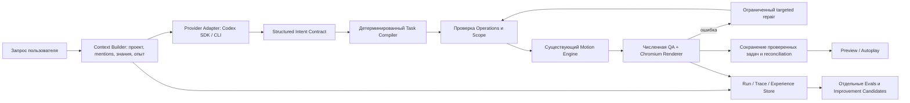

# Agent Harness

Harness встроен в существующий `executeMotion`, а не заменяет Motion Engine или Renderer. Source Figma остаётся неизменным. Автоматический агент работает через один семантический ответ и детерминированные операции; независимый LLM coverage audit больше не вызывается в стандартном успешном пути.



## Реализация

`apps/scene-validator/src/harness/` содержит:

- `providers/`: транспортный интерфейс, реестр доверенных адаптеров, сохранённые Codex SDK/CLI.
- `runtime.ts`, `config.ts`: жизненный цикл Run, отмена, deadline, бюджеты, постоянные Trace/Report.
- `context.ts`, `versions.ts`: progressive disclosure, fingerprint-кэш, версии реально использованных знаний и кода.
- `qa.ts`: выборочная проверка существующим QA, общий Chromium на Run, кэш проверенных результатов.
- `experience.ts`: постоянные случаи и ограниченный поиск релевантного опыта.
- `evals.ts`, `metrics.ts`: agent-level испытания, реальные показатели, сравнение регрессий.
- `improvements.ts`: пакетное обнаружение повторных ошибок и изолированное испытание декларативных кандидатов.
- `security.ts`: удаление узнаваемых секретов из диагностики.

Основной оркестратор остаётся `motion/service.ts`. Semantic Planner, Task Compiler, Operations API, Motion State, undo/redo, QA, Renderer и MP4 используют прежние контракты. Knowledge берётся из существующего `motion-library`, без второй библиотеки.

## Provider Interface

```ts
interface ProviderAdapter {
  readonly id: string;
  readonly mode: "live" | "mock";
  capabilities(): ProviderCapabilities;
  generate(request: ProviderRequest): Promise<ProviderResponse>;
}
```

Request содержит messages, responseSchema, model, AbortSignal, timeoutMs, maxOutputTokens и опциональные tool definitions. Response содержит structured output, usage, estimatedCost, latency, diagnostics и toolCalls. Capability flags описывают structured output, native tools, cancellation, usage и native output token limit.

Новый доверенный адаптер регистрируется через `registerProvider(id, factory)`. Он получает тот же контекст и возвращает тот же Intent Contract. Motion Knowledge, технические проверки и рендер находятся вне адаптера. OpenAI API, Claude и Local LLM пока не реализованы: отсутствие адаптера возвращает явный UNAVAILABLE. Codex работает без native tool calling, через валидируемые структурированные операции. Неожиданные tool calls отклоняются; произвольный код не исполняется.

## Данные проекта

```text
projects/<project>/
  source/                         # не изменяется Harness
  motion/
    motion.json                   # прежний Motion State + undo/redo
    ai/<runId>/                   # подробные provider/intent/task данные, privacy=full
    qa/<runId>/<task>-attempt-N/   # реальные samples и QA report
    harness/
      config.json                 # опциональная конфигурация проекта
      runs/<runId>/
        run.json                  # outcome, budget, versions, usage, timings
        trace.json                # стадии и результаты исполнения
      experience/<runId>.json     # objective QA отдельно от artistic quality
      improvements/<id>.json     # failed runs, patch, evals, решение, история
      cache/qa/<digest>.json      # ссылка на проверенный QA + зависимости
artifacts/harness/                 # отдельные диагностические eval-результаты
harness/evals/dataset.json         # версионируемый dataset приложения
```

Скопируйте `harness/config.example.json` в `motion/harness/config.json` нужного проекта. Стандартный успешный Run использует один LLM call; общий потолок — три, то есть основной + до двух дополнительных. Бюджет действует совместно на планирование и repair, а не отдельно для каждой задачи. Повтор одинаковой причины ошибки не запускает бесконечные вызовы. Кэш QA зависит от source fingerprint, before/after State, scope, запроса и версий знаний/кода. Ошибочный QA не кэшируется.

`privacy=full` сохраняет полный запрос и диагностические данные локально; `metadata` сохраняет счётчики и версии без текстов запросов, `off` не создаёт Run/Experience reports. В последних двух режимах временные provider-данные и QA samples удаляются при завершении. Эти режимы ограничивают новое хранение, но не удаляют старые full traces и не скрывают сохранённый Motion State. Для понимания запроса его релевантный контекст всё равно передаётся выбранному Provider.

После перезапуска незавершённый Run помечается INTERRUPTED; ранее проверенные атомарно сохранённые задачи остаются. Запуск самовольно не возобновляется. Кнопка отмены прерывает Provider и QA; интерфейс перечитывает последнее сохранённое состояние даже после ошибки.

## Evals и улучшения

```sh
npm run eval:harness -- --provider codex-sdk --output artifacts/harness/live-evals.json
npm run harness -- metrics --project projects/figma-test
npm run harness -- improvements --project projects/figma-test
npm run harness -- evaluate-improvement --project projects/figma-test --id <candidate-id>
```

Evals вызывают тот же `executeMotion` на изолированных искусственных проектах. Они проверяют реальную технику, QA, область изменений и итоговый State. Dataset включает Trim Paths, инерцию, amplitude / 2, изменение только QR, logical transition, custom easing, десять составных требований и QR scale + center + inertia вместе с path reveal. Они **не запускаются после обычного пользовательского запроса**.

Improvement collector не вызывает LLM: группирует повторные причины ошибок (минимум два случая) и предлагает ограниченный patch `extraGuidance`/`retrievalBoosts`. Проверка запускает baseline и candidate на свежих изолированных fixtures. Регрессия отклоняет кандидата. ACCEPTED_FOR_REVIEW требует два реальных Provider прогона полного одинакового dataset, улучшение и отсутствие регрессий. Mock и неполный dataset не дают основания для принятия. Production-код и Knowledge не изменяются; каждое решение сохраняет versionHistory. Это улучшение инфраструктуры, а не обучение весов модели.

## Измерения и границы

[Реальные Codex evals](../artifacts/harness/live-evals.json) отделены от infrastructure mocks. [Предыдущий измеренный baseline](../artifacts/harness/baseline.json) относится к одному реальному составному запросу. Маленькая выборка не доказывает производственную p95 и не позволяет обещать качество на любых промптах.

Метрики без данных имеют null: художественная оценка не выполняется, цена Codex не предоставляется, time-to-first-preview на стороне браузера не измеряется. `sampledPeakRSS` измеряет только Node, не весь Chromium/OS. Native Codex output-token cap отсутствует: Harness проверяет фактический usage после ответа и останавливает дальнейшее исполнение. Поэтому потолок не гарантирует остановку расхода токенов внутри уже выполняющегося ответа. Неизвестная цена также не позволяет гарантировать денежный лимит.

Структурная coverage validation детерминирована; понимание языка остаётся задачей LLM и может ошибаться. Evals выявляют известные классы ошибок, а не доказывают универсальную полноту. Vision LLM по умолчанию не вызывается; реальный локальный render QA сохраняется. QA не рендерит MP4 на каждый запрос. Preview/MP4 используют общий evaluator; соответствие проверяется отдельной регрессией.

Разработчик получает отчёты через CLI, существующую диагностику и GET `/api/projects/<projectId>/motion/harness` (а также `/metrics`, `/experience`, `/improvements`, `/<runId>`). Дополнительная сложность не вынесена в основной экран пользователя.

## Сохранённые примеры и фактические проверки

- [Agent Run](../artifacts/harness/example-run.json) и [Trace](../artifacts/harness/example-trace.json): реальный Codex, исходный проблемный запрос на копии test4, 10/10 требований, один LLM call, без repair.
- [QA Report](../artifacts/harness/example-qa-report.json): реальная Chromium-проверка того же проекта. Полные пути samples в отчёте относятся к изолированной тестовой копии.
- [Improvement Candidate](../artifacts/harness/example-improvement-candidate.json): демонстрация механизма на искусственно внесённых ошибках; mock-улучшение получает INCONCLUSIVE и не принимается.
- [Реальные agent evals](../artifacts/harness/live-evals.json): 8/8, по одному вызову Codex. Fixtures искусственные, Provider настоящий.
- [Повторная проверка amplitude / 2](../artifacts/harness/final-parameter-eval.json): реальный Codex, сохранение остальных анимаций, один вызов, 10 QA screenshots, без MP4.
- [Парное сравнение](../artifacts/harness/performance-comparison.json): один одинаковый реальный запрос, 2 → 1 LLM calls; 271.1 → 177.5 секунд; входные токены 63 982 → 24 888. Это наблюдение, не статистическая гарантия ускорения. Большой составной запрос остаётся медленным: локальная QA заняла около 59.6 секунд.

TypeScript и сборка проверяются стандартными `npm run typecheck` / `npm run build`. `npm test` проверяет 108 сценариев, включая existing compatibility, Undo/Redo, Preview/MP4 pixel consistency, budget/cancel, privacy/restart, QA-cache invalidation, bounded semantic retry и rejection mock-кандидатов. Эти infrastructure-тесты не являются подтверждением работы реального LLM; она показана отдельными файлами выше.
